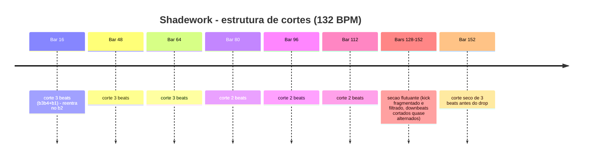

# Consolidado knowledge-base
Psytech Lab v0.1.0 · 03/11/2026

## AULA-DE-GROOVE-20261015.md

# AULA DE GROOVE — Desdobramento aplicado (15/10/2026)

> Síntese de estudos internos medidos: estudo forense comparativo de loops (29 loops), biblioteca de groove tech house, manual de produção psytech, e ciclos de referência. Aplicada ao motor em 15/10 (caso prático ao final).

## 1. A regra-mãe: CHÃO RETO + MALANDRAGEM NAS CAMADAS
- **Kick, baixo e hat de 16ths: NA GRADE** (offset medido das refs psytech: 0.42–0.50 — quase reto).
- **Malandragem (pull +10–25 ms / push −35 ms) SÓ nas camadas laterais**: shaker, wood, percs orgânicas. Nunca no 16th contínuo, nunca no motor.
- O pull sensual do selo (RM Breakdown p90 0.765) mora nas PERCUSSÕES; o push de Gazolla (offset 0.33) idem.

## 2. Gramática de ghost notes (o que faltava no mural de 16vos)
- **Ghosts = 25–45% da velocity do acento** (30–48 se o acento é 114). Abaixo disso vira ruído; acima vira mush.
- O campeão do nicho (Petrix — Allert) tem **30 ghosts de 32 posições** — hipnose por textura fraca em quase todo step, com ~15% de steps vazios para respirar.
- Estrutura por step (2 bars): downbeat 110–118 · backbeats 100–106 · contratempos de 8th 78–86 · 16ths fracos 30–48 · pickup de fim de bar 52–60 · **1 step omitido por bar** (respiração).
- Acentos CONCENTRADOS, não espalhados; **1 fill por 8 bars** máximo.

## 3. Sub e baixo conversam com a bateria
- Sub em colcheias/com a bateria, com **contorno de velocity por compasso** (downbeat +15% vs fim de compasso −8%) e **peso de 5ª abaixo (G#1) no fim do ciclo de 8 bars**.
- Rolling psytech aberto: HPF 90 Hz (kick é dono de 30–90), notas a **65% do 16th** (pluck), filtro aberto, saturação +5 dB, e **ciclo tonal de 4 bars**: raiz→raiz→passagem b2 (D) no fim→5ª (G#) no penúltimo + peso de oitava a cada 8.

## 4. Anti-padrões (medidos — o que NÃO fazer)
1. Swing igual em tudo (destrói o chão reto).
2. Delay real de 70 ms em hat (confundir média de energia com onset deixa a bateria bêbada).
3. Ghosts < 25% em tudo (ruído) ou velocity única no meio (mural — a escuta reprova: "não varia, não tem nada").
4. Fills todo compasso.
5. Loop de sample tocado nota a nota (cada trigger toca o início do loop = flam interno; usar one-shot).

## 5. Microtiming do material de referência (confirmado)
- Wood click no x.772 (+10 ms sobre o 16th) = pull sensual da referência ✓ (medido 10–12 ms nos canais de madeira).
- Closed hat humano ±6 ms; esteira na grade; ghosts +4–10 ms atrasados (toque de pull na textura).

## 7. O MOVIMENTO DO BAIXO — DNA medido de uma intro rolling de referência (15/10, 2ª edição)
Medido em trecho de intro rolling aprovado por escuta (bars 201–216; 256 notas):
1. **Escadinha de velocity por 8th** (não por 16th): alternância ~118 / ~97, média ~107 — é isso que "moi". Velocity média alta em tudo; nada de mid 86.
2. **Movimento de tom = side-step de 1 semitom no FIM do bar** (raiz → b2/D nos 2 últimos 16ths, voltando pra raiz). Não é ciclo harmônico espalhado pelo compasso — é o passinho no fim, que dá história sem quebrar a hipnose. (Catalogado na aula de fórmulas: "rolling com algumas notas 1 acima" + "parte A/B com micro-variação".)
3. **Duração constante curta (0.16)** — o pluck moendo, sem notas longas.
4. **Peso de oitava abaixo** reservado a momentos (o re-drop monumental desce de oitava de propósito).
5. Fórmulas do catálogo (Bass Grooves Formulas) que mapeiam para o estilo: rolling+oitava acima intercalada · sincopado valorizando regiões menos acentuadas · velocity em escadinha 40→90→120→90 (exige Velocity→Amp no Serum) · frase A/B com micro-variação · pergunta-resposta · camadas sub cama + pluck reforço.
**Anti-lição desta rodada:** um 1º rewrite que espalhou movimento (G# no meio do compasso, ciclo de 8 bar) e afroucou velocity (mids 86 + notas curtas demais) foi reprovado por escuta = "micropontos com dó". O movimento que a escuta aprova é RAIZ FIRME + passinho no fim do bar + escadinha alta moendo.

## 8. Caso prático (15/10, aplicado)
ROLLING: 630 Hz→8,15 kHz + Sat +5 dB + HPF 90 + bell 700 +3 + shelf +2 + notas 65% + ciclo tonal · SUBGROUND: contorno por compasso + G#1 fim de ciclo · CLOSED HAT: ghosts na faixa 30–48 · ESTEIRA: closed hat one-shot, notas intercaladas nos contratempos, na grade · madeiras mantêm o pull de ±10 ms.

**Regra de revisão:** fechado o bloco, mexer em EXATAMENTE uma alavanca e ouvir de novo.

### 8.1 Correção aprovada por escuta (15/10, ao vivo): rolling de mural ESMAGA

- **Sintoma:** "o rolling tá esmagando a música" + sensação de offbeat. Medido: notas NA grade com acento máximo (118) em CIMA de cada beat + AF aberto até 590–640 Hz (teto do DNA de referência: ~345 Hz).
- **Causa raiz do "encavalado":** dois canais (um sub extra e o rolling) com o MESMO preset em C#3 simultâneos. O sub extra saiu (mudo).
- **Correção aplicada e APROVADA:** kick sozinho na cabeça — notas só nos bolsos x.5 (v82, suave) e x.75 (v120, empurrão); dur 0.163; passinho D de fim de bar mantido.
- **Lei que isso confirma:** o groove de baixo de referência é pocket, não mural — o DNA Yao ("Kick bate solteiro na cabeça (0.0), baixo preenche 0.5, 0.75..."). Qualquer rolling novo: grid x.5/x.75, contraste 82/120, zero nota em x.0/x.25.
- **Nota de AF:** teto do filtro ~600 Hz viola o teto medido do DNA de referência (~345 Hz); corrigir antes de reutilizar a receita.


---

## Ableton_Template_Workflow_BTS.md

# Ableton Template Workflow BTS

**YouTube Video ID:** TFoyhvIPbOk

## Transcrição Limpa

Guys, in this video I want to share some behind-the-scenes footage of something I've been working on for months, and I was really sad, really sad, because a while back, a few weeks ago, I spilled a mug of coffee on my Mac and it died instantly, you know?  The device immediately stopped working and wouldn't turn on anymore.  So I took it in for repairs, and the guys said, "Hey, I'm going to have to give it a chemical bath . Just the chemical bath alone is R$600 to see what the damage will be. The chemical bath is just to be able to turn it on again to see the damage. And let me tell you something, the SSD in this computer is chipped onto the motherboard. So there's no way to save what was inside, remove the hard drive. I've been working on this template for many months now, basically since the beginning of the year. I think this is the first version, I need to check later, but I think I started with this idea for this template in January, which was something to greatly facilitate the workflow. And I was very happy that the guys managed to save my computer. I took a huge loss, but they saved my template along with some Max for Live plugins that were already ready. So, let's continue our mission. I want to show you the behind-the-scenes here. This is a video of..." Behind the scenes, this isn't a tutorial, right? How's this going to work? We're going to work in the session view here because it's really cool to produce in the session view. Then transfer it here, it's super easy. You create scenes here and then transfer the scenes to the arrangement screen and you'll create tracks really fast like that. Then there's the kick drum. I thought: "But how am I going to put a kick drum here?"  "Will it always be the same kick?" I did n't put all my kicks in a hack, so I put a selector here so you can choose whichever kick you want. Oh, I don't want your kicks. Then you put yours in, no problem. Just open it here . You put your kicks in there, okay? Great. But let's suppose you want to use mine here. It's already set, there's already gain, everything's normalized, volume normalized. All of them, I want bass. And then I thought, how can I give a wide range of bass so it doesn't all sound repetitive? First, numerous mids. This here is all groove, more groove-heavy, more syncopated. Here are more glide basses, here are some triplets and here are rolling. Look at all the rolling bass there is . And then I thought, but it's all going to be the same timbre, it won't work. So, I created presets for each of these groove types. I created a preset bank with 30 presets here. If you look closely, they are already divided.  In glide, groove, rolling, right? According to what we have in the template here. Whoa! Whoa! So, for example, I want a more groove-heavy bass, [music] look . I don't want a glide. [music] Wait, let me put an Elf 2 here, which is also one of our plugins , [music] kind of like an Elf To, right? A side chain, look. [music] I don't want triplets. [music] Or I want a classic rolling, [music] look. Then there's this other plugin here which is the Freak Base [music] [music] for bass processing, right? This plugin is super cool, it's still a secret. And then we have a bunch of chord progressions and they're all in the same key here. It's all in C minor, but calmer, I'll explain how you're going to change the key of everything. Look, actually it's all [music] in E, little plugin here, Okay. You choose chord progressions, make an intro. [music] Then, here are the drones I'm creating, [music] more bass-heavy. And here are the space shots, right? Those more spaced-out shots, with more reverb. [music] I put four columns because they complement each other, so one will never clash with the other. And you'll have 70 different timbres here from a bank that's already ready. Look, we have the space shot bank here in the template and it's already loaded, there are already a bunch of shots there for you to choose from. So there are four columns and 70 presets for you [music] FM. [music] Now this one will play. And then we have the dry shots here. I think it's still without presets. It's in the initial setup here. Just so you have an idea of ​​how the dry shot works. It's more, this one is more rhythmic, [music] that more rhythmic thing [music] for a moment in the track. [music] [ music] No, I don't want that little chord. Let's see this one. It 's still in the initial setup, right? I'm still creating it. And here are sequences or acid. [music] The ARP is still in the initial setup. I haven't created the bank yet, but there are already several insane ARPs here, look. [music] [music] Just put a reverb here, where it stops [music] little shot. [music] Choose the BPM. Ah, I want a melody. There are some call-response melodies here, some more complete ones. Call-response, I'm still organizing them, but look, [music] [music] look how beautiful. [ music] Wow, beautiful thing, guys. I want a hi-hat, one for eight, look. [music] And here I have a selector, several Rs too, look.  [music] It already controls the K. Sust, attack, drive. Rzinho for 16. Look at all those grooves. And then here everything is a 1 for 16 [music] more grooved. Let's take this one here, look. Really grooved, look. [music] Same thing. [music] Ah, I don't want it so grooved. I want it straight. It's too [music]. Let's take another melody here. [music] Another rest. [music] Each one has a groove. All one for 16, but each with a different group. [music] [music] Now the coolest thing I've developed in the last few days here, look, this plugin that's in the master, it changes the key of everything. It changes the key of the entire track of all the channels, look. It's in E. Ah, I want D. Produce a track in D now. It's already changed everything, [music] man.  This is proving to be a lot of work. Oh, I don't want to go there. [music] But then when I change the key here in the freak base, which is this bass processing plugin that I won't talk about now, I'd also have to change the key here, see? [music] Oh, no. I'll keep it in E. This is getting too cool, guys. It's still proving to be a lot of work. Now I'm going to produce the rest of the drums, the snessets. So, I've already created the space shot bank and the bass bank, and now I'm going to create the string bank, the drone bank, the dry shot bank, which are the most plucky ones, right? Little plucks there. The sequences, of course, I 'll reuse some things that already exist here. ARP will also be little plucks, but very nice. I think melody will end up being the same type of timbre here. And soon this will have hundreds of melodies and hundreds of presets. And then, look how interesting. Oh, let's suppose you liked this scene here, right?  Oh, did you like this combination of things you created here? [music] You press Ctrl+Shift and it generates a scene. This is a scene. You can call it verse one. This is verse one of your song. [music] Ah, I want to create, for example, an intro. I 'll get here. Let's take, for example, this pad, this drone, and I don't know, this sequence here. This is an intro, okay? I liked the intro. Control or command shift i. So we have the intro here. Look how interesting it is to take the intro, put it up there, to keep it organized, close to each other. Let's suppose, then I have the intro, then verse one, playing the intro. Ah, I wanted to make an intro that grows more. I can duplicate it here in this second one, I'll put this hat here. [music] It 's just a very rough example, right? [music] Ah, I want  [Music] Drop into the break. [Music] Then, to transfer that to the arrangement screen, it'll be, wow, really easy for you to come up with the skeleton of a track really quickly, in a matter of, well, a few hours, like, one or two hours, you'll already have the skeleton of a complete arrangement. So, this is the project I wanted to share the behind-the-scenes creation of with you all, because it's been a lot of work. I've been dedicating a lot of time to it in the last few months and now I'm going full force. We're in this together, guys.


---

## BASS_MONSTER_Supreme_Serum2_Processing.md

# BASS MONSTER Supreme Serum2 Processing

**YouTube Video ID:** 6Ivd2wvov6w

## Transcrição Limpa

Muito bem, galera. Nesse vídeo eu vou te ensinar alguns segredos de processamento para fazer suas baselines suarem realmente potentes. Quando a gente vai criar uma baseline, muitas vezes é frustrante, né? Você escolhe lá uma onda sol, [música] até coloca um filtro aqui, uma modulação do envelope no filtro e fica mais ou menos assim. [música] Não tá ruim, né? Primeiro segredo já que eu vou te ensinar é aqui no no nosso mid clip. Quando a gente abre o mid clip, eu posso desenhar o mid direto aqui. Eu não preciso desenhar no meu mid do Abeton, posso desenhar aqui. Por que desenhar aqui? Primeiro porque fica salvo, eu posso salvar no meu preset aqui. E segundo porque ele tem algumas coisas legais aqui também, como por exemplo, esse essa ferramenta aqui que eu não sei o nome, é o note expression, que eu posso mudar justamente a expressão da minha nota. Então, por exemplo, aqui eu tenho uma nota que ela tá quase 1 oitava acima, né? E aí eu desço o pit dela. É muito simples, ó. Basta fazer dois cliques, eu posso fazer uns bends, glides, tipo assim, ó. [música] Para fazer esse tipo de glide, [música] é importante que o baixo esteja com um pouco de sustém no envelope de amplitude, tá? senão o glide não funciona. Se ele for muito pluck, muito percussivo, aí o glide não funciona, porque você quer uma coisa sustentada para ele fazer. E aí, OK, né? Eu tenho este fio, esse envelope aqui, modulando o meu filtro, que é o MG Low 24 [música] e tenho mais um pequenininho para dar mais um tapinha aqui, ó, [música] ele ficar um pouquinho mais percussível. Mas não é ainda aquele baixo, né? Não é aquele super baixo. Então, primeira coisa, primeiro segredo aqui que você vai aprender, face shifting. Muita gente sabe aquela dica, o truque de você utilizar plugins multibanda na cadeia de processamentos simplesmente para criar face shifting, não para saturar. Por exemplo, quando eu coloco um Saturn aqui no meu canal e eu zero o drive, mas eu crio divisões aqui multibanda, né? Eu separo as bandas. Essas divisões aqui criam eh crossovers. Esses crossovers points, eles vão criar aqui face shifting, que é uma inversão da fase naquele ponto específico. E muitas vezes isso acaba sendo um efeito colateral que engorda o baixo ao mesmo tempo em que reduz a faixa dinâmica. Ou seja, uma vez que eu tô reduzindo a minha faixa dinâmica, dynamic range, eu ganho o quê? Laudness, eu tô diminuindo a, é como se eu tivesse comprimindo a onda, né? Eu ganho laudness no meu baixo. E aí eu vou [música] achar um ponto legal aqui. É bem diferente, ó. [música] Magrinho, [música] um pouco mais gordinho já. Então, a primeira coisa que a gente vai fazer com face shifting aqui, presta atenção, existe um filtro novo no Ser 2, que é diffuser. Esse filtro novo aqui, para que que ele serve este filtro? Ele só cria face shifting. E aí, o que que nós vamos fazer? Eu vou pegar, clicar aqui, aqui tava em main. E eu direciono este filtro um para o filtro dois. Então o sonzão vai vai sair daqui, vai passar pelo filtro um e depois ele vai pro filtro dois. Se eu não fizer isso, eles vão trabalhar em paralelo, não em série. Então é importante entender esse fluxo de sinal. Agora o filtro dois está após o filtro um. E agora que ele está após o filtro um, eu ligo aqui o diffuser. [música] Posso escolher alguns stages aqui, ó. [música] &gt;&gt; [música] &gt;&gt; E aí eu vou de ouvido mesmo, ó. Sem ele você vai precisar de um fone aí. Um bons monitores para entender. [música] Já melhorou, né? Tem uma outra estratégia, tem três estratégias de face shifting que você vai aprender aqui e uma delas eu tenho certeza que você não conhece. A segunda estratégia é dividir aqui utilizando o splitter low, mid e high. Eu posso colocar isso aqui no serum, ó. Splitter low, mid, high. Já escolhi. Então ele tá aqui, tá desligado no momento. Tá tudo desligado aqui, tá? Low mid high. Vou habilitar. Olha, sem ele, [música] com ele bem diferente, né? Tem até uma distorção aqui e uma compressão. Eu vou tirar só para ficar com o splitter. [música] E aqui eu também, ó, ele também causa face shift. [música] E aí eu posso fazer uma coisa. Olha a diferença no fone você ouve bem, ó. [música] Já deu uma gordura extra [música] baixo. Agora vamos aos processamentos. dentro deste splitter, no low, eu não coloco nada, mas no mid aqui, ó, eu coloquei um compressor, [música] ó, aumentando, comprimindo um pouco os médios e dando um ganho extra [música] nos médios. Assim, ele vai compensar um pouco, não vai ficar tão sub e ele vai [música] trazer um pouco mais de médios, médio graves para ele dar aquela já engordada. Coloquei uma distorçãozinha nos raios que tá desligada, na verdade [música] tá fazendo muita coisa, tá só lá. [música] E temos um terceiro face shifting aqui que às vezes eu uso, às vezes não, que é o body. O bod, deixa eu habilitar ele e colocar aqui, [música] ó, sem o bod. &gt;&gt; [música] &gt;&gt; pouquinho de diferença. Eu vou deixar como body range aqui zerado, largura zerado, delay zerado, feed zerado, blur zerado, tá tudo zerado. E aí eu gosto de ter um macro aqui, ó, que eu vou chamar de face shift, que é esse aqui, tá no body e esse aqui tá no filtro dois. Então eu posso escolher se eu quero esses dois face shifts ou não. Ó, sem ele, [música] com um eu filtro. Eu gosto de deixar a posição da fase aqui também, essa aqui, ó, nesse macro. [música] Assim eu posso controlar aqui, ó. onde a onda vai começar. [música] Ó, ficou estranho, tá vendo? Gosto de ter um macro aqui controlando o meu cutof também. [música] Assim eu tenho total controle, né, quando eu tô criando a baseline. E gosto de deixar um no sust aqui também, ó, reduzindo o susto envelope de amplitude e do envelope do filtro. Se eu quiser ali mais pluck, ó, [música] mais sustentado, [música] se eu encaixo com a música, com o bpm e tudo mais. E vamos ao processamento. Que que eu tenho aqui? Agora um pouquinho de distorção. Esse assimétrico é bom. [música] Distorcendo mais aqui lá para 7000 Hz. [música] Ó, mix tá pouco. [música] Esse aqui vai fazer muita diferença, que é o equalizador. Deu um boost aqui nos highs e nos lows. [música] Agora tá ficando gordo. [música] Esse compressor não faz quase nada. Vou até deixar desligado. E tem um filtro aqui para dar um drivezinho extra. [música] Eu deixo no MG 6, porque esse filtrinho ele tem um pouquinho a mais de drive. [música] Importante você sempre [música] observar aqui se não tá nada clipando, [música] não tem que fazer um game stage. E tem um outro segredinho. Eu gosto de deixar um buz aqui. Que que é buz? É um canal paralelo de processamentos. Process processamento paralelo. E aí o que que eu vou fazer aqui no mix? Eu vou sair do filtro um. Na verdade, na verdade eu vou tirar aqui, vou sair do filtro dois. Então, o som sai do oscilador, passa pelo filtro um, passa pelo filtro dois. Saindo do filtro dois, ele divide. Do filtro dois, eu vou mandar ele pro bus. Beleza? Como que eu faço isso? Eu gosto de deixar um macro aqui, bus drive. [música] Nesse busz drive aqui, eu tenho uma distorção bem agressiva até um overdrive no máximo. [música] E aqui um equalizador tirando bastante assim, bem bem agressivo. Então ele vai distorcer bastante. Aqui tá com filtro também no pós, ó. Então, tudo isso aqui tá sendo eliminado, tá mais distorcendo os lows ali para dar um peso extra, [música] ó. Sem ele, [música] mais pesadão agora, né? [música] [música] Importante estar bem filtrado. [música] Agora sim. Agora sim. Olha como é que tava sem o filtro. [música] Tava assim, ó. [música] E aí, todo mundo ligado. [música] Zero de processamento externo, né? Não tem nenhum plugin externo, só o presetão aqui. Por isso que os nossos presets são bravos. E é isso. Se você curtiu esse conteúdo, não deixa de se inscrever no canal.


---

## Bass_Grooves_Formulas.md

# Bass Grooves Formulas

**YouTube Video ID:** kobSOZOSzEg

## Transcrição Limpa

salve salve produtor Eduard oliato aqui nessa aula eu quero te ensinar vários ritmos diferentes de baselines que servem tanto pra melodic tecno como também para prog tren tren esses trenes mais modernos aí progzera mais moderna eu vou falar de vários tipos de baselines aqui algumas mais convencionais outras menos convencionais um dos vídeos mais vistos do meu canal foi quando eu criei eh diferentes padrões de baselines utilizados no no psit Trance na época no prog Trance não lembro nos primeiros vídeos aqui lá para 2015 Esse é um dos vídeos que mais tiveram acessos até hoje muito antigo muito tosco Eu acho que eu até já tirei do ar hoje é hora de dar um revamp nesse conteúdo e a gente vai falar sobre vários tipos de baixos aqui eu não quero me ater a dois ou três eu quero passar por vários aqui o máximo que eu puder de grooves de baselines diferentes para você se inspirar e criar baixos mais interessantes aí nas suas músicas então let's go rapaziada primeira primeiro baixo que eu quero te mostrar aqui é um pouco convencional ele é muito utilizado no tren principalmente o Euro trence e ele é um tipo de base Rolling Olha só o baixo Rolling ele é um baixo um para 16 geralmente a gente não toca essa primeira nota aqui no psit Trance ou pode tocar no melodic tecno eu vejo a galera usando mais a primeira nota aqui no entanto com um el um Side team bem agressivo para que essa primeira nota fique quase imperceptível não que você não possa fazer isso no TR também são técnicas e técnicas esse seria um Rolling ele tá com um delayzinho aqui no canal de retorno mas o que que a gente vai fazer aqui PR ele ficar mais interessante a gente vai tocar algumas notas 1 acima ele vai ficar assim ó esse aqui é um baixo que tá no meu banco de presets novo melodic Techno Forum Volume 2 aliás todos eles aqui esse é o base ignum interessante né esse aqui eu Ch de baixo sincopado e é um baixo muito utilizado no prog trence no zenonesque no prog Dark é um baixo que vai valorizar regiões menos acentuadas aqui do nosso compasso tá então aqui entre um kck e outro tem um quarto de nota né Essa nota aqui por exemplo era uma nota mais acentuada assim como essa aqui tá já na segunda casinha e na quarta casinha são regiões menos acentuadas ritmicamente então eu posso ter por exemplo aqui ó pode ver que eu valorizo muito as regiões menos acentuadas só em alguns momentos eu vou ter umas notas off bit aqui deixa eu dar um cont control eu vou ter algumas notas off bit Em alguns momentos aqui então esse baixo ele é bem interessante ele mais gruv [Música] ó bation né vai da hora esse baixo é o baixo que eu mais gosto também é um pretão aqui do nosso banco e ele tá com automações aqui ó nos macros no Kof uma automação Zinha onde mais tem no Pit Band também no final da aqui no final ele tem uma automação inha no Band Side chinho esse aqui parece parce o primeiro que eu mostrei só que ele tem uma peculiaridade ele faz como se fosse um polirritmia uma 1 oitav a ca duas uma oitava a baixo e o que acontece Olha só no primeiro quarto de nota aqui eu tenho duas notas aqui embaixo no meio né e duas em cima nas pontas mas nessa segunda parte aqui nesse segundo quarto de nó vou ter três aqui embaixo e uma aqui em cima no off bit depois eu tenho três aqui embaixo e uma aqui em cima na segunda casa você vê que depois ele vai repetir a primeira a cada três ele repete então forma como se fosse um [Música] polirritmia melódica só para criar uma tensão com um pouco de automação esse é outro baixo do o nosso banco de presets também melodic techn for serum e todos esses kicks aqui também vem no pacote né 25 kicks com labels aqui para você saber que tom que tá dividido em soft todos eles são meio soft mas esses de baixo aqui os nove primeiros são mais soft ainda são kicks muito irados sempre automação Zinha nos baixos por isso que todos os presets eu gosto de colocar macro aqui para você fazer automações nos macros e cri esses movimentos esse aqui é um baixo que eu chamei de melodic Groove porque ele é sincopado também você vê que as notas é como se fosse ó região menos acentuada off bit na segunda casa aqui na quarta casa ele valoriza muito regiões menos acentuadas que ele baixa um sincopado só que ele forma uma frase melódica que que é uma frase melódica um negócio que tem é uma historinha que tem começo meio e fim e ela volta e não fica [Música] enjoativa aqui tem uma pequena variação em relação aqui né parte seria assim parte a e parte B da Melodia na parte B ela tem uma pequena variação aqui em relação a parte a para criar uma história não ficar repetitivo né [Música] Esse eu não fiz automações eu fiz tava [Música] desligado Deixa eu tirar esse delay [Música] aqui ó com a automação Zinha [Música] bem interessante esse Baixão né desses quatro aqui já dá para fazer várias variações né Por exemplo esse aqui dá para ser um baixo mais simples valorizando notas menos acentuadas poderia ser mais simplão assim ó existe uma cacetada de música assim também que é só assim ó Às vezes você pode incrementar colocar mais uma notinha aqui e aí ele vai ficar mais [Música] interessante eu gosto bastante desse tipo de de baixo assim esse próximo baixo aqui é um baixo Rolling também mas ele tem um segredinho ele tem uma variação rítmica no Velocity a gente tem uma frase aqui rítmica do tamanho de meia meia nota 1 2 3 dois kicks aqui né o intervalo de dois kicks Então essa variação de Velocity aqui ó que na a primeira nota tá 40 a segunda no 90 terceira 120 e a quarta 90 então ele sobe e desce só que na segunda parte ele baixo lá em cima baixo lá em cima então aqui ele é uma escadinha e desce aqui ele é mais agressivo e esse intervalo aqui se repete tá de Velocity claro que você precisa ter um baixo configurado com o Velocity aqui senão o Velocity do serum não vai funcionar no caso esse baixo ignit aqui do nosso banco ele é configurado com Velocity mas é muito simples basta você pegar isso aqui e colocar no volume aqui dos osciladores ou você pode ir na Matrix e colocar Velocity no Amp Vel aí você vai colocar no Amp geral no global Amp que aí vai ser no Amp geral ou você põe todos os osciladores tá inclusive nos no Noise no caso aqui ele já tá configuradas junto com outros timbres que estão no nosso banco também ó esse próximo baixo ele é um baixo que eu chamo de sustentado é um baixo mais pad like parecido com pad sabe com notas longas também é muito utilizado esse aqui é um baixo é o base aqualis que é um R [Música] base pode ser qualquer baixo só que aí a a nota não vai ser aquela nota plu né Por exemplo poderia pegar outro Baixão aqui nesse banco todos os baixos sustentados eles estão escritos aqui sustain né posso pegar um por exemplo esse crisalis [Música] aqui tá dando uns estalos aí porque tá esses ess projetos tá com mais de 50 tracks abertas do sérum Então são baios um pouco mais com envelope sustentados né vamos achar outro aqui por exemplo esse [Música] aqui legal [Música] também e é legal você ter um arp daí meio retinho assim não fazendo muita variação melódica na verdade esse arp aqui até acompanha a melodia do baixo mas ele poderia ser reto assim ó que daí com a melodia do baixo ó como fica legal fica massa né mesmo exemplo aqui baixa um sustentado também fazendo duas notas três notas na verdade não quatro [Música] notas fazendo uma melodia Zinha aí olha só como fica [Música] bonito processamento [Música] esse outro baixo aqui é um outro exemplo de uma frase melódica né olha só ele se repete ele cria uma historinha melódica Olha que bonito pergunta resposta pergunta e resposta com é a mesma coisa na verdade né A B A B então ele tem uma pergunta e tem uma resposta melódica isso é muito interessante Olha como fica no [Música] contexto aqui um outro exemplo de um baixo sincop Porém esse aqui é bem sub por ele tá bem lá embaixo porque ele tem um steb um outro elemento um outro cint que fortalece o gruve junto com ele então ele fica assim ó ele faz uma cama grave mas ele tem esse outro S PL aqui [Música] ó fica assim então então ele utiliza esse outro plu como [Música] reforço mais Dezão né ó outro exemplo aqui de baixão [Música] sincopado no entanto esse aqui ele tem um uma uma camadinha fazendo a mesma coisa ó camadinha mais top com [Música] delay Olha que [Música] irado nunca mais vai te faltar inspiração para produzir baixo né Vamos para o próximo então esse próximo baixo aqui ele é feito em duas camadas temos uma camada sub olha só [Música] sincopado tá dando até um cliquez e temos uma outra camada que faz basicamente a mesma co poré tem um pouquinho a mais de notas tem algumas notas a mais ele tem um delay Olha só ol interess tava sem nome ainda quando eu criei mas tá no nosso banco também olha [Música] só [Música] o próximo baixo é aquele Rolling oitavado que a gente já falou no entanto ele faz uma certa melodia olha só ele se mantém aqui só a segunda nota oitavada mas ele faz assim ó olha que bonito e ele tem uma segunda camada [Música] uma camada de um baixo sustentado fazendo as mesmas notas olha como é que fica com o Baixão sustentado 10 horas da noite eu tô tomando café [Música] cortou o [Música] cin pegou um pedaço da outra track aqui porque tá frisado aqui temos o Rolling galopado que estão evidentes somente duas notas aqui essa primeira poderia nem ter Ela é bem fraquinha Side chain corta bastante ela é um baixo muito utilizado no prog Trance você não vê muito a primeira nota você não ouve muito a primeira nota né tipo assim ó baix um Rolling só que ele é mais [Música] galopado [Música] belíssimo né todos esses presets aqui estão lá no banco para você pegar e usar como você quiser esse último aqui eu já mostrei é o Baixão sincopado estilo ard que muito comum assim hoje em dia mas eu quero mostrar esses sints aqui porque estão bem [Música] legais doira [Música] de novo um Baixão sustentado fazendo as mesmas notas que eu já mostrei anteriormente porém num outro contexto Olha como fica [Música] interessante bom então é isso rapaziada espero ter trazido novas ideias novas inspirações para você criar diferentes ritmos e groves e padrões de baselines pras suas músicas fugi um pouco do convencional ou utilizar o convencional de uma forma um pouco mais elegante eu trouxe várias ideias para você se você esquecer assiste de novo esse tutorial se você curtir esse tutorial deixa um comentário aqui abaixo do vídeo dá um likezinho e ajuda nós a crescer esse canal Beleza tamo junto rapaziada e até o próximo vídeo


---

## Bass_Saturation_Trick_SUPER_PUNCH.md

# Bass Saturation Trick SUPER PUNCH

**YouTube Video ID:** VKHp-YzJzyE

## Transcrição Limpa

muitas vezes ao criar uma baseline este baixo se torna bem legal no seu headphone às vezes bem legal no seu monitor no Sound System mas ele não se traduz tão bem assim quando você ouve por exemplo num celular quando você ouve num radinho menor numa num sound system pequenininho algum sei às vezes até no carro algum sistema que não tenha um grande altofalante aí para entregar os Graves do jeito que o Baixão precisa isso acontece muitas vezes porque falta neste baixo harmônicos um baixo precisa suar bem nos speakers nos sound Systems Mas ele também precisa suar bem quando você ouve no Spotify aí se você ouve um uma música de um artista profissional no Spotify você vai ver que o baixo é muito presente uma das maneiras da gente conseguir isso existem várias né Sempre existem vários caminhos na música sempre existem múltiplos caminhos na produção você nunca tá Refém de um caminho só tá o que eu vou te mostrar aqui é um caminho para fazer com que o seu baixo tenha mais presença de de médios mais harmônicos quando você aplica saturação no seu baixo naturalmente a saturação ela vai fazer com que novos harmônicos sejam evidenciados no seu espectro entet tanto às vezes principalmente num baixo de psit trense quando você aplica a saturação direto no baixo você acaba perdendo um pouco perde daquela perde um pouco daquela limpeza aquela delicadeza do baixo ele acaba ficando meio amet perde um pouco da dinâmica Então existe uma outra maneira da gente fazer essa saturação e o seu baixo ficar muito presente nos médios nos médio Agudos e vai ficar muito massa Não é só para psit trense Inclusive eu nunca vi a galera do psit trense usando essa técnica aqui é mais galera do Tecno melodic tecno que eu já vi usando isso aqui antes da gente ir pra técnica eu quero te fazer um convite eu acabei de lançar um novo e-book que é o super workflow um e-book mais uma série de três vídeos um treinamento gratuito eu vou deixar o link abaixo do vídeo aqui você vai clicar e baixar o e-book gratuito e assistir os Três vídeos lá que eu vou te mandar você vai desenvolver um super workflow vai aprender a aguçar sua criatividade vai aprender a trabalhar mais rápido e ter mais resultado e construir habilidades mais sólidas na produção Então vamos lá sem mais delongas bom eu tenho uma baseline aqui já não tá ruim tá tá faltando algum processamento aqui e tal mas a gente pode ver pelo espectro aqui que tá bem preenchida mas é muito comum a gente a gente criar um baixo e ele ficar meio assim ó ele ficar um Baixão meio tipo assim sabe tá faltando um Side chain um el aqui e tudo mais eu tenho um saturn aqui mas ele não tá saturando nada ele simplesmente tá dividindo as bandas aqui por uma questão de fase que eu clic em outro vídeo mas quem é aluno da masterclass do Sonic maala já sabe o que que a gente pode fazer eu posso fazer então um processamento paralelo nesse baixo aqui o que que a gente vai fazer meus senhores primeira coisa que a gente vai colocar aqui num canal de retorno é um compressor para macetar bem esse baixo eu vou deixar aqui agora no solo e vou enviar o sinal inteiro até o zero para este canal aqui tá não estamos ouvindo nada porque o volume tá zerado sem o compressor uma compressão bem agressiva Afinal Estamos fazendo um processamento paralelo tô deixando um ataque de 10 aqui para preservar o transi entin Inicial um release bem rápido aqui de 0.2 um ratio de 4 e uma uma redução de ganho quase extrema aqui né tá chegando num sete mais ou menos próximo passo que a gente vai fazer é pegar um saturn e eu vou dividir aqui e vou saturar somente de 140 paraa frente bom se a gente quiser ser mais específico eu venho aqui na tabela eu tô em mi Na oitava TR aí 164 Então vamos colocar aqui Ó 164 para ficar bem preciso agora essa parte aqui eu vou saturar essa aqui eu vou deixar sem nada aqui a gente vai escolher alguma saturação acho que é sub YouTube acho que tá legal e depois eu vou até cortar um pouco agora o que que eu vou fazer eu tô enviando o sinal inteiro para cá né através desse desse Sand aqui então agora vou diminuir o volume vou tirar do solo e vou ver como que fica aumentando o volume gradualmente o e eu vou deixar lineer Face E este aqui também vou ativar o lineer Face e antes da gente terminar eu quero te convidar pro Vip Club que é um clube onde todos os meses eu mando um banco de samples ou um banco de presets gratuitamente para quem faz parte desse clube tá um banco de S irado um banco de preset irado mas assim que você entrar lá você já vai ter acesso a todos que eu já disponibilizei você vai poder baixar todos de uma vez vale a pena tamo junto então espero que você tenha curtido esse vídeo e até o próximo


---

## Beatport_Psy_Tech_Genre_Truth.md

# Beatport Psy Tech Genre Truth

**YouTube Video ID:** U6gbkqauUX0

## Transcrição Limpa

O BP recentemente lançou uma nova categoria, um subgênero PSAI Tecno. Nesse vídeo aqui eu quero discutir o que que isso significa, né? Quais são o que que isso revela, quais são as minhas impressões, o que que a comunidade do Pitecuro entendeu dessa parada? Eu conversei com alguns artistas também que são pilares deste gênero e o que que eles acharam sobre isso. Então vamos lá. Primeiro, dia 27 de janeiro, o Bitpart lançou esse artigo aqui, né, falando que agora o Psidecno é um novo subgênero dentro do tecno Pck Time. Dentro do tecno Pck Time é um nicho híbrido de psychedelic, techno. Upside Techno eh tem crescido consistentemente como um crossover sounds no club, no ecossistema de clubs. E aí ele fala que surgiu nos anos 2000, inicialmente como um gênero mais lento, mais deep do que o Fullon, né, entre 128. E ele fala aqui que alguns dos fundadores que contribuíram foram Senciente, OK? Bit Bizar, Luis M, tá justo e Miles from Mars [música] que eles ajudaram a definir esse gênero. É aqui a gente já tem um uma ressalva, né? Eu acho que sem ciente é bem diferente de Luis M, mas tudo bem. E aí ele fala que depois lá para 2010 o Psc Pitecno evoluiu para um negócio mais dance floor driven com artistas como Triforce, MVMB e Act. Meio estranho, né? Parece que foi o Maia que escreveu isso aqui. E agora uma nova onda puxou o gênero para tempos mais rápidos e uma estética mais agressiva com artistas como Speck, Web, Sara Landry, Aisha e a rainha Indira Paganoto, que ela falou uma perspectiva aqui do gênero. Criar Pscno é um comprometimento comigo mesmo para construir um som que é autêntico mesmo quando o mundo pensa diferente. Não é uma rebelião, é integridade. Este gênero abre [música] portas na mente misturando o poder puro e emocional do PSAI, natureza, liberdade e paixão. E aí, quais são as labos que foram colocadas lá, Zenon? A Ibogatec, Tecnosis, Alpaca Music, OK? e tal, beleza? Oculta Records, que para mim já [música] é mais Dart Prog, né? Arte. E aí o Benel da Iboga Records, né, que é o dono da Iboga, falou: "O SCTEC é um subgênero que a gente tá abraçando na a Ebogac. A gente tem negociado com artistas [música] que estão ali na borda mesclando entre Tecno e Pside Trins for many years, por muito tempo e faz muito tempo mesmo. Acho que a IBOG até que é o grande pilar disso tudo, né? Então, reconhecendo que o PS [música] tecno é um subgênero do tecno, isso introduz uma infraestrutura necessária para o crescimento. E taging, beleza? Então, vamos lá. Por que que esse artigo, né, ele é uma uma vitória comercial e uma certa injustiça histórica? A gente [música] vai discutir isso e por que existe uma certa mistura um pouco indigesta entre [música] Indira Paganoto e Saralendre e Zenon Records, Stereo Society Ibogate Tech. [música] Como que eu entendo as divisões, tá? Eu não acho que no Bitport deveria estar desse jeito por por inúmeras razões, mas eu entendo que a gente tem dentro [música] do PSitec, o PSitec é um negócio muito confuso quando se fala Psi, mas eu acho que a gente tem quatro linhagens dentro do PSitec. Eu acho que o Psit é tão grande que ele já engloba quatro subvertentes dentro do Pitec. A gente tem o Psight, que é o estilo ibogatek, estilo ali é Luisem, Boundless, Grout, Acar System, essa galera que é essa é uma linha do Pitec 125 bpm, 128, 124, sei lá, uma coisa mais gruve, mais deep. Para mim, esses caras são os que fundaram o Psitc. Esse é o pilar básico do Pitech. E aí a gente tem o hard tecno, que foi invadido pelo PSAI, que abraçou o PSI trin. Se a gente tem lá em Dira Paganoto, essas artistas assim que tiraram o Rumble base do hard techno e colocaram um rolling base de Pside Trence, um tecno a 145 bpm. Para mim é um tecno 145 bpm com baixo de PSI trs. Tudo bem, chamam isso de PSEC. Além disso, a gente vai ter então depois o Zenon Style, Zenonesk, que engloba muita coisa também. É uma confusão, né? Até o Psitc eh se mistura ali também com Zenon, afinal Grout, por exemplo, surgiu na Zenon. E a gente tem ainda uma outra coisa que chamam deepsite, que é a galera da Stéo Society ali, o Freedom Fighters, Deckel, Modus, essa galera eh mais que é mais trenc, né? Então eu acho que assim, Gorovit, a gente tem duas mais tecno e duas mais tren. Eu acho que tem duas que estariam mais no guarda-chuva do Tecno, que é a galera da Ibogac, Alpaca, Boundless, Luisem, A System, tá ali mais techno eu acho. E tem a galera do hard techno com cara de PSI que tá dentro do Tecno também, só pegou o baseline de PSI. E dentro do tren a gente tem o o Zenonesc e tem a galera do Square Base lá, Stereo Society, Deckel, Captain Hook, essa galera. Então são quatro coisas dentro do mesmo balaio, mas que duas para mim são mais tren duas são mais tech. Essa é a maneira como eu enxergo, tá? Mas eh no Bitport foi colocado tudo, todo mundo junto. E eu não acho que isso tá errado. Eu acho que isso revela que primeiro aquele preconceito bobo que existia de da galera do técnico com tren e vice-versa, eu acho que isso tá acabando cada vez mais, tá havendo cada vez mais eh respeito entre os gêneros. E eu acho que a fusão de gêneros é uma tendência de mercado. É uma coisa que, cara, tá acontecendo, né? Vai acontecer cada vez mais. Eu acho que a pureza de cada gênero, ela já tá ficando meio ultrapassada. Tanto que, pô, no P TR Trom, no Tecno agora tem muita coisa de Psitrence. Então, o que eu acho interessante é que o som que antes era restrito ao meio do mato, que é o psense, ele tá indo pro me pro mainstream, tá indo para pro clube de Berlim, né? Tá indo pro pra Ibiza. É louco isso, né? O Psitrense ele não só tá ganhando espaço, como ele tá se tornando o motor do mainstream. Ele tá se adentrando cada vez mais em tudo que é coisa ali, tá virando muito mainstream, né? Isso é bom de uma maneira geral, eu acredito. Eu acho que tem o lado negativo que é o distanciamento da essência da cultura, mas de certa forma é um crescimento e todo crescimento traz isso, esse distanciamento da essência e depois acabam surgindo novas subvertentes, novos núcleos que vão eh buscando mais a proximidade com a essência do negócio. Outro fator que demonstra isso, outro fato que demonstra isso é Avalon e GMS, que acabaram de lançar um EPão de quatro tracks pela KNTXT, que é a label da Charlotte Devit, que é uma label de tecno, né? Nunca foi uma label de tren. E eles lançaram o PSI tren lá, mano. É um pouquinho techno? Sim, é um pouquinho, mas é 99% psense e com uma pitadinha de tecnir só, aroma artificial de tecno. Só isso. Não é que os caras produziram um EP de tecno, não é só aroma artificial de tecno. Com tudo isso, existem as críticas, né? Se você observar no Reddit, eh, em alguns fóruns, a galera do Psitec mesmo se sentiu ofendida de ser colocada no mesmo balaio de Endira Paganoto, porque eles alegam que se você vê no Reddit aqui, a galera discutindo, eles falam: "Não, pelo amor de Deus, Sara Lendry, Indira Paganoto, eh, não tem nada a ver, não tem nada a ver com o nosso Pitec aqui, pelo amor de Deus. São apenas surfistas, são artistas de mainstream que estão surfando nessa onda agora, não construíram nada, por isso que eu falo surfistas versus arquitetos. E uma coisa que me deixou assim, eu eu achei que faltou no artigo aqui, tudo bem, é só um artigo, não é nada demais, mas poderiam ter citado aqui artistas que foram os grandes pilares do Psitech, que pô, Grout, Boundless, Luisem citaram, mas Perfect Stranger, Jess, faltou citar alguns aqui, colocaram meio que Indira Paganoto como fundadora do movimento. Aí isso aí a galera recebeu meio mal isso, né, a comunidade, mas eu acho que embora o artigo não tenha não tenha dado os devidos créditos aos pilares do Psidec, eu acho que tudo isso vai ser bom. Vai ser bom pro usuário que pesquisa TRX e vai ser bom para a cultura do Pitec também, porque o Bitport ele é um canal de muita autoridade. Então, quando o Bitport define que o gênero tal é gênero tal, todo mundo vai começa a entender a essa certa taxonomia, né, que é a nomenclatura dos gêneros. Eu sei que hoje em dia tá cada vez mais difícil isso, né? dar nome aos gêneros, porque as coisas estão se mesclando muito assim, cada vez mais. Então, eh, fica difícil mesmo. Mas mesmo que não, para mim, no meu ponto de vista, não tem nada a ver em Dira Paganoto, Zenon e Iboga Tech, Alpaca Record, não tem nada a ver. Eu acho que vai facilitar a busca pros artistas, para quem quer comprar track, pesquisar e tudo mais. Eu acho que vai, acho que isso vai, vai ser bom. Eu também acho que essa onda de hard tecno com, com cara de full longo, isso vai durar pouco, eu acho. Eu acho que vai durar pouco, porque eu não acho que isso é uma coisa muito natural. Me parece uma modinha assim, me parece uma uma onda rápida que vai passar e aí os artistas vão voltar a fazer o tecno deles lá e beleza, vão tirar. [música] Ah, enjoei já de rolling base. Vamos voltar pro Rumble. e vai voltar tudo, eu acho. Tá, não sei se estou errado. Quem quem sou eu para falar, mas o Ps tren ele surgiu do tecno, né? E hoje o Tecno bebe da fonte do Psitance. Isso eu acho interessante. Então não adianta subdividir tanto as coisas, não. Só ia criar muita confusão dentro do Pitec. Como eu falei, a gente tem várias subdivisões no meu entendimento, mas a questão é essa. O meu entendimento é diferente do seu, é diferente do outro artista. Cada artista acha que eh produz um um determinado gênero. Tem muitos artistas que falam: "Não, mas o meu não é nem PSEC, o meu é PEC Groove Organic Hightech com uma pitada de de dark. Então não dá, né? Não dá, não dá pro bitport, o sistema ia pirar, não tem como. Então é, valeu a pena. Eu acho, acho que é bom colocar tudo no Pitech. Eu só não colocaria. [música] Eu se, se eu fosse dono do PS, do do Bitport, eu deixaria de fora esse hard tecno aí com cara de PSI. Sei lá, eu não chamaria isso de PS, [música] eu chamaria isso de tech PSAI. Tech PSAI. essa essa galera aí no PSEC, mas tudo bem. Me fala o que que você achou aí dessa dessa atualização do Bitport. Acho que o Citec tá crescendo e vai crescer bastante nos próximos tempos aí. E eu acho isso muito bom, porque é um gênero muito legal, muito interessante. [música] E não adianta também a gente falar, a se apropriou do do PSI Trence, porque a gente também se apropriou do técnico, o Tren também se apropriou do técno. Então todo mundo se apropria de todo mundo. É arte, o negócio é livre e é interessante que haja essa fusão. É interessante que que as coisas evoluam. Tamo junto então e a gente se vê no próximo vídeo.


---

## FOREST_AMBIENCES_Aula_Completa.md

# FOREST AMBIENCES Aula Completa

**YouTube Video ID:** lQ_6LXf7LHQ

## Transcrição Limpa

Hey everyone, how's it going? I hope everything is alright with you all there. Okay, let's continue then. For those who have been following since the first video, we did the bassline, the drums, and in the last video we had this lead conversation, okay?  And now we're going to create an atmospheric layer. We're going to make two.  Uh, I recorded this lead conversation here to speed up the process, right?  I recorded two entire sentences here, look.  It's simply recorded the way it is there. Beauty?  And from this point on, we're going to create our two atmospheres.  Well, I'm going to do two for one, I'm only going to do it with native speakers.  We're going to create this effect here.  Okay, so I'm going to show you a second option, which uses effects that aren't native, but that I believe many people have, and we're going to use the glitch from Portal. Well, I'll leave those two possibilities as is, right?  One for native users and one for those who have plugins to do something different.  It doesn't mean one is better than the other, okay?  They are simply different things.  Beauty.  Well, I'm just going to throw this out there so you guys can see more or less what's going to happen, right? Uh, it's a grain delay.  There's a bit repeat here to stretch things out a bit, some LFs. And there's a delay here with a second layer.  And this guy here, he's really cool, he's a preset of one of the reverbs from Webon itself, okay?  And it goes something like this . Beauty?  Yes, and that's very interesting because when we create an atmosphere with our leads, with the base being our summaries, our conversation, it makes it much easier to combine things, right?  So, let's go .  The first thing is the grandin delay. [clearing throat] We have this here.  Let me put it on to play.  I didn't even press play.  [music] [music] Alright, now I'm going to call this guy here.  [music] [music] Cool.  And this here will be the general manipulation of the timbre. But now we need to make that a little more spread out and in the background, to really create an atmosphere .  So there are several ways to do it.  Okay, let's catch a delay here first. [Music] Cool.  Now I'm going to create a group here. This is a technique I use quite often, okay?  Whenever you want to chain the effect without losing its main sound, especially here, it's more about having two layers, but in the lead, if I want to add a delay, it's fine because here it 's in the input, but if I do this here, then in the first one we turn it off. This is the dry and this is the wet. On Monday, we're going to put in 100% dryet, lots of feedback, and we'll control the volume.  What happens? The signal is coming from our sensors and it's going in two directions, the same signal, right?  Imagine [snoring] that there are two lines.  So here we have our effect always being recorded at maximum volume, and we control how much effect we want by adjusting the volume of the track here.  Well, that makes the effect prettier, right? Because if we're at 50% here, we're only recording half of it, and it ends up not being as clear, right?  So this is a very interesting technique, look.  Let's see what I'm like. [music] Do you realize how it sounds, bro?  Perfect. Okay, now let's go over to our atmosphere. So I'm going to duplicate this here.  It won't be dry, I'll add delay.  Why?  We'll leave it at 50% here.  Let's turn off the sink here to get better stereo sound.  Yes, and on Monday it will be the parallel delay, which is our parallel.  And here, yes, 100% dryet is quite a lot.  And I'm going to change the time here on our Wi-Fi, okay?  Then we have to lower the volume quite a bit, put -5 and -8 here.  Oops, this isn't the right place .   I bumped the microphone cord here.  It went badly. Beauty.  Hey, what's going on here?  Well, we already have something more undefined, subjective, right?  That's what we want for an atmosphere. We want to blur her vision.  Imagine a camera lens.  Wow, that analogy is awful.  But imagine you have a professional camera, and you have a photo with a person in the foreground.  Not a photo, right?  You have a person in front of you and an animal, a dog, about 10 meters behind and slightly to the left.  With your camera, you can focus on the person or you can blur the person and focus on the dog. So, when we're talking about atmosphere, we want to take a sound, blur it out, you know, go to the background and focus on the main conversation.  More or less, that's one way of interpreting and thinking. Beauty?  And now we're going to get it. [clearing throat] Hey, where is it? Hey man, lost.  Let me see what he calls this thing here.  Gated stretch.  I found this guy here yesterday.   I was snooping around with some Doom stuff and I found it insane. So let's put this here. And now it's going to have a real atmospheric feel.  I'm going to reduce the amount of this dragee a little . I had typed the value wrong here, I hadn't noticed. Great, now we have something much more atmospheric. Let's see how this [music] turned out in our conversation. [music] Cool.  You see, that makes a lot of sense, right? Sorry.  Now let's take a repeat bit and put it before this.  So we're going to leave a really quick interval here, I don't know, 1/4. The drive here is 1/10, it could be 1/4.  This is very much a matter of taste.  Either way, it will have the effect we want.  Switch here from mix to insert. [Music] Cool.  We already have a lot of what we want here.  Now what am I going to do?  I'm going to group all of this together here. Yeah, let's grab here 3 [clearing throat] LF fs.  Oh, I'll show you how it's done.  I'll teach you this only once.  Well, generally when we want to, we're creating timbres, manipulating many things at the same time, we're going to want several LFS (Low Frequency Sounds), right?  So do this here, to help you in your life. Save it here.  I saved it as triple LF. [clearing throat] So, that gives you a general idea of ​​how I use LFO, you know?  So you can pre-define here how you want it, man.  Speed ​​up your lives!  Yeah, so I'm going to get this guy here, the triple LF. And [clearing his throat] oh, you see he's already going pretty slowly here.  He's random and 100% smooth.  So I'm going to map out this opportunity here, okay? Yeah, that frequency and that pit. Legal. [clearing throat] Now I'm going to uh control, wait, no need for a control G. I'm going to map these guys here to the macros.  Beauty? Right-click, it will take you to the macro here.  Now this is controlling the parameter.  And then I'll go into the macros here in this Audio Effect hack.  Why?  Because then you don't need to keep all that open, you know? Yeah, doing these hacks in your daily routine with things you use a lot really speeds up the process , you know?  So, we have these here, you rename them correctly, and here, ah, this one is the change, look. Great, no problem.  And now this place can all be closed, you understand? We control it from here.   That's what we want.  We have our own atmosphere. [music] Hey guys?  So, don't limit yourselves to that, okay?  Oh, I'm going to press Ctrl+D here. Okay, let's change this from C to milliseconds plus two epheus.  We put these guys here, look.  So we significantly reduce how far they can travel and raise them a bit higher. [music] Cool, we've got our atmosphere right there. Beauty.  Okay, now I'm going to duplicate this channel here, I 'm going to delete everything we have here. And now I'm going to do something that's more or less similar, but with external plugins, as I mentioned.   I'm going to use Glitch 2 and Portal. Legal.  Yeah, and then there's a delay afterwards, right? And a reverb. We can even use the same one there. You 'll see that they'll look very similar. So what are we going to do here at the gate?  We trigger the glitch, we give it an init.  We only want the stretcher that 's for stretching, which is basically the work that the bit repeat is doing in the other pet.  Beauty?   Hey there on the portal, man, he's got a bunch of awesome pets.  Uh, it's a granulizer, right?  It will make your sound more granular in countless different ways.  I really like this one, Grain Swells.  So I'm going to turn off this modulation here and leave the Dravet at 100%, because it keeps going back and forth and we want the modulation all the time.  And that's basically it. Legal.  You're coming, right?  Basically, it's the same thing. Let's map these two guys here, put them in the macro over there. [snoring] And then we take these two guys here, look, these are the parameters. And put it on five and six there so it's underneath. And then we'll get the LFzinhos again.   I'll create another one.   I'm going to duplicate this guy here, look. Yes, and turn that off.  And in this one, I'm going to delete the effects, which is our conversation with L. Okay. The color of this thing.  Change the color of this thing . Beauty.  Yes, so I duplicated it back here . Well, we can even take this here, we can double it up. Okay, guys, what I'm doing here is like, the next step, after we have this structure of ideas and the first sounds created, which we already know more or less, right?  What we want, what we're going to do for the music, we'll stretch the arrangement of it right here.  Beauty?   That's it .  We're turning it off here. Turn this guy off. 1 2 3. And then we pull these atmospheres here for the vibe. по enter kind of here. [music] เ [music] Alright, guys?  Well, and that's how we can arrive at a structure, right?  Well, that's where we can already more or less see a piece of music.  Yeah, I really like doing it that way. Well, and then we work on it, like, day after day, first this, then this, adjusting every little detail, but by creating this broader idea, you know, whether our sound will be faster or slower, anyway, by creating a structure like this, we can control everything much better.  So, what are we going to put there, right?  What our music must have. So here we created one lead channel and two atmosphere channels, so there are many more different timbres, right?  But the idea behind the structure is more or less that.  You see, we only had this much, and [clearing throat] then suddenly we have all this , right?  Basically, once we create the foundation, everything becomes much easier.  Beauty? So that's it for today.  Uh, we'll continue in the next [clearing throat] video. In the next video, we can talk a little about how to evolve this , you know, to the next step of a song, and we'll keep working on this little project.  Yeah, and if you want to know more about all this now, Freck Store has Dark Switch Production, which has all the tools you need to produce, it has everything here in a semi-ready format.  Well, there are also the full lessons, where they create a whole song and explain all these concepts in more detail, applying them, showing them in practice. Beauty?  So that's it, folks, that's all for today .  Thanks, bye.


---

## FREAK_VAULT_Max_for_Live_Plugins.md

# FREAK VAULT Max for Live Plugins

**YouTube Video ID:** 109ovlVehlc

## Transcrição Limpa

Muito bem, senhoras e senhores, vamos começar a apresentação deste novo mega pacote de plugins Max for Live, que é composto por todos esses plugins aqui. E aqui eu vou mostrar rapidamente cada um deles e para que que eles servem. A começar pelo freak aura. É interessante que agora todos os parâmetros aqui, ó, quando você habilita a infoview, cada parâmetro tem os a sua descrição ali. Então é só ler aqui, é só passar se você tiver dúvida. Tem manual, todos vem com manual, mas também na hora que você tá mexendo ali, já dá uma olhada, ó. Bipolar body control, ó. Abaixo de zero, ele seca o sust, deixando o transiente mais exposto acima de zero. E que que ele vai fazer? Ele vai eh engordar o corpo, mas sem mexer no transiente, tá? Então o density aqui ele separa o transiente do suste só no sust. O density só mexe no sustent. Então é basicamente essa parte aqui, um transent shaper bem elaborado, né? Então, por exemplo, no grupo de tem esse loop aqui, ó, [música] batera que eu tô com essas coisas aqui. Vou aumentar o dent e diminuir para você ver. &gt;&gt; [música] &gt;&gt; E rapidamente você tem uma batéria um pouco mais cheia, né, mais carregada, mais preenchida. Uma dica é você fazer automações ao longo do seu arranjo. De repente no começo da track, só que tá no grupo, você pode deixar assim mais paraa frente, num clímax da track, num momento de maior energia, você pode simplesmente aumentar a energia da sua track somente com isso aqui. uma estratégia extremamente simples que vai aumentar a energia da num clímax, por exemplo, num dropzão. [música] Ataque [música] menos ataque, mais ataque separado do corpo, tá? O ataque trabalha separado do corpo. Aqui a gente tem o glow, que é uma saturação no estilo tube, ó, tube style saturation. É uma saturação muito interessante, você vai ver. Nada melhor do que observar na prática, né? Olha só. [música] E o dimension ele vai aumentar a informação estéreo de uma batéria que já tem estéo. Ele é um stéreo expander. Olha só o que acontece. [música] &gt;&gt; [música] &gt;&gt; Sem o freak aura, só na batera, né, que tu coloquei, ó. [música] [música] &gt;&gt; [música] [música] &gt;&gt; Ah, e agora um dos meus preferidos, o Freak Effects, meus amigos. Esse aqui você vai querer colocar em tudo. Eu vou colocar na batera aqui. Você pode colocar em vocais, em sintes. Eu vou mostrar. Cara, esse esse aqui é absurdo. Esse aqui é maluco. Olha só. Eu não vou nem parar porque preciso de um curso para explicar ele inteiro, mas você vai simplesmente clicar no dice aqui, ó, que é o randomizador. Isso aqui é um step sequencer basicamente, mas ele funciona em áudio e mí. Ambos os canais ele vai funcionar. E o que que ele faz? Eh, aqui a gente tem time e aqui embaixo a gente tem color. Aqui, ó, conforme eu subo, tá vendo que aqui rosinha, ó, tem o parâmetros stutter, reverse, stop, pit, gate, crush, combi, filter. Então aqui eu escolho, ó, tá um para 16. Aqui 16 steps. Então no primeiro vai ser stutter, no segundo vai ser eh reverse, no terceiro vai ser stop, no quarto vai ser pit ou e aí eu posso colocar quais eu quero aqui embaixo é a intensidade de cada um, tá? E na na telinha de baixo são outros parâmetros mais relacionados à coloração. Aqui eu tenho combi, aqui filter, crush, distorção e o roxo é gate. Então, ó, embaixo a intensidade. Beleza? Aí aqui eu tenho dice, tenho também d ressonância, feedback, o output, o chance é quanto é a porcentagem que vai habilitar de steps aqui quando eu clicar no dice. Se o change tiver mais baixo, ó, ele vai habilitar apenas alguns, mas vamos colocar em todos aqui para você ver o efeitão mesmo, ó. Primeiro sem ele, a batera. Vamos ver a batera sem ele agora com ele. Ah, quero deixar alguns normais e outros com efeito. Vamos ver. Quer 32 steps? &gt;&gt; [música] [música] &gt;&gt; Aí, ó, baixei o primeiro vocal que eu vi no YouTube, primeiro vídeo do YouTube que eu achei, peguei um vocal aleatório do do shorts, ele fala assim, ó. [risadas] Agora vamos ver. Vamos ver com isso aqui. Dice, vamos colocar o chance no talo. Dice mais ressonância. &gt;&gt; [música] [risadas] &gt;&gt; Vamos colocar nesse aqui para ver. &gt;&gt; [música] [música] &gt;&gt; Ó, só esse aqui já vale o combo, né? Só esse já vale o combo. Agora, um muito interessante também é o freak gate. Vamos lá. Esse aqui, o que que ele é? Também é áudio e mí. Você pode colocar em qualquer canal. Ele vai criar padrões aqui de ritmos. Então ele tem na parte de cima velocity. Habilitar aqui todos os steps. Velocity de todas as notas. Aqui embaixo é o lens, é a duração de cada nota. Pode ser pequenininha, ó, total. E aqui embaixo na bolinha é quem vai tocar ou não, tá? smooth, ele faz um fade in fade out. E aqui eu posso randomizar o pattern, velocity e a duração. Se eu não quero randomizar, só clicar aqui na setinha para trás. para criar patterns é bem legal, tanto em áudio como em mid. [música] &gt;&gt; [música] &gt;&gt; Doideira, né? Maravilhoso. Agora um novo também que ganhou versão nova é o Freak hats. Esse aqui tá bem legal. Agora você vai criar, esse é um cint, né? Você vai criar hats. Vou colocar aqui um padrãozinho off bitzinho aqui. Aqui você vai morfar, mudar o timbre. Rel do LF do da síntese FM. Density é quantidade de harmônicos. Drive é saturação de K. [música] E o legal é isso aqui que é o randomizador, né? Ele toda hora que você clicar, ele vai gerar parâmetros diferentes, exceto a o ataque e o decay que eu deixei fixo. [música] [música] Você vai ter hats únicos, exclusivos, Rs absurdos, muito legais, que não precisa usar Simple pack, ficar caçando aqui. Você já põe tudo direitinho, do jeito que você quer. E você tem o seu Rzão lá, ó. Mais orgânico, mais metálico, mais noise, mais FM, mais 808. [música] Doideira freaks, né? E temos também o freak hit. Esse aqui é uma saturação muito massa. Vou colocar junto do freak heads aqui. Ele tem o pentad, o tri, como se fosse o black box da plugin Alliance, que são geram harmônicos diferentes. Um vai gerar mais harmônicos pares, outro mais harmônicos ímpares. Harmonic Air vai gerar um pouco mais de brilho aqui. O sampling até oito vezes de oversampling. Absurdo, né? E aqui são três sabores de tubo, tape ou console, que é como se fosse uma aquelas mesas, né? SSL. Vamos colocar no baixo aqui. Vamos ver o que que dá. &gt;&gt; [música] [música] &gt;&gt; Uma [música] saturação bem interessante, muito mais avançada e delicada do que um saturator do Abeton, por exemplo. Que mais que falta, galera? Freak monster. Esse, esse é monstro. Esse é monstro. Ó lá a interface do bichão. Esse aqui é um clipper com saturação. E você vai ver como ele come transientes. Deixa eu dar uma explicada aqui. O feed é como você empurra o áudio e o crush é onde ele vai cortar de cima para baixo. Esse áudio. Ele vai atuar como um clipper de cima para baixo. Obviamente o feed empurra de baixo para cima e o crush. Portanto, ele vai formar aqui uma salsicha se você permitir. Vamos lá. [música] Dava para ver um monte de transientes aqui, né? Aí conforme a gente puxa no crush. Só aumentar o feed aqui para ficar mais evidente. Color, ele dá uma saturadinha. O guardian é um limiter que tem no final da cadeia. Então isso aqui ele ele garante para você laudness, né? Porque ó, tá tá entrando -7 -10 tá saindo -17. Então ele tá comendo 7 dB aqui de picos, né? Claro que eu tô a macetando bastante o som. E o blast é a saída. &gt;&gt; [música] &gt;&gt; Vamos tirar esse negócio aqui primeiro. [música] Muito mais Laudines e muito menos pico ao mesmo tempo, né? Esse é o poder do Clipper hoje em dia. [música] Chique ou não? Agora um que eu gosto muito, acho que já tá até aqui no kick, no base, o freak passive e kill, que é um EQ inspirado. Ah, já tá aqui. Inspirado pelo PLT, mas não tem nada a ver. As curvas não tem nada a ver com o PLtech. que é um equalizador passivo, que ele vai ter curvas de equalização muito sutis e ele tem o poder de dar boost e atenuar na mesma frequência, criando uma curva diferente que você jamais conseguiria fazer esse tipo de curva aqui num equalizador do Abeton, por exemplo. Até mesmo porque ele tem aqui é um pouco de saturação de tubo na entrada e na saída. Então ele dá uma leve esquentadinha no som. Ele é muito musical e você pode colocar onde você quiser e você vai ver que só fica bom. Ó, vou colocar no grupo de kick base. Tá sem ele. [música] [música] Vou colocar aqui mais ou menos uns cento e poucos herz. [música] &gt;&gt; [música] [música] &gt;&gt; É uma gordura, mas é uma gordura que não é não é boom, né? É muito musical. E aí tem os na nas altas frequências também que no kickbase aqui não vai fazer tanta diferença. [música] Na verdade fez no ataque do Kick ficou bem interessante. Ó, [música] olha como trouxe esse ataque pra frente colado na cara. Posso até no também na mesma frequência. [música] Olha que diferença de kick base, mas colado na cara. dá nem para explicar, velho. [música] Muito simples, não tem muito o que falar sobre ele. O freak phase. Que que é o freak phase? Esse aqui ele vai alinhar a fase do seu kick base. Você coloca aqui no input o kick, ó. Você vai colocar ele no base, coloca como input o kick e ele vai ter três parâmetros para você ajustar e deixar melhor a relação de fase de kick. [música] Primeira coisa é o flip. Ele vai flipar a polaridade, né? [música] No caso, eu não gostei do flip nessa situação. É o primeiro que eu mexo. O outro é o rotate, que ele vai rotacionar a fase através de um all pass filter. [música] Não fica olhando aqui, tenta sentir, tá? &gt;&gt; [música] [música] &gt;&gt; Percebe como ficou bem mais na cara? [música] É isso. Simples, nada de muito luxo, de muita frescura, mas eficiente. Resolve o seu problema. Esse aqui é maravilhoso. Ah, o freak. Vou colocar um sérum aqui. Deixa eu pegar um sérum. Pegar um serumzão. Ó, init preset. É. É ou não? Não tem um pluckzinho aqui. Beleza. Colocar o freak hi rif. Olha que maravilhoso que é esse plugin. Ele [roncando] vai gerar patterns, rifs. [música] Ó, sem ele nada, né? Não tem nada rodando aqui. Na verdade, eu posso escolher o tom que eu quero. Que tom que eu quero? Mi escala frija. Frig dominante. Vamos colocar isso aqui. Vou clicar. Eu tenho também a randomização do pit. Ó, aqui em cima é a escalinha. [música] Colocar 32 steps. Não, steps é aqui. [música] Escolher um outro timbrão aqui. Pode ser qualquer coisa. [música] &gt;&gt; [música] [música] &gt;&gt; Deixa só ver que tom que a gente tá aqui na música. Fá. Então vamos colocar aqui em Fá. [música] &gt;&gt; [música] [música] &gt;&gt; เ Aí eu tenho o pit escalinha menor. เฮ [música] Aqui velocity. Posso randomizar também o velocity, randomizar o pit, randomizar o lens, randomizar o pattern. Se eu não quero mexer no pit, deixa. Quantas vezes a gente vai ter o pattern aqui? randomiz all. [música] O very variation é variação da melodia. Se eu não quiser muita melodia, eu deixo o Não tá. &gt;&gt; [música] [música] &gt;&gt; Ah. [música] &gt;&gt; [música] [música] &gt;&gt; Beleza, vamos lá deixar um chance menor. Ah. [música] เฮ [música] &gt;&gt; [música] &gt;&gt; Posso deixar menor também, uma coisa Mais [música] Deixar uma coisa mais polític Ja. [música] &gt;&gt; [música] [música] &gt;&gt; Dá para você colocar em tudo que é mid isso aqui, né? Qualquer canal de mí você pode pôr. Dá para fazer até de baixo. Что? [música] &gt;&gt; [música] [música] &gt;&gt; Doideira, né? E esse aqui também, muito legal é o Freak Stab. &gt;&gt; [música] &gt;&gt; Aqui [roncando] tem um monte de parâmetro, né? Rati, a parte de FM, FM amount, FM eh, que que é deck mesmo? De qu evil sub de tune with drive. Tem um monte de coisa, mas o legal é apertar no random aqui, ó. [música] Cada vez que você apertar vai sair um step diferente. [música] Ó, esse é legal. &gt;&gt; [música] [música] &gt;&gt; Pode colocar outro aqui, por exemplo. [música] Esse aqui a gente randomiza. [música] S. [música] &gt;&gt; [música] &gt;&gt; Imagina infinitos stavs. Muito louco, né? Aí você controla as vozes. Oitavas. &gt;&gt; [música] &gt;&gt; É isso, galera. 1 2 3 4 5 6 7 8 9 10. 10 plugins.


---

## HOZHO_Segredos_Revelados_MasterClass.md

# HOZHO Segredos Revelados MasterClass

**YouTube Video ID:** tuQInt_t7bI

## Transcrição Limpa

Greetings hackers, welcome to another "Hacking Timbres" lesson! In today's class, we're going to deconstruct the harmony, the orchestration idea of ​​a very cool artist called Ros. This artist has been growing a lot lately, standing out a lot. We see big parties, he came to play in Brazil and everything else. We're not going to focus too much on the timbres, on the reconstruction of the timbre. Today we're going to focus more on the reconstruction of the harmony, on the idea he used to orchestrate this introduction, which is basically the story of the track. We're going to talk about a few things, so we're not going to focus, as I said, on hacking the timbre itself, but we're going to hack the construction. Let's focus here on this introduction [Music]. Here I wanted you to try to understand the message, the idea, sitting in this J. What does it [Music] say? I don't [ Music] understand? Anding [Music] [ Applause] [ Music] [Applause] [ Music] the [Music] to. It seems like a very complex thing, but it's extremely simple. Everything that was created here, you'll realize it's an orchestration.  The idea of ​​orchestration is that we have a base, and then one element comes in, then another, then another, then another, then a drum beat, and so on, building tension, building tension, and then things come out and the kick drum kicks in, starting with the air. Oh, another thing is that it's interesting to observe the vibe of the music, the mood, the intention of the music. This is an extremely melancholic song, right? The arpeggio is melancholic. So we have a minor scale here, and the vocals talk about something melancholic, sitting in a cage. The cover of the song is a bottle of Rem M, so maybe that's the idea of ​​being addicted to a drug and that being a prison. Maybe that's the intention of what he wanted to say there. So it's something introspective, something inward, melancholic, and generally in these cases we'll work with the minor scale. I've already reconstructed it here more or less, and it's extremely simple. Look how simple this is, let me give it a zero here. We have... I took any little piano and put it in contact, we have a G minor chord, a G minor [Music] simple, right?  But the last note here, it repeats the second note of the chord, which is the minor third, in this case the C flat. It repeats it an octave higher because this note here is what gives the chord its minor aspect. If it were here, it would be major. Look how completely different the vibe would be if it were here, very different, right? More open, happier, but because of this note, this chord is minor. So we reinforce this [music] minor aspect, inwardly melancholic, with this note repeating. So a simple minor chord with a repetition of the minor third here on top, and here it maintained the same chord, but it went down a semitone. And when in a melody or in a chord, regardless of the function of that chord, the function that this new chord will have, regardless of whether it's a minor chord or a fourth, we're working with a difference of a semitone. When you have a difference of a semitone, you naturally create a certain tension in the music. The difference of a semitone always creates tension; it creates this aspect of tension, something tense. In this case, it went down to A, so this chord became...  A chord, if I'm not mistaken, a suspended chord here, if I'm not wrong, the musicians can correct me later, but I think it's a suspended chord here, maybe it's a suspended chord, I think it's a suspended chord, not a suspended chord, I don't know. In Portuguese, add2 would be here, right? To be an Ed2, if it were an Ed4 it would also be here, it's cool. But we made the same chord, but now with an 'e' or 'do'. So what can we extract if you created a minor chord and then in sequence, an 'e' or ' do', add2, I don't know how it is in Portuguese, added, additional, I don't know, and 'e' or 'do', I learned it in English, it sounds good, normal, then an 'e' or 'do', we can extract that. And when you take this note that would compose the Ed2 and move it an octave higher, it 's very interesting. And then we're going down a semitone, look, here's the only variation that actually exists, right? So here we have a D which is the fifth, D is the fifth, A is the second, so we have a fifth, second, and C is the fourth, so he made, I don't know what chord this would be, a possible one, let me see, D A  And I do n't know what chord this is, but okay, but it goes down to the fifth, then returns to the fundamental, which is G. So repeat now. Something interesting to observe is that this arpeggio or melody opens up and then closes. When we open the melody in this contour here, the melody contour, we open this contour, it creates more drama, and then we close it. Again, it opens, creates drama, and closes. So whenever you want to create drama and tension, you can open your melody even if you don't know what chord it is. [Music] This, this here is the seventh, right? So we 're on D here, this is a D minor seventh, if I'm not mistaken. [Music] I don't know, but maybe yes, and here it returns to G minor. Okay, did you understand? And then we start with a harmony. Now here we have a melody, and this harmony will basically accompany the melody that we created in the arpeggio, right? So here I used a contact, a contact, this little piano here could be any other I used.  This Hyri Keys here, this harmony here that we start to create. Let's create some very simple chords here too. We're in G, right? In our G minor sharp, it's G minor here. So we have the chords G, B flat, and D. You can see that they are the same notes here, right? G and B flat. We could have the D, we could have the D here. Look what we did in the arpeggio. A semitone, we did here, but there it was an octave higher. Here we did here. Now we could even keep [Music] here, we could keep [Music] here. But I thought it was nicer to keep only two notes like this. Sometimes for a pad, two notes [Music] are enough, always keeping the fundamental note here, right? So we have the minor third here, we have the second [Music] [Music], right? The fourth and the minor third of [Music] again here. I even picked a preset, any pad with a little noise, and it starts very, very lightly here. The ambiences [Music] too, so it starts very well. [Music] Relax, you can start a little more closed here, it'll open up, cough, do an automation in this cough, it'll open up a bit here, two waves, G with quite a few open voices here in one, and noise, that's all, nothing too much, choruses, revb, of A here, so we'll open it up more, I wo n't do it exactly the same, I won't follow it exactly, but it would be something more or less like this, it'll gain tension, we'll create [Music] that, we'll increase the attention to the story [Music], right? [Music] Same chords, super [Music] simple. And look how cool this chord already is, super simple, following the arpeggio, so they basically do the same thing as the arpeggio here in the third phrase. So we'll have what, a base... Oops, I messed up, base here, the bass will [Music] follow too, but with a small variation here, which here goes to the fifth, it will strengthen the fifth, it's the same too, so here it's just creating a bass, I didn't create anything, I just picked up a wave here, playing the same notes here, as it's a chord that is an Ed do ou ou SUS 2, basically it's the same, right? The fundamental note is the same.  So he keeps going and here he pulled in the fifth, it became [Music] like this, so the bass became Fundamental and fifth, then of course we can take another bass here, let's see, here we can take and bass, bass, bass, bass, bass, bass, bass, bass, Rolling, no, no, these are from trains, let's take [Music] here, paste, su, prema [Music] base, maybe, ise, it is [Music ], a [Music], [ Music] can do some automations [Music], it keeps going, right? You can see, notice here in the bass [Music] here [Music] [Applause] [ Music] [ Applause] And then the drums come in, drums, no, the melody has that little air that isn't exactly a melody, but we have here now the melody which is also very [Music], simple, fundamental, fifth, but it goes down, so, uh, intervals here, there's not much of a secret, but it's interesting to see the contour, it goes down, up, down, up and down, ends down there, starts on G and ends on G, an octave, bass, he does this  The game of going up, down, up, down, and ending up there [Music] down. I grabbed any preset here, I didn't even try to recreate [Music], and it repeats. You see how important it is how everything repeats here, things keep repeating and new things keep coming in. That's an interesting insight, even from the method of creating the song, and sometimes we tend to make too many variations in the melody. And with too much variation, the music loses some of its strength. So this here, this here, guys, this here is the hul of the music. This is a melody that will stay in the memory, so this has to be repeated in the music. This is what people will [Music] remember. It even sounds like the melody from some Netflix series [Music]. It could be any other preset [Music], and this fits very well here, right? So instead of making many variations, notice how everything repeats. He created something here, this repeats here, here, here, here, then another thing comes in that repeats, repeats, repeats, repeats, then another comes in, repeats, repeats, repeats, another comes in, repeats, repeats, and here we have a construction. [Music] drum kit with Open Hat, super simple, and here's a snare. I did some [Music] layers. This is the core of the whole song, the entire harmony of the song. After we orchestrated this, you're going to do effects uplifters, so for example, here you could put an [Music] uplifter. [Music] could have an uplifter here, maybe here, take the same key, then we can come here and look for an uplifter. Noise [Music] uplifter [Music], okay, this one [Music] [Music], already a little automation here, but before that I'm going to do a double, double the channel. We're going to get another more tonal uplifter now, get a tonal lifter here from my Pret Melitic Tech bank, for it could be [Music] [Music], right? Let's see if there's another ambience [Music] [Applause] [Music] lifter [Music] [Music], maybe. So we have to put some [Music] here, there could be a [Music] Suddenly, here's the same sound, maybe a layer more like this... Let me put them all together here, we'll orchestrate it, right? Imagine I'm very influenced by Rimer, the way he builds his music. I see it when watching live shows, people come in, one starts playing and keeps doing one thing, then another one comes in from the back, starts playing and keeps repeating something, another one comes in, it 's pretty much like this [Music] like this [ Music] to give it more fullness, right? If it were my music, I could even try other notes here too, create more [Music] tension [Music] Oops, I don't know, I would try to raise it more, do some crazy things, make it even more tense, but he did very well to keep it simple [Music] oh, put a delay on this top layer, filter it a little [Music] but it could have a trop [Music] lifter maybe here, take it away [Music] Well, I hope you enjoyed learning some things here, let's call this an uplifter, nothing is equalized, nothing has timbre  It's been very well done, basically we just deconstructed the harmony, right? So let's put an arp here, I'll release this project for you guys here, chords, base chords, hook here, open here, CL here, or S, I don't know, S here is a bong and uplifter. And then, let's play another way now, let's take another context, apply this to my music, I don't know, I'm making a song, I'm making a song in F now, let's leave it in G, it's all easy here, so I don't know, I play the G minor chord here to [Music] start, make an arp here like this, right? P be [ Music] G, take the same technique and do something a little different, Us [Music] we C, wait a minute, ah, I did it quickly, almost the same here. But this one I went down a semitone, it became like this, another vibe, right? But now, for example, we're going to take, now we can take, I'll even take the same E here, make some chords, those chords accompanying here, let's see [Music] [Applause] went up an [Music] octave. Ah, this one is  Okay, let's play it [Music] here [Music] hey Let's take this same [Music] here [Music] bass and now a certain melody [Music] Zinha could [Music] be thinking of a completely different one, it's just that I'm biased [Music] now [Music] [Music ] [Music] [Music] C [Music] [Music] C [ Music] [Music] [Music] [ Music] [ Music] [Music] this melody is kind of breathless but it's okay [Music] these bass notes here maybe maybe not just like this more [Music] [ Music] simple [Music] [Music] [Music] [Applause] C [Music] Practical application of the technique we just learned here. The melody turned out well. This melody is in my head, so it's difficult to create a new one here, but I could grab, I don't know, my little pack of melodies here, some hooks melodies, I don't know. Let's see if it would be good. Maybe not. This here is also an arpeggio. [Music] This here is kind of an arpeggio. [Music] [ Music] Not really. Let's see if here. [Music] [Music] [Music] Maybe for. [Music] [Music] k [Music] [Music] Cool, right? So that's it. I'm even going to delete this part here. Practical applications. We're together and until the next lesson.


---

## KUNI-P0-KNOWLEDGE-PACK.md

# PACK DE CONHECIMENTO P0 — Canônico para o Executor

> **Classificação: Spike de curadoria (candidato -> P0 aprovado)**
> Material bruto desdogmatizado, sem plugins específicos, alinhado a targets funcionais (Fox Artemis / AlpaKa MuziK) e com as diretrizes PME congeladas nesta fase.

---

## 1. As 12 Camadas do P0

### Camada 1 — Invariantes do método
1. **Intenção antes da ferramenta**: Antes de abrir plugin, definir qual transformação auditiva estamos tentando obter.
2. **Espaço é parte do groove**: Silêncio, retirada e lacunas têm valor igual ao som.
3. **Low-end repetível**: Kick/bass com comportamento consistente entre hits (phase retrigger e envelopes reproduzíveis).
4. **Psychedelia por transformação**: Wavetable, FM, filtro, modulação e textura criam evolução sem escrever melodia nova.
5. **Resampling como instrumento criativo**: Renderizar -> processar -> recortar partes boas.
6. **Microvariação sem quebrar a hipnose**: Mudanças pequenas em timbre/FX a cada frase; não criar novidade musical o tempo todo.
7. **Referência ensina estrutura**: Mapear entradas, saídas, densidade e breaks; não copiar composição.
8. **Layer somente por função**: Elemento novo precisa resolver um vazio auditivo/estrutural específico.
9. **Reverb/Delay com controle**: Returns filtrados, caudas deliberadas, sem sends zerados e sem lama.
10. **O ouvido ganha da receita**: O método fornece o caminho; a escuta valida a música.

---

### Camada 2 — Low-End: Regras Práticas
- **Meta**: Repetibilidade + Pocket + Kick legível + Bass seco + Propulsão hipnótica.
- **Promovido**:
  - Oscillator phase/retrigger consistente no bass;
  - Sub estritamente mono (<120 Hz);
  - Envelope de decay curto (sem embolar o próximo 16th);
  - Zero reverb/delay no sub;
  - Sidechain como ferramenta rítmica e de limpeza;
  - Saturação/harmônicos acima do sub (150–300 Hz) para legibilidade;
  - Kick e Bass avaliados sempre juntos.
- **Não promovido (Rejeitado)**:
  - Phase 0% cega em tudo;
  - Notch obrigatório em 140 Hz (receita de patch);
  - Kick fixo em 231 ms;
  - Regra de afinar kick sempre na tônica/quinta.
- **Conflito método x referência**: Quando divergirem, **a referência auditiva vence**.

---

### Camada 3 — Psy Sound Design (Abstração de Ferramentas)
O material original cita Rift, Portal, Infiltrator, Trash, Vital.
Traduzir em **funções sonoras no stack disponível**:
`distort`, `granularize`, `frequency-shift`, `filter`, `modulate`, `resample`, `delay`, `re-contextualize`.

---

### Camada 4 — Dark Atmos / Drone
- Pitch motion = MÍNIMO (atonal, sem revelar escalas).
- Timbral motion = ALTO (filtros lentos, modulação de textura).
- Rhythmic attention = BAIXO (cama hipnótica).
- Atmospheric tension = ALTA.
- Origem: reverb tails congeladas, noise, texturas analógicas.

---

### Camada 5 — Groove e Percussão
- Offbeat hats como condução;
- Ghost percussion e micro-timing;
- Congas/shakers quentes para balanço de quadril (Tech House 2018);
- Fills pequenos de 1 compasso;
- Retirada de hits (subtração) antes de quedas/reentradas.

---

### Camada 6 — Arrangement por Blocos de Energia
`INTRO (linguagem)` -> `GROOVE (hipnose)` -> `EVOLUTION (novas relações)` -> `SIMMER/BREAK (redução/respiro)` -> `REENTRY/DROP (impacto)` -> `PEAK (clímax)` -> `OUTRO`.
Blocos têm funções energéticas; tempos são flexíveis.

---

### Camada 7 — Mix e Espaço (Guardar para a fase de mix)
Mono low-end, returns filtrados, sidechain em FX, gain staging. (Receitas de master chains congeladas até a mix estar pronta).

---

### Camada 8 — Tradutor de percepção -> causa técnica
- *"Tá videogame"* -> Waveform simples demais, nota reconhecível, envelope repetitivo sem saturação/filtro.
- *"Tá melódico demais"* -> Intervalos reconhecíveis, arpejo de escala, release longo criando acordes.
- *"Tá muito clean"* -> Falta de saturação, sends zerados, transientes excessivamente digitais.
- *"Falta conversa"* -> Elementos tocando juntos sem espaço; falta de delay response em estéreo.
- *"Tá parado"* -> Investigar: 1. Timbre, 2. Filtro/Modulação, 3. Dinâmica, 4. Estéreo, 5. Microvariação de percussão. Pitch só por último.
- *"Tá muito triste"* -> Falta de suingue, ausência de percussão orgânica dançando no break, drone estático funerário.
- *"Tem safadeza"* -> Balanço de quadril, congas/shakers sincopados, malandragem de Tech House BR 2018.

---

### Camada 9 — Catálogo de Técnicas Disponíveis
Consultar quando houver problema específico a resolver:
`phase retrigger`, `FM`, `spectral morph`, `notch modulation`, `resampling`, `granular`, `foley`, `reverb tail capture`, `weak/strong ducking`, `microvariation`, `anticipation by subtraction`.

---

### Camada 10 — Hierarquia de Decisão
1. **A escuta do produtor** — Gosto, ouvido e decisão final;
2. **CONTRATO DA FAIXA** — BPM, tonalidade e referências definidos por projeto (ex.: 132 BPM, C#m, Yao Ofosu / AlpaKa);
3. **Targets funcionais** — Fox / AlpaKa / Black Belt;
4. **Método P0** — Construção Psytech;
5. Conhecimento geral de produção;
6. Defaults de plugins.

---

### Camada 11 — Escopo
Nada aqui vira regra universal. Cada técnica entra como candidata no escopo do gênero (psytech-dark-prog) e vale enquanto a escuta aprovar.

---

### Camada 12 — Pacote Resumo do Executor
```text
P0
CORE: intention before tools | negative space | repeatable low-end | movement by timbre | microvariation | functional layering | controlled spatial FX | ear > recipe
LOW-END: dry bass | mono sub | short envelope | deliberate pocket | a referência auditiva sobrepõe receitas genéricas
SOUND DESIGN: FM | morph | filtering | distortion | granular | atonal stabs
ATMOS: textures | reverb tails | slow filtering | minimal pitch motion
GROOVE: ghost hits | congas safadeza | subtraction | microvariation
ARRANGEMENT: energy blocks | reduce before re-entry | evolve via transformation
GATES: no fixed recipes | 1 coherent delta per experiment | a escuta é o gate musical
```


---

## KUNI-SOUND-GUIAS-COMPLEMENTARES.md

# Guias Complementares de Produção Psytech (compilados em 2026-09-06)

> Complemento de KUNI-SOUND-MANUAL-DEFINITIVO.md. Números são baseline comparável, não lei. Master final/-8 LUFS fora do escopo deste guia.

## Especificação Operacional: Agente de Coprodução (resumo executivo)
- Princípio central: intenção sonora antes de plugin; espaço negativo é moldura; fase estática 0% em bass é inegociável.
- Reciclagem funcional: mesmo patch/planeta para leads, plucks e pads (DNA coerente).
- Sidechain como motor rítmico: Strong (100%) para sub/bass; Weak (~60%) para plucks/leads.
- Convenção de cores: Roxo (musical/leads/pads), Laranja (drums), Rosa (midbases/drones).
- Returns: reverb 100% wet + High-pass/Low-pass + sidechain pós-reverb.
- Milking: no Simmer remover sub (<80Hz); reintrodução no drop = impacto 3x.
- Suction: remover o 4º kick antes de transição.
- Automação de volume via LFO Tool em vez de velocity manual.
- FX chain padrão: Trash 2 (Multiband) → EQ Eight (limpeza) → Loudmax/BX Limiter.
- Master: BX Digital V3 (Mono Maker <80Hz, width ≤20-25%) → MJUC (Loud & Clean, GR <1dB, agulha volta a zero antes de cada kick) → BX Limiter (34% saturation).
- 80/20: estrutura sólida primeiro; polimento por último.
- Princípio estético soberano: se soar bem, está certo (ouvido > técnica).

## Hierarquia de volumes no Drop (referência do método)
| Elemento | Peak relativo | Estéreo |
|---|---|---|
| Kick & Sub | 0 dB (referência) | 100% mono |
| Mid-bases / Stabs | -5 a -8 dB | wide/stereo |
| Hats / percussão | ~ -18 dB | panned |
| Master | -8 a -7.6 RMS | Mono Maker ~20% |

## Low-end (kick)
- Sine + pitch envelope C8 → D1 (~37Hz); notch no 1º quarto do envelope; duração 1/8 (~231ms a 130 BPM) terminando antes do bass offbeat; amp envelope em "V" no início; sloped tail; afinar na tônica ou 5ª.
- Bass: saw/square fase 0%; notch filters (~140Hz) modulados ("donky"); FM do sub para o mid-bass; pitch bend do bass seguindo o sub.

## Transições (guia mestre)
- Manter fluxo: "esvaziar" sem quebrar pressão; reciclar timbres; nunca riser EDM.
- Simmer: ruído branco + band-pass com sweep descendente (poeira/vapor), não brilho sintético.
- Reverb freeze: capturar cauda 5s+ de elemento da própria track, congelar, resamplear = wash de fundo coerente.
- Vocoder layer: carrier = midbase, modulator = foley (madeira, coiote) → estética "bush".
- Haas/widener < 30ms para laterais no break; centro limpo para o sub no drop.
- 500Hz: dip 2-3 dB (woody/mud). HPF 100-160Hz em toda bateria. Corte 20Hz em todos os canais.

## Arranjo (blueprint)
- Blocos de 4/8/16/32 bars; track 6-7 min: Intro 32-64 → Drop 1 32-64 → Simmer/Break 16-32 → Drop Final 32-64 → Outro 32.
- Drop final concentra a densidade (call-and-response entre neuro bass, plucks metálicos, glitch).
- Outro: desconstrução até o esqueleto rítmico; loop points 8-16 bars para DJ.

## Diagnóstico de escuta → técnico (translator)
- "Videogame/Trance": reduzir ressonância, escala menor/cromática, fechar LPF.
- "Parado/Sem conversa": automação de filtros/LFO nos midbases; variar wavetable position.
- "Grave fraco/Embolado": fase 0%, HPF 20Hz, mono <80Hz.
- "Clean demais": Erosion/bitcrush/saturação multibanda suave.
- "Sons brigando": sidechain Weak no secundário.
- "Pontiagudo": dip 500Hz, presence shift negativo, de-esser.

## Técnicas top (principais do ranking das 50)
1. Pitch bend no bass seguindo o sub. 2. Vocoder layering em graves. 3. Spectral morph (Vital). 4. V-shape kick. 5. Freeze & flatten de reverb tails. 6. 5ª nota p/ tensão. 7. LFO Tool 1-bar nos hats. 8. Notch 140Hz no bass. 9. Sidechain no reverb send. 10. Mono sub (M/S). 21. Suction (4º kick). 22. Fase 0%. 46. Simmer pós-break. 47. Stolen structure de referência.


---

## KUNI-SOUND-MANUAL-DEFINITIVO.md

# Manual Técnico Definitivo: Método de Produção Psytech

> Fonte: manual compilado em 2026-09-06. Referência de trabalho — números são baseline comparável, não lei.

## 1. Psytech Playbook: Os Princípios Fundamentais

A produção avançada de Psytech não reside no acúmulo de plugins, mas na gestão rigorosa da fase, dos harmônicos e da energia. Como um "Mecânico do Som", o produtor deve entender que a complexidade sonora percebida é fruto de uma simplicidade técnica disciplinada. A filosofia do método adota o princípio da "menor resistência" (be like water): se um timbre exige processamento excessivo para funcionar, ele é o som errado. O foco reside na tradução fiel para sistemas de som de larga escala, onde o controle do crest factor e a integridade da fase determinam quem domina a pista e quem apenas gera ruído.

### Os 30 Princípios Técnicos de Valor

1. Consistência de Fase Estática (0%): Osciladores de Kick e Bass devem ter a fase em 0% (Random em 0) para garantir que cada ciclo inicie identicamente, evitando cancelamentos aleatórios.
2. A Regra do 1/8 de Note: O comprimento do Kick deve terminar exatamente antes do transiente do baixo. Em 130 BPM, isso equivale a exatamente 231ms.
3. M-S EQ Sub-80Hz (Mono Maker): Toda energia abaixo de 80-100Hz deve ser rigorosamente mono. Use o Mono Maker do Brainworx Digital V3 ou Voxengo MSE para garantir solidez central.
4. Saturação Antes do EQ: Adicione harmônicos primeiro; use o EQ pós-processamento para esculpir o que a distorção criou e remover ressonâncias indesejadas.
5. O Notch de 500Hz: Frequentemente, uma redução de 2-3dB nesta região remove o caráter "woody" ou "muddy" que polui o mix.
6. Presence Shift Estratégico: Utilize o Presence Shift (Digital V3) para compensar cortes cirúrgicos, trazendo brilho sem agressividade.
7. Strong vs. Weak Sidechain: Use sidechain agressivo no Kick/Bass, mas limite a 60% de profundidade em elementos melódicos/plucks para preservar seus transientes naturais.
8. Gestão de Crest Factor: Utilize saturação de fita para "achatar" picos de forma harmônica, permitindo que o limiter final trabalhe menos e soe mais alto.
9. A Regra dos 25% de Saturação: Em mix/master, a saturação de fita (Clean Tape) raramente deve exceder 25-30% para manter a transparência.
10. Técnica Freeze & Capture: Grave caudas de reverb de 5-10s e resampleie para criar atmosferas evolutivas e orgânicas.
11. Princípio da Menor Resistência: Não lute contra um som. Se não encaixou em 2 minutos, delete e escolha um novo.
12. Mindset de Mecânico: Diagnostique problemas técnicos (fase, masking) antes de aplicar soluções artísticas (efeitos).
13. Referenciamento Estrutural: "Grandes artistas roubam". Mapeie a estrutura de faixas consagradas (Bars 1-32, 33-64) como um blueprint funcional.
14. Suction Technique (Negative Space): Remova o quarto bumbo de um ciclo para criar um efeito de sucção, aumentando o impacto do retorno.
15. Monitoração Neutra (OLLO X1): Utilize fones com resposta plana para garantir que o mix traduza de salas pequenas para festivais sem surpresas.
16. Visualização Downward Slope: No Voxengo Span, busque um declive suave para a direita; picos isolados acima da linha do baixo destroem o headroom.
17. Alvo de Loudness Comercial (-8 LUFS): O equilíbrio ideal entre pressão sonora e preservação de transientes para o gênero.
18. Envelopes de Volume de 16th Notes: Substitua a edição tediosa de velocity por LFOs de volume (LFO Tool) para grooves mais orgânicos.
19. V-Curve de Amplitude: O envelope de amplitude do Kick deve ter uma curva em "V" no início para abrir um pocket de fase para o Sub.
20. Ancoragem Harmônica: No design, alinhe as fundamentais. Em E Minor, a sub-fundamental deve residir em E1 (~41.2 Hz).
21. Filtragem Pós-Distorção: Filtros ressonantes após a saturação criam timbres metálicos controlados, típicos da estética hi-tech.
22. Resampling de Granulação: Use granulação em texturas de foley para criar "grão" e sujeira orgânica no ambiente digital.
23. Tensão via Quinta Justa: Use drones na quinta (B para E Minor) para gerar suspense místico sem dissonância barata.
24. Controle de Stereo Width (20% Rule): No master, o alargamento estéreo não deve ultrapassar 20-25% para evitar problemas de correlação de fase.
25. Cortes Brickwall (20Hz / 22kHz): Remova o que o ouvido humano não processa para liberar energia para os conversores do sistema de som.
26. Variação em Ciclos de 4: Mantenha a hipnose trocando ou evoluindo micro-elementos a cada 4 compassos.
27. Workflow Freeze & Flatten: Converta MIDI em áudio rapidamente. O áudio é estático, confiável e infinitamente mais manipulável.
28. Foley de Textura Orgânica: Sons de chuva, madeira e metal gravados no mundo real trazem vida a osciladores digitais estéreis.
29. Ganho Relativo de Hats (-18dB): High-hats devem ser percebidos, não ouvidos com dominância. Mantenha-os baixos para preservar o equilíbrio tonal.
30. Auditoria Final: A técnica é a base, mas os ouvidos são a autoridade. O mix deve "sentir" certo, além de "parecer" certo no Span.

## 2. Session Blueprint: Estrutura e Fluxo no Ableton Live

Um template não é apenas organização; é a preservação da energia criativa. A velocidade de execução é o que impede que uma ideia morra antes de chegar ao áudio.

### Organização de Grupos e Roteamento

- Sidechain Groups:
  - Strong Sidechain (Pink/Laranja): Dedicado ao Kick e Bass. Roteamento direto com compressão de alta proporção (Kickstart ou compressor padrão).
  - Weak Sidechain (Purple): Para plucks e elementos musicais. Configurado em 60% de mix para manter o "bite" inicial do som.
- Color Coding Rigoroso:
  - Laranja (Orange): Bateria e Percussão.
  - Rosa (Pink): Baixos e Subs.
  - Púrpura (Purple): Elementos Musicais, Leads e Stabs FM.
- Routing de Retorno:
  - Utilize envios (Sends) para Reverbs longos (5s, 100% wet).
  - Obrigatório: Aplicar Sidechain e High-pass (EQ) no canal de retorno para que a cauda do reverb não "engula" o transiente do Kick.

## 3. Low-End Playbook: Engenharia de Kick e Rolling Bass

No Psytech, o bumbo e o baixo formam um único organismo rítmico. Erros de milissegundos aqui destroem a pista.

### Kick Design (E Minor / 130 BPM)

- Duração: 1/8 note (231ms). O Kick deve estar "fora do caminho" antes da primeira nota do baixo.
- Pitch Envelope (Kick 2): Inicie em C8 para o click e desça até a fundamental E1 (41.2 Hz). Use notches no envelope para esculpir harmônicos específicos durante o sweep.
- Amp Envelope: Curva em "V" no início para dar definição ao transiente e abrir espaço para o sub respirar, com um declive final rápido para evitar overlap.

### Rolling Bass (Vital/Serum)

- Fase: Estática (0%). Essencial para consistência tonal.
- Pitch Bend: Siga o sub-pitch bend de 3 semitons para garantir que as camadas se movam em uníssono harmônico.
- M-S Processing: Corte rigoroso de tudo o que for "Side" abaixo de 80Hz. O sub deve ser um pilar central e mono.

## 4. Psy Sound Design Playbook: Síntese FM e Saturação

A estética "alienígena" vem da modulação de frequência e do controle de harmônicos pós-distorção.

- Stabs Metálicos: No Vital, utilize FM a partir de uma Sine Wave básica. Manipule o Spectral Morph para extrair timbres metálicos "secos".
- Texturas "Watery" via Vocoder: Use áudio externo (foley de água ou voz) como modulador para um oscilador de sintetizador (Carrier).
- Cadeia de Efeitos Padrão: Saturação (M-Saturator ou Trash) -> EQ (para domar ressonâncias) -> Limiter (Loudmax) para controle de picos. O EQ pós-distorção é o que diferencia o som "sujo profissional" do "ruído amador".

## 5. Atmos / Dark Texture Playbook: O Contraste Místico

O design atmosférico deve criar a narrativa de "Luz e Escuridão", ancorando o ouvinte durante os momentos de transição.

- Drones em Diva: Utilize o intervalo de quinta justa (B para a tonalidade de E Minor). Isso gera uma tensão estável que "puxa" o ouvinte para a tônica.
- Freeze and Capture: Acione o Freeze no reverb do Ableton enquanto um som percussivo passa. Capture essa cauda infinita e utilize-a como um Pad etéreo que respira no mix.
- Contraste Glassy/Gritty: Combine texturas cristalinas (high-end limpo) com foley de ambientes processados (chuva/deserto) para profundidade emocional.

## 6. Groove & Percussion Playbook: Espaço Negativo e Variação

Percussão é direção rítmica, não preenchimento de buracos.

- Negative Space: A técnica de sucção (remover o último kick do loop) gera uma antecipação física que faz o drop seguinte parecer mais potente.
- Microvariação: LFOs aleatórios no Panning e Auto Filter impedem que a percussão soe robótica.
- Volume Envelopes: Use envelopes de volume em 16th notes para criar movimento rítmico; é mais rápido e musical que ajustar velocidades individuais no MIDI.

## 7. Arrangement Playbook: A Jornada de 64 Compassos

O arranjo funcional garante que a track seja amigável para o DJ e hipnótica para o público.

- Bars 1-32 (Luz): Introdução de elementos harmônicos (E, D#, C, B). Uso de processamento via Portal para reflexos e brilho.
- Bars 33-64 (Escuridão/Build): Depravação de sub. Aplique um High-pass filter em 160Hz em todo o grupo de Kick/Bass. Ao privar o ouvinte das sub-frequências, o retorno no drop torna-se massivo.
- Clichês a Evitar: Proibição total de melodias eufóricas de Trance ou progressões progressivas comerciais.

## 8. Mix, Space & Headroom Playbook: Controle de Energia

Mixagem é escultura, não volume.

- Tape Saturation como Peak Limiter: Utilize 25% de saturação para controlar transientes erráticos em vez de usar compressores agressivos que destroem o punch.
- The 500Hz Rule: Sempre cheque o mix por acúmulo nesta região. O corte cirúrgico aqui traz clareza instantânea.
- Equilíbrio Tonal: O alvo é -8 LUFS. Use o Voxengo Span para garantir que o downward slope seja respeitado, evitando que agudos "furem" o mix.

## 9. Tradutor de Percepção: Guia de Diagnóstico de Áudio

| Feedback Subjetivo | Solução Técnica |
|---|---|
| "Videogame/Trance demais" | Reduza a ressonância dos filtros; mude para escalas cromáticas ou menores. |
| "Parado/Sem conversa" | Automação de filtros e LFOs nos midbases; varie o wavetable position. |
| "Grave fraco/Embolado" | Verifique a fase (0%); aplique High-pass em 20Hz; Mono Maker abaixo de 80Hz. |
| "Clean demais/Sem vida" | Adicione Erosion, Bitcrush ou saturação multibanda suave. |
| "Sons brigando" | Identifique a fundamental; use Sidechain "Weak" no elemento secundário. |
| "Pontiagudo/Dói o ouvido" | Verifique o Span; aplique Presence Shift negativo ou de-esser em ressonâncias. |

**So What?** O diagnóstico preciso separa o produtor do engenheiro. Ao ouvir como um "Mecânico de Som", você deixa de adivinhar e passa a esculpir a energia necessária para que o som não apenas toque, mas domine qualquer sistema de som.


---

## Leads_from_Forest_Dark_Serum2.md

# Leads from Forest Dark Serum2

**YouTube Video ID:** OloldsSLuN0

## Transcrição Limpa

[música] Salve salve, galera. Então, seguindo aí eh a nossa sériezinha de foundations aí, né, as fundações, o que que a gente tem aí no que são os elementos principais de uma música de Pal Trence, né? Hoje eu vou falar dos leads. Eh, nesse momento aqui a gente poderia seguir para vários caminhos, né? Criar atmosferas, efeim. Eu gosto de nesse momento, criar os leads principais. Eh, e é importante a gente entender o que que é um lead, né? O lead ele é o elemento principal da sua música, certo? E ele não necessariamente precisa ser um cint fm igual são esses aqui. Pode ser uma melodia. Pode ser um vocal, sei lá, é literalmente o que você quiser. Lead significa o elemento principal. Toda música tem, né? Então, eh, eu vou mostrar para vocês aqui os leads principais, como que a gente faz. A gente vai fazer uma síntese e aí outros timbres derivados dessa síntese de uma maneira que fica bem coiso, bem legal. E aí eu vou mostrar uma parada legal que é o instrumento hack aqui, as chains, né? Usando o chain selector aqui, a gente consegue gravar a conversa de uma maneira um pouco mais dinâmica, um pouco mais no feeling. Fica legal. E aí a gente vai ter algo mais ou menos assim, ó. [música] &gt;&gt; [música] [música] &gt;&gt; Beleza. É, vocês vão ver que parece algo bem complexo de fazer, mas é bem rápido, bem fácil. Beleza, eu vou deletar esse canal aqui e a gente vai fazer tudo de novo, fechou? Então vamos lá. Primeira coisa, a gente pega o nosso queridão aqui, o Serum 2. É, vamos criar aqui o M Creeper. E tem um spoilerzinho ali no início do vídeo. Para quem reparou, sequencer que a gente vai utilizar é o o nosso freak sequencer, que vai est disponível aí em breve, nosso sequenciador eh do Max for Live, que pô, o bagulho ficou irado. Eh, então vamos lá. A gente pega o serum aqui. Eh, e aí aqui no C a gente tem várias maneiras de fazer o FM. Eu vou ligar o sub, a gente desliga o level e aí aqui em FM a gente vem com FM from sub. Beleza? Vou abaixar 3/8 aqui. Baixar um pouquinho. Baixar isso aqui. Acho que é isso que tá aí. Legal. Eh, então, basicamente a gente tem aqui, eu vou desligar o handle aqui, eh, para quando a gente usar o warp, ele não ficar randomizando. Eu gosto de ter ele mais controladinha ali consistente. E aí, galera, uma parada que é importante frisar aqui é que só com as basic shapes aqui, é, a gente tem uma gama absurda de timbres, tá ligado? É só você ir mudando as combinações aí. &gt;&gt; [música] &gt;&gt; Beleza. Eh, eu vou deixar aqui na sign mesmo e mão onda sol aqui. Cara, eu particularmente adoro esse time. A gente coloca um Band 24. Aí eu vou ligar esse ARP aqui por enquanto. A gente diminuir um pouquinho o gate e vamos dar uma ajustada no envelope, deixar ele por volta de 70 aqui, ó. E aí a gente pega um LFO em samp e coloca aqui no decay. Eh, é importante você fechar bastante aqui, ó, porque 6 segundos, cara, isso é muita coisa. A gente vai deixar até uns por aí, mas vai testando aí. [música] Ligar o retriger aqui porque senão não funciona. [música] Legal. Aí a gente pega esse mesmo LFO e coloca no gate aqui, que quando o gate abrir o o envelope vai ficar um pouquinho maior, né? [música] Vamos tentar com HP. &gt;&gt; [música] &gt;&gt; ا &gt;&gt; [música] &gt;&gt; Ó, tá vendo? Mudou a oitava e tal, ele já vai mudando o timbre. Então, mano, você vai mudando aí, muda a oitava, mexe um pouco aqui no knop do FM, vai dando uma mexida de pouco em pouco, cara. Você vai encontrando os teams aí que você espera, né? Vamos dar uma ouvidinha nele com a música aqui para ver aqui. [música] [música] Legal. Ó, vocês vem que, cara, não é tão difícil. liga o FM aqui e joga o envelope, mano. Beleza. É, aí eu vou pegar outra elfow aqui em samp também, ligar o retrager e colocar aqui. [música] Legal. Eh, e aí, ó, um, isso aqui é uma diquinha que às vezes você faz o seu timbre lá e você fala: "Pô, não tá tão forte assim, né, tão pra frente. Eh, e tem um truquezinho que ajuda bastante nisso. Eu geralmente sempre costumo fazer quem tem os presets aí, o Missellium e e os outros. Eh, eu sempre costumo colocar um pouco de distorção aqui, eh, um soft clip ou um tub, às vezes hard clip, dependendo da situação. [música] Isso faz a gente encorpar um pouco o tim, né? A distorção aqui no modo de warp, ela é nova do serum 2. É, se você usa o serum 1, você pode colocar por aqui também. Eh, hum. E agora vem a outra parte do processo. Eu gosto de colocar duas. Quando a gente coloca essa distorção em soft clip aqui no oscilador, ele passa pelo filtro. Quando a gente coloca aqui, é depois do filtro, né? Tem essa diferença. Então, eu gosto de colocar um pouco em cada um. É interessante a gente manter a mesma só, não colocar distorção diferente, porque senão elas afetam harmônicos diferentes e aí pode estragar muito a fase e acabar com com a força do seu time [música] de leve, tá vendo? Só para dar uma encorpadinha. [música] Ó, você vê o quão baixo ele está e o quanto ele tá aparecendo, [música] sacou? Beleza. Então, eh, a gente tem o nosso timbre, é a base da nossa conversa. Então, o que que eu vou fazer? Eu vou dar um contrl G, a gente cria um grupo e aí clicando aqui, a gente abre o instrumento hack. Vou renomear aqui, lead um e vou duplicar esse canal. Vou mutar aqui por enquanto e aí a gente vem aqui e muda alguma coisa. [música] &gt;&gt; [música] [música] &gt;&gt; Eh, ó, esse comando que eu vou fazer aqui, se você segurar Alt Shift, clica e arrasta, ele copia o LFO, beleza? eh, Alt Shift, só que aí você precisa remover a destinations, porque ele copia com os parâmetros mapeados também. Eh, beleza. Aí eu nesse eu vou colocar esse cara aqui. [música] Legal. Agora a gente coloca o nome aqui de dois. Duplica. Eh, deixa só eu já fazer uma coisa. Eu vou desligar esse ARP aqui e desligar esse ARP aqui. Eh, por que que eu vou fazer isso, galera? Porque é uma coisa muito importante. O instrumento hack, as chains, elas só vão funcionar, só vai trocar de um sintetizador pro outro aqui, uma um canal para outro, uma chain. Se uma nota for tocada. Então, o RPGator precisa vir antes ou então você desenhar as notas aqui no vídeo, né? Então eu vou pegar aqui um spoilerzinho para vocês. Esse é o freak sequencer. Vou até desligar essa nota. Eh, ele funciona como um RPGor normal aí o nativo do Hitmeizer, o Autoplay, esses caras da eh, mas por enquanto a gente vai continuar só com um. É só para porque depois vai ter que desligar em tudo, né? Mais [música] legal. Agora vamos aqui no nosso lead 3. Vamos colocar uma square. [música] Legal. Agora a gente duplica aqui. E esse aqui a gente faz sem tanto FM, uma parada um pouco mais melódica. Eu vou pegar um desses caras aqui, pode ser o dois, e vou colocar no core speed. [música] Legal. E aí, o que que eu vou fazer? Eu vou pegar um LF no modo PEF. Ele tem alguns já legais aqui. E eu tenho utilizado muito esse cara aqui que é um círculo, né? Aí a gente coloca no pan, eu vou diminuir aqui para 50% porque eu vou colocar o X e o Y. 50%. Aí ele tá indo até 100. Vou diminuir a velocidade aqui. [música] E aí esse a gente deixa em freir. [música] Legal. E aí eu vou vir aqui nesse dois e eu também vou colocar um um pan nele. Eu vou duplicar esse cara aqui, remove as destinações e joga no pan, porque aí a gente tem dois p e dois no centro, né? P. Legal. Agora, se a gente contar aqui, ó, 1 2 3 4 5 6 7 8. Então são 16. 16/ 4 a gente tem 4. Então a gente vai aumentar o tamanho disso aqui. 1 2 3 4. Não sei se tem como fazer tudo de uma vez. Eu acho que não. Tem que ser um por um. E aí a gente coloca um na frente do outro. E agora já tá rolando. Vai tocar o que tiver selecionado pelo change selector. [música] E aí você pode jogar um LFO aí se você quiser deixar automático. Você simplesmente pode dar play com o hack ligado, gravar automação, colocar no kinob da sua controladora. Eh, cara, assim, esse é um dos jeitos que eu mais gosto, fica dinâmico. Eh, você tem bastante, é, controle do flow, né, do feeling. Você dá play para gravar e aí, mano, você controla o que toca quando, sabe? Eh, vamos colocar um delay aqui, porque aí eles vão se misturar, né? Não fica tão abrupta a a troca. Apesar que assim ele já fica bem interessante, né? Porque ele troca sempre quando uma nota toca. Então tá sempre no flor. &gt;&gt; [música] [música] &gt;&gt; E se você tá gostando, dessa série, a gente tem o Dark Switch, que tem esse tipo de conteúdo muito mais e um arsenal completo para vocês produzirem esse tipo de som. Então, se vocês quiserem aprofundar nisso aí, dá um pulo lá na freako, dá uma olhada no Dark Switch Production, que o bagulho é irado, tem, mano, muito conteúdo que vai cortar um bom tempo de caminho e acerte e erro aí da jornada de vocês, beleza? É isso aí, tamo junto. Valeu, falou. Yeah.


---

## Lucas_DARKSIDE_Secret_Behind_Dark_Bass.md

# Lucas DARKSIDE Secret Behind Dark Bass

**YouTube Video ID:** whXF_2BTLtE

## Transcrição Limpa

[música] Muita gente me pede para criar conteúdo sobre Forest Dark Hightech. E embora eu possa criar tecnicamente, eu acredito que eu tenha alguma capacidade de chegar eh num resultado aí mais ou menos satisfatório, eu não sou um grande entendedor dessas vertentes. Então eu convidei para fazer parte do nosso time aqui um garoto chamado Lucas Darkside, que ele tem aí seus 10 anos de produção, é um geniozinho nerd, com um pouquinho até de psicopatia, eu acho, porque ele é muito alucinado no que ele faz. Ele tem criado vários produtos para nós aqui que a gente vende hoje na minha loja Freak audio, que só vende para fora do Brasil, infelizmente. Mas ele criou o Missellium, que é um banco de presets insano pro Sérum, o Codex, que é um sample pack alucinante, o Ritual Drums, ele criou já uma série de produtos aqui e e esses produtos eu não tenho vendido muito no Brasil porque a minha loja tem um problema de configuração de checkout e tudo mais. Enfim, a gente fez um combo agora com todos esses produtos, incluindo uma masterclass, produzindo uma track do zero com todos esses produtos. Então, todo esse combo tá disponível só pra galera do Brasil. Se você tá fora do Brasil também pode comprar, mas a Masterclass tá em português, tá? Não tá em inglês. E é algo especial que a gente fez, porque o pessoal daqui não consegue comprar na minha loja. Infelizmente ainda não consegui resolver isso. E o tutorial de hoje é com ele, com o Lucas Darkside. A gente vai começar a trazer agora uma série de novos tutoriais, novos conteúdos, novas masterclasses e tudo mais com o Lucas Darkside. Então é isso, estamos junto. &gt;&gt; Salve salve galera, Lucas do Projeto Darkside aqui e hoje eu vou ensinar vocês a fazer um baixo de Forest Dark PSI. Funciona bem pros dois gêneros aí com alguns ajustes, né? Mas a ideia é fazer da maneira mais simples e objetiva possível, mas fica bastante eficaz, funciona muito bem. Eh, eu criei aqui alguns sons e uma ideia do baixo de como vai ficar aqui no final, só pra gente ter uma noção. [música] Então, é mais ou menos assim que ele vai soar. É um baixo no sérum. Ele tem só um Saturn aqui, não é extremamente necessário também, é mais por estética. Beleza? Eh, então vamos lá colocar esse cara aqui para baixo, desligar ele, desligar essas outras coisas todas. Vamos criar aqui o midclip. Então, vamos lá. Aqui a gente vai criar um rolling base, certo? Então é o rolling base, são três notas, né? Clique baixo, baixo, baixo. É isso que a gente quer. Vou lupar essa parte aqui. E aí a gente vai pegar o nosso queridão, o sérum do eh isso tudo que eu vou fazer aqui, com exceção de uma coisa, funciona no séo um também, se você não tiver o dois, tá? É, então vamos lá. O primeiro passo é desligar esse cara aqui. Isso é um random mais da fase da onda, né? A fase nada mais é do que a posição em que quando uma nota é tocada, a onda começa, né? O som inicia. Então, quando isso aqui tá ligado, ele toda vez que toca uma nota, ele inicia a onda de um ponto aleatório. Então, acaba que fica eh ele não fica consistente, né? Ele fica sempre variando assim, cada nota ele vai tocar um pouco diferente. Isso causa muitos problemas. pro baixo, a gente quer desligar esse rend aqui. E aí o ponto mais importante, cara, de um baixo são os envelopes. Como você envelopa o seu bas, isso é o mais importante, isso que vai criar problemas ou resolver problemas, né, para você aí. Então, o primeiro passo, eu vou desligar o ataque aqui. Dependendo do que a gente fizer, pode ser que a gente precise de um pouquinho de ataque para desligar o clique, mas para atenuar, né? Um clique que pode vir a acontecer dependendo de onde tiver essa posição aqui. Beleza? Então, vamos lá. A gente zera o ataque e aí e eu vou zerar o sistem enquanto, mas a gente vai ajustar. Aqui no coal. que se a gente digitar o tempo, né, a subdivisão, ele calcula pra gente. Então, eu vou colocar 1/16, isso me dá 94 msundos a 160 bpm. Beleza? De início eu vou colocar 1/8. Aqui, a gente ajusta. Vou clicar aqui nesse cadeado para ele melhorar esse zoom, para eu enxergar melhor, certo? E aí o hold aqui eu vou colocar 5 msundos. O que que é o hold? Vocês viram que ele criou eh um espaço aqui em cima, né? O hold ele é como se fosse o sustento, só que no início, né? o ponto mais alto da nota, ele é uma sustentação no volume mais alto. Então, eh, quando a gente quer um baixo com um pouco mais de ataque, né, assim, com mais consistência, com mais força, a gente coloca um pouquinho de hold, o início da nota vai permanecer no volume mais alto por um pouquinho mais de tempo, né? Mas sem exagerar também, não vai fazer isso aqui, galera. Eh, então eu vou colocar cinco. Eu acho que o ideal é de 0 a 15. 15 é o máximo que a gente pode chegar aqui e já é bastante, tá? Eh, e aí eu vou aumentar um pouco tem aqui por volta de -1, mas a gente vai avaliar se a gente deixa aqui ou não. Beleza? Eh, o próximo passo é o filtro. A gente pode usar o low ou mg low. Eu prefiro esse cara aqui. Ele tem a curva um pouco mais acentuada. Beleza? E aí a uma das sacadas é gosto de utilizar o envelope aqui, né, que muita gente faz. Nem todo mundo, mas bastante gente faz. Eu prefiro criar um LFO aqui. E aí a gente faz duas barriguinhas e a gente tem esse controle aqui, certo? Eh, eu acho que essa configuração de controle dá um um controle bem legal assim do que a gente espera pro baixo, né? Claro que aí você pode testar isso, isso, né? Ajustar bem ajustadinho aí. Eh, vou colocar em 1/16 e eu vou ligar o envelope mode aqui, né? Que toda vez que uma nota for tocada, ele inicia assim. E esse 1/16 aqui não é extremamente necessário, mas eh assim ele fica encaixado, não é melhor, ele vai funcionar mais no timing, correto, mas você pode testar em 1/8 também, a nota fica um pouco mais eh o o filtro ele fica um pouco mais aberto. Pode ser interessante também, mas aí você precisa diminuir um pouco isso aqui, certo? Porque se você deixar ele com um tempo maior, né, e você deixar isso aqui, ele vai ficar muito tempo todo aberto e vai ficar estranho. Beleza? Então vamos partir aqui com o barra 16 mesmo. Eh, eu vou abaixar 3/8 aqui. Você pode abaixar duas também. Isso vai um pouco de gosto e um pouco eh da ideia. Se você quer um som que seja um pouco mais aberto e com a energia um pouco mais para cima ou se você quer um som um pouco mais darker, digamos assim, né? Um pouco mais fechado mesmo e tal. Eu gosto de utilizar a oitava mais abaixo aqui. Beleza? O filtro eu já tinha, eu comentei sobre o low e o MG low, né? Mas eu vou fechar um pouco mais aqui. Eu vou deixar em 24, certo? E a gente joga esse cara aqui. E vocês vão ver que só isso aqui já vai dar algo bem interessante pra gente. &gt;&gt; [música] [música] &gt;&gt; Beleza? Eh, eu tô dando uma movimentada nos parâmetros aqui, mas para vocês entenderem, né, quais são os controles que a gente tem, assim, eh, e aí o que que rola aqui nesse envelope um? Isso aqui ele meio que eh dita o que é eh o som do sub, né? E isso aqui, o som do clique, porque pensa o seguinte, o nosso ele tá aqui. Então, quando eh não existe modulação acontecendo, esse som ele tá sempre passando. Então, o tempo que isso aqui tá alto, esse som tá funcionando, né? Então, se a gente quer mais sub, a gente aumenta a sustentação. Pode aumentar um pouco o dec aqui também, mas com cuidado para nota não ficar muito grande pegar na outra, né? [música] Saca? Vocês estão entendendo? E aí, eh, isso aqui, velho, é você, mano, lupar essa parada e ficar aqui ouvindo, mexendo, ajustando e isso ao longo da sua música toda, tá? Aqui a gente não tem nada rolando, mas eu até separei essas coisas aqui justamente para mostrar para vocês que a gente às vezes faz o nosso baixo e fica um tempão aqui ajustando sem mais nada quando no contexto com vários outros elementos a gente precisa de uma configuração que pode ser um pouco diferente, tá? &gt;&gt; [música] &gt;&gt; Beleza. É, eu gosto de um pouquinho de drive e um pouquinho de fetch assim, não muito, saca. [música] Legal. É. Agora, o próximo passo é a gente criar um pouco de textura de de harmônicos para essa onda para ela ter um pouco mais de presença, né? Vamos dar uma olhada aqui, ó. Ela tá batendo -7.46. Então vamos abaixar um pouco aqui. &gt;&gt; [música] [música] &gt;&gt; Legal. Só pra gente partir de um ponto aonde a gente tem um bom volume assim, né? Então, beleza. Eh, aqui no sérum a gente tem no sérum dois, eh, lembra que no início do vídeo eu falei que tinha só uma coisa que não dá para fazer no C1. Eh, aqui nos modos de warp do Cum 2, a gente tem a distorção. A gente não tinha essa opção de distorção aqui no oscilador no 01. Eh, então eu vou colocar aqui um soft clip. Você pode testar aí o que você acha melhor, né? Vamos de soft clip aqui. E aqui é legal que a gente tem um feedback visual, né? A gente tá dando uma apimentada na onda, né? Uma temperada aí. Só que qual que é o lance? Quando a gente satura isso aqui, a gente distorce, distorce, desculpa, a gente ainda vai passar pelo filtro, certo? Então isso aqui ainda vai ser filtrado. Então ainda assim aqui eu coloco outra distorção. A gente tem uma dupla distorção. E aí a gente tem que ficar ligado porque precisa ser a mesma, certo? Dá para ser diferente, mas aí envolve um pouco mais de matemática, porque elas criam harmônico diferentes e você pode estragar tudo. Então vamos pelo safe aqui. Soft clip nas duas, a gente aumenta esse drive. [música] &gt;&gt; [música] [música] &gt;&gt; с [música] &gt;&gt; [música] &gt;&gt; Saca? Eh, são sonoridades diferentes. Vai de você testar. Eu acho ele bem mais bonito assim, eh, sem tantos harmônicos mais altos, né? ele mais puxado para frequências baixas ali. E agora a gente coloca um compressor multibanda. E aqui esse compressor ele pode ou não funcionar, pode ou não ficar bom. Beleza? Eh, então eu vou começar com ele com isso aqui todo aberto, isso aqui todo fechado. &gt;&gt; [música] [música] &gt;&gt; Então aqui você vê que eh com esse compressor multibanda a gente consegue controlar bastante a característica, né? Se eh isso aqui ele acaba controlando um pouco o a cor do clique, né? Se a gente abaixa muito isso aqui, o clique ele fica mais quietinho assim na dele, mais para baixo. Se a gente aumenta isso aqui, isso aqui, o clique ele fica mais evidente, né? [música] &gt;&gt; [música] [música] &gt;&gt; Beleza? E aí, lá no início que a gente tinha colocado para -11 pon alguma coisa aqui, a gente já eh ganhou o volume, né? o que é esperado, porque a gente aumentou bastante coisa. E aí a gente pode ou colocar [música] eh, eu acho que o ideal aqui é a gente colocar um utility e aí a gente abaixa o volume aqui. Por quê? É, vocês estão vendo que o sinal tá saindo verde aqui, né? No início do amarelo, é interessante que a gente tire um som com um volume de sinal interessante do sintetizador, né? Então, se a gente abaixa muito aqui, ele a gente acaba que tem um sinal que pode vir a ficar meio fraco e tal, né? Porque pensa que isso aqui é um instrumento. É como se você tivesse tocando violão. Se você tocar eh muito fraco, muito baixo, o qualquer coisa que for captar isso aí não vai eh ter um tanta informação disponível, né, para gerar o volume. Então quando a gente gera o som aqui, aí tudo bem a gente abaixar, beleza? [música] &gt;&gt; [música] &gt;&gt; esse lance de controle de volumes, tá, galera? É bem interessante vocês ficarem ligados nisso aí, ó. [música] Eh, não é muito saudável pra vida das músicas de vocês vocês ficarem tirando coisas, batendo vermelho ou mesmo que não chegue no vermelho, tá ligado? um amarelo muito alto aqui. E aí é na cadeia toda, desde o oscilador até o filtro. Porque se aqui no oscilador tá saindo, tá batendo no talo aqui o vermelho e você abaixa, você tá abaixando um volume que tá estourado, né? Então é importante a gente corrigir essas coisas nos lugares certos. [música] E cara, assim, eh, de geral mesmo é isso, assim, um baixo de psace para noturno. Isso aqui é uma base excelente, é uma síntese que funciona muito bem, é, vai de vocês testarem aí as coisas, né, controlarem e chegar na estética de vocês. Eu vou colocar aquele Saturn aqui para mostrar para vocês como fica, que aí a gente tem uma característica diferente, né? Eh, aquele Saturn lá, ele não tem nada, ele tá exatamente assim. É só ele mesmo aqui, ó. Vocês podem ver, só tá ele e mais nada com isso aqui zerado. &gt;&gt; [música] [música] &gt;&gt; Legal. Eh, e se eu desligar o Saturn aqui, [música] vocês veem que mesmo o base batendo 2 dBs a menos, né? 3 dBs a menos, o nosso master do grupo aqui, ele tá batendo mais alto, né, do que se eu ligar o Saturn. [música] Por que que isso rola? Porque o Saturn ele muda a fase, né? Inevitavelmente ele vai alterar a fase. E por que que eu não faço esse tipo de coisa? Porque isso aqui altera muito mais, né? Cada eh eh corte desse nas bandas que você faz aqui, isso gera um fazing diferente. Então eu por baixo, eu costumo usar ele assim por esse motivo. Eh, e por quê que a soma tá dando menos, sendo que ele tá mais alto? Porque isso aqui mudou a fase e fez com que ele encaixasse melhor na fase do baixo, né, do kick, desculpa. Então ele funcionou melhor ali por conta dessa mudança de fase. A gente precisaria ajustar a fase, então, porém isso é na fase final da música, não é agora. Eh, eu vou copiar esse mid clip aqui para cima, só pra gente eh ouvir com todas essas coisas e entender como é que fica aí esse baixo, beleza? [música] &gt;&gt; [música] [música] &gt;&gt; Então é isso, valeu. Falou. M.


---

## MODO_ALIEN_Dark_Psytrance_Serum2.md

# MODO ALIEN Dark Psytrance Serum2

**YouTube Video ID:** HuTOPL7EII4

## Transcrição Limpa

[música] Recentemente lançamos o Missellium 3, nosso novo banco de presets para dark forest high tech e vertentes ultra psicodélicas do Pit Trens. Esse pack ele foi feito pelo Lucas Darkside que é o nosso sound designer da casa aqui dos gêneros noturnos. é um moleque muito brabo, muito nerd, muito avançado na síntese e ele faz o sérum eh falar de um jeito que eu nunca vi em nenhum outro banco de preset. O bagulho é muito avançado e ele vai trazer uma dica de conversas de sintes. Claro, utilizando o Misselion 3, afinal estamos querendo mostrar o pack para você, mas é claro que você pode usar essa técnica com quaisquer timbres que você tiver aí, qualquer preset que você tiver vai funcionar. Uma técnica bem avançada usando quatro chains para criar conversas de síntese alucinantes e alucinógenas dentro do sérum. Tamo junto e bora pro tutorial. &gt;&gt; Salve salve galera, eu tava fazendo alguns testes aqui, ouvindo algumas coisas, uns timbres e testando algumas maneiras de criar as conversas. E aí eu tava testando os leads do Misséum aqui e eu acabei chegando num resultado bem legal, de uma maneira relativamente simples. Não é tão simples de certa forma, mas é rápido para fazer, né? E aí eu decidi mostrar aqui um pouquinho para vocês também para vocês verem o poder que esse esse pack de presets aí tem, né? Então a conversa é mais ou menos assim. São quatro times aqui no instrumento de hack. Quem já viu meus outros vídeos aí, eu já mostrei isso antes, é uma mão na roda aí pra gente criar as conversa. E aí a conversa é mais ou menos assim. [música] &gt;&gt; [música] [música] &gt;&gt; Enfim, aí os míos aqui fazendo algumas subidas e tal, né? Eh, e eu vou mostrar para vocês aqui como é que a gente faz isso. Eh, que vocês vão ver que é bem fácil, né? Então, vamos criar um canal mid. Eu vou usar esse mesmo mid, certo? E aí vamos pegar um sérum aqui. Eh, eu vou escolher leads diferentes daqueles lá para vocês verem assim mesmo que quão poderoso é esse pack de preceptos aqui. Vamos ver. [música] &gt;&gt; [música] &gt;&gt; Eh, alguns eles não tem todos aqui os macros, mas é justamente porque eu queria trazer alguma coisa mais específica mesmo, saca? Não algo que pudesse mudar tanto, né? E tão longe assim e tal. É claro que tem alguns presets que eles vão bem longe, né? Mas tem alguns que eles são mais específicos, assim, a característica deles mesmo, né? Legal. [roncando] E aí, qual que é a grande sacada? A gente vai dar um contrl G aqui para criar um grupo, certo? Você pode clicar com o botão direito group. E aí a gente vai abrir essa última abinha aqui. E agora a gente tem aqui o nosso vou, opa, vou renomear aqui. Lead um. &gt;&gt; [roncando] &gt;&gt; E aí eu simplesmente vou duplicar esse. Vamos solar aqui. Vamos escolher outro. Eh, deixa eu já fazer antes aqui para depois não precisar fazer. É importante que a gente desligue o ARP. Por quê? Porque para que ele troque quando a gente tiver mexendo no chain selector, a gente vai precisar que uma nota seja tocada. Então eu vou pegar aqui um autoplay nos meus Max for Live e o autoplay é que vai tocar a nota. Então quando eu for trocar, toda vez que uma nota for tocada, ele vai mudar o timbre depois, certo? &gt;&gt; [música] &gt;&gt; É esse aqui. Legal. Gostei. Vamos aqui pro três agora. Escolher mais um. [música] &gt;&gt; [música] &gt;&gt; Interessante. E aí vamos aqui pro quatro. Opa. 24. &gt;&gt; [música] &gt;&gt; Legal. Gostei desse também. E agora a gente vai vir aqui em chain. A gente seleciona os quatro, aumenta eles aqui e aí a gente vai colocando um na frente do outro. [música] &gt;&gt; [música] &gt;&gt; Esse aqui eu acho que não ficou tão legal aqui não. Vamos ver outro. &gt;&gt; [música] &gt;&gt; Legal. Vamos desligar esse e vamos ver como é que ele fica com a nossa base aqui agora. [música] &gt;&gt; [música] &gt;&gt; Esse terceiro aqui também acho que não tá tão legal não. Vamos ver se a gente encontra outro. Esse aqui eu acho que vai ser bem legal. [música] เฮ [música] &gt;&gt; [música] [música] &gt;&gt; เฮ [música] เฮ [música] &gt;&gt; [música] [música] &gt;&gt; เฮ [música] &gt;&gt; [música] [música] &gt;&gt; Beleza. Beleza? Então aí eu toquei tudo aqui para vocês verem mais ou menos, né, que é muito interessante porque fica muito no flow assim, né? Você depois que tiver uma base bem feita assim da sua música, você simplesmente vai escolher os teams que você quer aqui. Lembrando que podem ser até 127, né? Pode ser um assim e um do lado do outro, até 127 PC não explodir. E aí [limpando a garganta] a gente vai testando e vai vendo aí. Aqui tem algumas outras coisinhas a mais, ó, como esse delay aqui. Deixa eu copiar ele. Eh, [limpando a garganta] e aí eu criei um grupo aqui, ó. E aqui nos macros eu coloquei o gate pro mesmo macro e eu fiz uma automação nele aqui lá no outro. [música] Eh, deixa eu copiar essa automação aqui para eu não precisar fazer tudo de novo. E aí tem uma automação aqui justamente no gate, controlando o tamanho, né, da nota que pode tocar. [música] &gt;&gt; [música] &gt;&gt; Ih, cara, eu fiz besteira show. É aqui. [música] E aí é mais ou menos isso aqui, galera. É uma automaçãozinha aqui. Aí a gente faz uma automação no gate e fica extremamente psicodélico aí já, né? [música] &gt;&gt; [música] [música] &gt;&gt; É, então é isso, galera. Queria mostrar um pouco para vocês aqui o poder desse pack, né? E essa maneira legal da gente criar as conversas, né? Fica mais no flow assim. E aí eu costumo gravar várias vezes, umas três ou quatro, e aí eu vou eh preenchendo, né, algumas partes onde ficou meio vazio, meio falhado, a gente vai ajustando aí com eh várias gravações da mesma coisa, né? Então é isso aí, galera. Tamo junto. Ah, inclusive, acho que eu não falei, o baixo, ele também é do nosso pack lá, é o baixo número um, inclusive gosto muito desse base. Beleza, então é isso aí, galera. Tamos junto. É nós.


---

## My_Complete_Psytrance_Mixing_Method_2026.md

# My Complete Psytrance Mixing Method 2026

**YouTube Video ID:** 09L-leqGg1Q

## Transcrição Limpa

How many times have you started a mix and worked on it, worked, worked, worked, worked, and then after a long time you compared it to the pre-mix version, the one you hadn't mixed yet, and then you realized that your pre-mix was better?  What?  Man, it's rare, but it happens all the time. This often happens because you overprocess the individual channels in your mix.  Let me move my microphone a little further over here. You can see that my diffuser that was back there fell off.  It's right there on the ground.  I need to hang it up again.  Holy crap. But what happened, guys, is that I was making a mix just now and I started thinking about this, you know? How many mixes have I ruined before using this mixing method that I use today , which is quite different from what most people use out there?  Some people don't really like this method in electronic music, but I personally think it's the best thing there is.  This method is called top- down mixing.  It's something well known, it's already a classic.  It's a classic method.  Chris Lord, great mixing engineers out there use it, all the big guys who mix bands, the Grammys use this method.  A lot, right?  Not all of them. And this method consists of you starting your mix with the Master Bus. For example, I have my Master Bus here, which is the Master, right?  And I already have a number of plugins here.  Some are analysis plugins, and others are actual plugins that will affect my audio.  The first plugin in my chain that I like to use is an IQ plugin, but here I'm going to set it to 20 Hz with a very smooth slope, right?  Slopezinho mais natural. So this natural curve here, you might think, but will this cause... did it shift the entire track?  That's possible .  In mixing, every action has a cost, okay?  Any move you make in your mix will have a cost, a side effect, something that is undesirable, okay?  And you have to deal with whatever will cause the least possible harm.  I could use a linear p, and a linear pe here.  I could, but the linear face also brings some drawbacks, such as the "pring," which is a very bad effect of blurring the transients in the music, of introducing something before the transient, so eventually if you put it on the kick drum. A linear face with a somewhat aggressive slope like that, you'll notice that in addition to the latency it generates, it introduces a section before the kick begins. Let me see if I can give an example here.  No, it sounds great here with the beautiful transient, but it introduces a noise here, like this, a small noise, but it blurs this transient here on the kick drum.  So, linear programming did work, and it's not entirely without its problems either.  But this EQ here at the beginning of my bus, my master bus, it also has another purpose, which is to reduce something called DC offset, which I don't know the exact math of to explain to you in this video, and I haven't studied it beforehand to explain why. But I'll show you what it is right here. See this here? I can correct this on the channel itself, but generally speaking, you see here?  He's down here, he 's unbalanced. This bass here is unbalanced .  Is that OK?  It's slightly unbalanced here, but here it's downwards. So what does this thing do?  That's the displacement of the center of the axis from zero. You won't notice anything in your ear here; it's basically not an effect you'll perceive, but the compressor will react to it.  He'll see these peaks here more than those. So it will react to this, the limiter will react to this, a clipper will react to this.  So ultimately, this ends up taking away from the laudness of your track, right?  This will generate distortion when you press a limiter at the end of the master track.  I recently discovered that many times you put on this channel here, and it's free because of this [ __ ] Waves here, look, these damn Waves plugins that keep losing the connection with the computer.  Why?  Because Waves launches the product and then doesn't update the plugin at all, but if you want to update, you have to pay again, right?  He is going to screw it up.  He is going to screw it up . Waves.  I'm not going to update.  I already paid for this plugin.  That's an impressive deal, man.  It would be infuriating if the plugin hadn't even been updated yet, no, at least they changed the DIY, right, the interface of the thing.  But anyway, that's a topic for another video. When I'm dealing with this setup here, which is a DC offset, often a little EQ like this, around 20 Hz or 10 Hz, solves the problem.  It's impressive.  I didn't know that. I recently learned that he's going to solve that offset issue quite well .  I don't know if there's another way to solve this.  This isn't a problem I've really studied in detail , but anyway.  A little bit of this here already guarantees a bit of that reduction in offset, that accumulation of localized fat here in the lower end.  Then a very easy glue compressor, really easy, with no gain reduction whatsoever, but there's a little secret, okay?  In this glue compressor.  What's the secret here?  The secret is the filter.  This EQ here, it's an EQ inside the compressor that doesn't equalize the signal.  Oh, pay attention. This here is an equalizer that is connected to the compressor's signal detector.  It will equalize the signal that the compressor is seeing.  So, let me close this email here.  This way, it will tell the compressor, " Forget the low end and start looking from the mid-range frequencies," okay?  So I'm filtering quite a bit here, starting from 1524 so it can see further ahead.  Just for doing that?  Because you agree that if I don't do this, what's the first sign that will affect my compressor and make it compress?  It's the bass, right, of the kick and the bass.  It's that really deep bass thing over there.  So this will cause my compressor, which is on the master volume, to pump up, giving it that pumping effect.  And I don't want that.  which was a more steady compressor, a more stable thing there, more glue, with a little glue, something not so pumping.  And that's why we do this filtering here.  By the way, this compressor here is very good, it's very interesting.  You don't need to be so obsessed with wanting a bunch of different compressors. Learn how to use Glue because it's very good.  He's a compressor, a comic book guy, right?  A partnership with Abeton, I don't know , maybe for 50 years, but it's a classic, a classic compressor, it works very well.  So I've been using glue for 90% of the things I've been using.  And then I have a clipper.  But the button doesn't have a clipper.  Later I'll teach you how to make this clipper in another video.  I have this clipper that I created in a hack, but basically it's a saturator.  I 'll be using digital clip mode here, or it could be analog clip because digital is more transparent and will generate fewer harmonics.  The analog curve rounds things off more, it brings in more even harmonics because it's a non- linear curve.  This non-linearity brings in some very analog harmonics here, which is quite interesting and musical; it's nice to put it on a high, for example, it becomes more rounded, but in the master I'm looking for more transparency.  So, what is my goal here?  I have this wave.  What is this transient thing that appears out of nowhere, [laughs] right?  Out of nowhere, things are at a standstill.  A transient appears there. [snoring] So I have my signal here from my track, you know.  Let me. [music] And then I can see if there are any clips, some really exaggerated peaks here, some things like that.  I'm going to give it a little, a tiny little clip, but very gently, okay?  Very lightly. Now, at the same time, and this is the big secret, as I increase the drive, I'm going to decrease the output here.  So, I created a macro precisely for that purpose.  As he increases my drive speed, he decreases the output by the same amount.  Therefore, I don't have any volume gain, which could confuse my ears and make the sound seem better when it's not.  What I want here is simply to start cleaning up some of the really nasty things that are out here .  I usually don't leave much time during my production process, you know ?  I'm going to get my mix here, it's already pretty [music], everything's already pretty well controlled due to the production process itself, but I like having this buddy here now.  And that's all, okay?  It's only later, of course, that I 'll have some analytics plugins.  This one is amazing, it's absurd how much I use it.  On all channels I put this Swiss Arm Me meter because it already gives me the true peck and lu here, right?  LFS is true pack, that's all I need to know, I don't need anything else.  So he shows it to me, and I really like knowing that; I put it after the plugins.  Why? I turned on the clipper, okay?  How much is this? Let's see.  without the clipper.  [music] - 9.6 9.4.  Then I turned on the clipper, [the music] didn't change a damn thing, did it?  [laughs] Okay then.  So that's how it is.  Okay then .  It's not clipping anything right now, but for example, you could add a compressor.  So I like to see if it's increasing the volume or not, because the idea isn't to increase the volume with each processing step.  So, we have to maintain this game staging here, this profit structure across our entire plugin chain, in all channels, so that there isn't an increase in volume here, because then you'll end up with way too much profit. Not volume, right?  "Lots of gain here," which is the same thing, but gain refers to the plugin chain there; volume is the final result. These are technical terms, but if there's a lot of gain here, my saturation will receive a lot of gain, so it will work harder.  In the digital world this isn't such a big problem, but in the analog world this needs to be taken very seriously. And then we start mixing from the master, right?  I have this utility here, I'll always have one here so I can test my mix in mono to see how it sounds.  I'll always be testing this out.  Always.  Holy [ __ ].   Oh no , the mouse battery died.  [laughs] Damn, the mouse battery dies, I plug in the watch cable to charge, then the cell phone cable to charge, then the keyboard cable to charge. Damn.  I have this Wave Observer, which is a really good free plugin that's like a little oscilloscope, right?  But I really liked it; it's part of my workflow now.  It's difficult for a plugin to become part of your workflow, isn't it? And then I have the reference that I like because of the AB one, right?  I can see my premix here.  Oh, the premix, can you see how well-controlled it is already?  Oh, there are some big ones here.  A little something here. Well, there isn't much.  I'll have some references here where I just want the kickbase, but a little more drumming and everything.  And he's going to give the level mat, right?  He keeps all the tracks at the same volume, and for me, that's the most important thing.  I do n't really trust this setup, but I'm always switching to listen along with the reference tracks, because that's essential, especially in the beginning, when you're in the master channel and starting your mix.  First thing, guys, is to know where you need to take that mix.  And often you don't know where you want to take that mix, because you have no idea.  Simply put, you don't know, your ear isn't trained enough, your acoustics aren't good enough, your headphones aren't good enough.  So what are you going to do?  You're going to copy the references, right? Of course. And copying references is a process that I think almost every mixing and mastering engineer adopts.  This is a gold standard level mixing process; compare it to the reference trex.  It's only when a guy is really top-notch, overly confident in his ear, that he won't have a reference track because he wants to be the reference himself. So, yes, we, being normal human beings, we'll always want to look up to those role models.  And then I 'll listen to my reference many times while looking in the spam folder, which is another free plugin I'll have here. So I put my reference track in to play and I'll check here what 's different about my music, right?  I'm not going to post it here to avoid getting a strike on the referenced video, but I 'll check it out.  Wow, mine has much less bass, mine has much less treble.  What do I have to do now?  Now I'm going to start working not on the Master EQ over there, right?  Equid Master is very subtle, but in the groups, when balancing volumes, especially in the groups, I'll increase the volume of the high frequencies, for example, if I need more treble here, maybe in the synth group I'll open up the rays more.  And so, I always have some philosophies, you know, about mixing.   My number one philosophy is: before making any decision, I need to make a diagnosis. When I have a diagnosis of the problem, I know what problem I need to solve in my mix, what my objective is , so I can find a way to solve that problem.  There are many paths.   That's why I can't give you a mixing protocol that will work. You have to learn to analyze your mix and say, "Hey, there's a lack of presence here in the tracks."  What do I do? I can saturate my high notes, for example, create more harmonics there, excite them more.  I can increase the volume, I can, I don't know, add some reverb, some compression, some multiband expansion, a titan.  There are several paths I can take.  But the first path, the first and most obvious solution of all, and the most important and most neglected, I'd say people forget, is volume, okay?  It's about increasing the volume, man.  You need a high note, man.  Why not turn up the volume on the drums here? But at the beginning, I said that we'll start with the master channel, then we'll move on to groups, and I'll be working with groups; I won't be working with individual channels for now, so I'll start with that, with one exception, okay?  That's why I say my method is hybrid.  In the kickbase group, I will indeed address each individual, because it's a very precise, meticulous, and detailed process.  So I'm going to leave my nice kick drum at the volume, nice and anchored at -10.  My bass will be there, all tuned up, in phase, everything perfect with the kick drum.  After I've worked on the individual kickbase channels, then I'll start working on the groups, okay? Kickbase group.  Then I'll start working with the group, and from that moment on, I'll only think about the group. Oh, kickbase group here.  I've already done a pretty brutal job of equalizing things out in this group.  A compressor glue and a little volume.  And that's all I did in the kickbas group.  I am not going.  And there's very little glue, okay?  That's very little indeed.  It's a tiny bit of glue.  And look, the filter here is also there so it doesn't compress the bass and become... It 's not that it won't compress the bass, it will compress everything.  It's a full-band compressor.  But the way he reacts isn't influenced by the bass, otherwise he'll be booming too much, okay? Then I'll go to the group.  What is most important after kickbase?  It's the drum group, because that's how I create the form of my track.  I learned this from Sonic Massala in the mixing course he launched at PME.  First the kick drums, then the drums.  When I have these two already well aligned and they're basically at the same psi train, they'll be at the same volume there, you can see it in a spam.  If you take a reference track and look at the num spam, you'll see that the bass is usually at about the same volume as the treble.  I'm not very familiar with other genres here, but in Pai Trence it's more or less like that.  And that's why you need to analyze and compare with a reference, right?  And then, once I have the bass and the kick drums ready , I move on to the drum section. So, in my drumming group, once again , first I do a diagnosis.  What does this group need?  First thing is volume.  That's why the first thing I put here is a utility.  I already realized it was too loud, so I'm going to turn the volume down. And that's why my drum kit needed some transients. Then I decided to add a Drom Bus. Then a little gluing to glue it together, a slight saturation, a slight clipper. And then I realized I needed to open up the rays a bit more.  Then I used this plugin here, which is free, but it's really cool. Giving a boost to RiS here, huh?  In the 10K.  Why?  Looking at the spectrum, looking at the spam. So, of course, I used a new plugin here, God Particle, which I'm still testing; it's a very, very interesting plugin. [music] Oops, that's the reference. And we're getting close to the benchmark already, right?  If we're just putting Kickbase here, I haven't touched any individual channels yet, only group ones, look. [music] So, what's the deal with this approach, guys?  By snoring, you end up getting great results with few movements.  Remember how I said at the beginning that every action has a cost in the mix?  Every EQ will generate a cost, a face shift, a spring.  All saturation will cause face shifting, a phase change.  It's natural, it's inherent in the mathematics of the process.  It couldn't be any other way. Every single change will generate a cost.  Changing the volume on one of the individual channels can unbalance the track.  So, everything has a cost in mixing.  So, mindset number two, philosophy number two, is to work with the fewest actions possible, the fewest tasks possible, you know? So that you don't ruin your mix.  And then I'll go to the leads group.  In the leads group, who are the leads? The ARPs, the sequences.  If there were a vocalist, he would be in the order of priority right now.  I'll go by order of importance, but always listening in context. I don't spend my time soloing the channel here.  Actually, it doesn't have one.  If you look at the channels, there's nothing there.  I only tweaked the groups and we already have a very interesting result. [music] There are a lot of channels turned off here, right? But compared to Prémix, [music] we already see much more pressure, much more control, and I haven't even started yet, right?  I only did the kickbass and drums and a little bit of the leads here. And then with leads, it's the same thing, I start with volume.  The most obvious solution is in the leads. I realized there was a slight problem with the stereo.  I took a little bit of time from the sidebar here in a little hack.  I could have done it on the Pro4, but I wanted to do different processing on the mid and side panels.  So I'm doing this hack here so that in the midpressor with side chain in the mid and sides I've left it free.  In the sides I also added a compressor, but without sidechaining, with a much faster attack here to kill some of the side transients and have more sustain, more openness in the sides as well as on the sides. Then the mid-range becomes controlled and precise.  And also, if I'm not mistaken, I equalized the mids here a little, didn't I? Ah, I've adjusted the mid-range here, see?  I gave it a bit of a boost here, and I also opened up the mid-range frequencies in the higher ranges.  And this hack here, I also saturated the mid and put a saturator in the mid here as well.  This created a lot more pressure and solidity in the central part of my leads, while the stereo remained loose here, floating around in space.  Very interesting.  And do you know what that ultimately caused?   It resulted in a much healthier phase relationship.  My phase correlation here on my correlation meter has become much healthier.  Let's take a look.  [music] Without [music] she kept jumping more and getting closer to zero.  No, zero isn't a problem yet, it's positive.  Anyway, the thing is, I was still using mono here in the no utility.  [music] [music] Titizão, right?  Brabo, to give that close-up, crushed all the belts, that opening, that makes him shine, right? So, of course, I put in a smooth amount here, 30%, meaning smooth parallel processing, okay?  So, since I'm testing this little friend here, God Particle, I've also added it, I'm even putting it in my coffee now that I'm testing it.  And then I realized that, of course, all this processing ended up generating harmonics down here, and I decided to create a new EQ, removing these bass frequencies that don't interest me much.  And here in this region too, I thought it was excessive. Anina is a very interesting free plugin that does the same job as track spacer, for example.  And look, I've included the kickbase group as a side chain here . When the kickbass hits, it will take away, in a spectral way, a spectral sidechain, only the frequencies that are competing with the kickbass. Very interesting to debunk. [music] So, my lead won't conflict with my kick drum.  Of course, this is being done subtly; I'm not going to do anything too aggressive so it doesn't look artificial.  Beauty? So this would be the processing of my leads.  I put a limiter here just to make sure it doesn't go over -1 so we don't have anything going too far beyond kick base.  I don't want that. Kickbase is king.  Swiss Arm is always here, and it's also useful for us to check the spam, and I end up putting a utility at the end.  If I need to do a game stage here, increase the volume a little, decrease it, I can adjust it directly here.  I personally don't mess with the mix much on these faders here. And then we moved on to the synthesis group.  There are some reverbs on the bus here in the send/return channel.  The first reverb is a very short room reverb. This one here is pre-equalized, very short, very short size.  The second one is space.  It's a little bit more spatial, a little bit bigger, a little bit larger in size, and also more balanced.  And the third one is the raz, it's a much bigger reverb, you know.  6 seconds, much larger size, however, more equalized, with more damping here, this drop in the highs so it doesn't become that very artificial reverb, I like a darker, more closed reverb like this. So I have these three reverbs to use throughout my mix with various elements, but I also put a little bit directly on the group here to place the group itself in a room. So, the next step now is to mix the group of ambient sounds after the EFE, which is now quite easy; there's not much else to make it shine like that.  Now I'll fit it in among these others that are already playing, and my mix is ​​already 80% done.  If I stop here, she's already sweating a lot, that's good enough. Then, lastly, I'll go to the individual channels, but then I basically don't need to mess with the individual channels as much because the group is already processed.  So I don't need to cut the low end of an element here if it 's already cut in the group.  So, dude, I'm going to avoid an EQ.  Remember?  The fewer processes you have, the fewer problems you'll have in your mix. Therefore, in my opinion, I end up getting a more natural, more effective, faster, and less frustrating mixing result when I use this approach.  Here's the complete course on my mixing method, how I do things nowadays.  Tell me in the comments what you thought, if you already know this method, if you were already following something similar, or if you don't like it, if you turn your nose up at this method, if you hate the method, just comment, because the algorithm will recognize it as a comment and it will be useful anyway, [laughs] okay?  We're in this together. If you want to master this process in practice, I have a course within the PME Academy where I explain it exactly; it's called Easy Mix .  I'll show you exactly how I do it, step by step.  So, we're in this together .  I'll leave the link in the description and we'll see each other in the next videos.  M.


---

## Nunca_mais_erre_no_KICK_SNARE_BASS.md

# Nunca mais erre no KICK SNARE BASS

**YouTube Video ID:** I34rILt20TM

## Transcrição Limpa

Kick base SN. Esta é a maior treta dos produtores de Pai Trence e de outros gêneros também. Afinal, o Kick, o Baixo e o Sner são a fundação da música. Se você errar em qualquer um desses três elementos, a sua música não tem chances de dar certo. Não tem como você criar uma música profissional se o seu kick, o Snir e o baixo, não forem absolutamente profissionais. E de longe, a maior dificuldade dos produtores de todos os níveis, de todos os gêneros e de todos os lugares do mundo está na criação de Kick, Base e Snare. E foi pensando nisso que uma empresa chamada Pro Audio Elements, que foi formada pelo VO, pelo Frost Bite e pelo Cosmic Wolf, que inclusive foi nosso aluno aqui na PME, e já lançaram esses três plugins que eu vou te apresentar hoje, que é o combo ácido sulfúrico. Por que ácido sulfúrico? Porque eles, esse combo, ele é composto pelo hydrogen kick, pelo oxygen base e pelo Sul Fornar. Se você lembra das aulas de química aí, oxigênio mais hidrogênio mais enxofre vai formar ácido sulfúrico. E essa empresa deles tem um branding bem legal assim com esse aspecto de laboratório experimental, química. É, achei muito interessante assim o site, muito massa, a proposta e só pelos depoimentos que você vê de artistas aqui no site dos caras, ó, Sonic Speces, Burning Noisey, Vegas, S Asian, Kilatic, você vê os caras que já estão usando esses plugins aí e eles me deram para testar de presente. Então, obrigado aí ao Vio e o Gabriel Cosmic Wolf. Certamente vou utilizar nas minhas produções a partir de agora. E hoje eu vou fazer esse review um pouquinho técnico aqui, mas com o interesse mais de mostrar os plugins para vocês. E se você tiver interesse em adquirir esses plugins, eu vou deixar um link abaixo da descrição aqui, talvez um cupom de desconto para você ter um desconto especial aí por ser meu seguidor. Primeiro plugin da lista, então, que a gente vai falar aqui hoje é o Hydrogen Kick. E ele é muito simples, muito interessante. Eu acho que a grande sacada são os kicks de altíssima qualidade que você vai encontrar aqui dentro. Atualmente, enquanto eu gravo esse vídeo, são 30, mas já tô sabendo aí pelos bastidores que teremos atualizações, novos kicks chegando. Ó os kicão. E o que que você tem aqui de controle? ADSR, né, normal. Pode diminuir o tamanho do kick, ajustar ele do jeito que você quer para encaixar melhor na track, né? A gente tem aqui o ganho e tem esse uncil que é legal. Eu posso evidenciar o clique ou tirar, deixar mais deep, ó, ou mais clicudo, mais punch, né? Super punch. Isso aqui é extremamente importante, útil quando eu coloco baixo ali no contexto da track, eventualmente eu vou precisar de mais punch ou vou querer ele mais deep. Se ele tá com muito pant. E temos vários kicks interessantes aqui. Acho que foram criados pelo Vio, que é um artista assim que dispensa comentários, né? Vou dar uma passeada aqui. Eu gostei muito desse Fusion, meu preferido. Esse aqui também eu gosto. O meu estilo, né, que é mais clique, bem duro, hard esse aqui. Olha uns kicks bem punch total. Gostei desse aqui também. Gosto desse. Eu gosto dos mais de, né? Esse aqui também é legal, ó. Bem sequinho. Esse também é maneiro. E vamos para o próximo plugin. Então, esse aqui super simples, não tem muito o que explicar. O próximo é esse aqui, o Oxygen Base. E aí, vamos dar uma olhada nos baixos. Então, aqui eu tenho vários baixos também. Também tem o ganho. Agora tem essa função glide aqui. Se eu fizer notas, por exemplo, iguais a essa aqui, ó, que tem uma um overlap, [Música] aquele controle ADSR. E aqui eu controlo o tempo do glide, né? Plugins simples de entender, não tem muita frescura na interface, é para você resolver o seu problema. Quero um kickbase top, poderoso? Tá aqui, ó. E assim, ó, aquele baixo que não tem que fazer mais nada, né? Já tá no estado da arte. Esse é o lance. Virado isso aqui, hein? Muito louco. Nós gosta de clique no baixo. E é legal que você vai ajustar o clique para ele combinar com clique do kick, né? Ó, cada baixo, hein? V, não tem um e não tem nada, só o kick base aqui, ó. Dá para fazer diferentes camadas também. Vamos colocar um outro aqui. El faltuou é necessário sempre, né? [Música] Ó, legal esse também. Subisão. Doideira. Vamos ver alguns exemplos aqui agora. Isso aqui foi feito para facilitar a sua vida, cara. Kick base do mais alto nível de PS TR a dois clics. E o terceiro plugin é o S for SN. Esse aqui foi feito para facilitar sua vida no nível supremo. Só snoria de ps trens. Claro, tem uns com uma pegada de tecno também, mas esse aqui é muito interessante. Eu acho que é o plugin mais novo. Zero latência. Então vamos ver esse aqui. Esse aqui você pode dividir por layers, né? Olha que interessante. Eu tenho aqui, ó, layer um. E dentro de cada layer, eu tenho vários tipos, ó. Tenho hard, 40 tipos. soft 50 tips noise temer e zap. Então eu posso fazer uma segunda layer com todas essas combinações. Então basicamente são infinitas combinações, né? Infinitas é muita coisa mesmo. E claro que já tem uns presets aqui prontos também, né? Que as combinações já estão prontas, ó. Soft, noise layer. Então, então aqui eu tenho o volume da layer, né? Aqui eu habilito, desabilito. Isso aqui é um stéreo midside que cada camada pode ter. Olha que interessante. Eu posso abrir separadamente cutof. Aqui eu escolho o tipo de filtro, né? No caso tá high pass que para mim faz sentido um high pass. Eu posso filtrar até encaixar bem no meu no site trem. Se os ner bem filtradões, quiser uma ressonância. Envelope do filtro. Eu posso colocar um envelope nesse filtro aqui, modulando como que esse filtro aqui vai se comportar. E aqui eu escolho a intensidade disso, né? E aqui eu tenho uma amplitude geral, né? Um envelope geral de amplitude para eu organizar como que eu quero o shape desse sn. Posso fazer uma layer, duas layers, três layers. Aqui eu tenho como se fosse um transent shaper. Muito legal essa interface dos caras 3D, né? Parece um um hack mesmo. Aqui tem os presets dos artistas do Vo, Frost Bite, Cosmic Wolf, que é o criador, né? Ah, quero só vamos desabilitar aqui. Quero só um laser zap. Ó que legal. Você nunca mais vai precisar pensar em sner, né? E para cada contexto faria um snerzinho diferente, tipo assim, ó. Laserzinho. Então, a grande vantagem desses plugins aqui é você conseguir construir a fundação da sua música de uma maneira muito rápida e com uma qualidade muito profissional. São dois, três cliques aqui e você já tem um kick baixo e um snemo, nível de grandes artistas. E para isso você não precisa pensar em grandes processamentos, nada. É só colocar ali e já tá pronto. Essa é uma grande vantagem, a velocidade e a facilidade. Então é isso, rapaziada. Espero que você tenha curtido esse vídeo. Não deixa de se inscrever no canal e a gente se vê nos próximos aí. Valeu,


---

## O_Erro_que_Todos_Cometem_no_Baixo.md

# O Erro que Todos Cometem no Baixo

**YouTube Video ID:** xRiBtNuLViA

## Transcrição Limpa

salve rapaziada aqui é Eduardo juliato e hoje eu quero te passar seis dicas seis dicas seis dicas avançadas para a síntese de baselines de psit trence eu vejo muita gente errando nas baselines baseline é um negócio que leva um tempo para você acertar a síntese e é por isso que eu resolvi gravar esse vídeo aqui então a gente vai dividir isso aqui em seis dicas essenciais tá a primeira dica que eu vou te dar ela é a mais subjetiva mas você precisa alcançar o máximo de resultado da sua baseline na sntese tá por isso que a gente não vai falar de processamentos hoje aqui muita gente acha que ah eu preciso do Quadra F eu preciso do Plugin x do Plugin y e de fato os plugins vão fazer uma maquiagem no seu baixo e vão elevar o nível pro nível Supremo né mas você tem que alcançar eu diria que 80 90% de resultado na síntese e não nos processamentos o que a galera faz é 50% de resultado na síntese e e espera que os outros 50 venham do processamento Então a primeira coisa então a primeira dica é essa né alcançar o máximo de resultado na síntese coloca isso na sua cabeça por favor coloca isso na sua cabeça não larga a síntese antes de dela tá muito boa não faça uma síntese mais ou menos e começa a tacar plugin achando que vai melhorar o seu baixo tá você precisa alcançar o máximo de gordura o máximo de clique o máximo de controle de envelope do controle dinâmico da nota tudo isso na síntese Então a gente vai pegar um sérum aqui e tenho aqui um uma onda sol tá uma onda sol aqui que ela já ela tá com eu coloquei o modo flip na fase aqui flipin aqui né tá -18 ela é uma onda sol assim ó tá beleza eu deixei a -18 aqui por uma questão de timbragem eu achei que ela ficou meio Square assim ficou legal só que isso aqui tá horrível né Tá beleza tá horrível baixou o em mi eu deixo as notas um pouquinho menos aqui do que o tamanho completo ali e [Música] beleza O que que a gente vai fazer uma maneira de você utilizar os envelopes no filtro é não utilizar o envelope mas sim o lfo porque aqui você tem um controle mais preciso no serum você pode usar o lfo como um envelope né E aí o que que a gente vai fazer eu vou pegar esse amigão aqui vou habilitar um filtro e vou colocar ele aqui eu vou colocar no modo envelope embora as notas sejam um para 16 Eu percebo que um para o8 aqui fica mais interessante tá olha só que interessante E aí é aqui meus senhores no amount que a gente vai criar um baixo que seja esse controle do amount o tanto que ele vai modular e esta curva aqui é o controle mais preciso de uma baseline que você pode ter antes da gente continuar deixa eu te fazer um convite aqui eu criei um negócio chamado Vip Club que é um clube onde todo mês eu vou te dar um banco de presets ou um banco de samples você vai entrar aqui vou deixar o link abaixo você vai colocar seu e-mail E aí já vai liberar direto para você o pack do mês e todos os Packs gratuitos que a gente já lançou é 100% gratuito para você entrar no Vip Club então clica no botão no link que tá abaixo do vídeo aqui para você se inscrever beleza tá isso aqui é a coisa mais precisa claro que a randomização da fase aqui ela vai estar fechada Tá bom a gente vai sempre manter ela fechada Para que tá vendo que tá amarelinho ali ó a onda sempre começa do mesmo ponto porque num baixo de de PSR ele tem que ser muito sólido se isso aqui ficar randomizado cada hora que tocar ela vai ela vai começar em um momento aí você não vai ter um baixo sólido você vai ter um baixo que Cada hora cada nota é de um jeito filtram 18 e aqui é o que a gente vai controlar eu percebo muitos baixos que eu recebo são assim ó uma tijolada ele não tem aquele pluck aquela abertura e aquele fechamento do filtro que faz com que ele fique pluck olha como ele já tem um clique interessante ó porque ele tá começando meio aberto aqui ó ó como ele começa aberto agora ele não pode ser assim Senão ele fica muito percussivo ele precisa de corpo aqui a gente tem um ataque ó agora ele precisa de corpo Ó o corpo agora uma dica extra aqui quando eu faço esse baixo no fone eu tendo a deixá-lo muito plu porque no fone eu acho que tá bom Aqui ó no fone tá bom aqui mas quando eu vouv nos monitores isso aqui tá horrível então é importante Observar isso aí e aqui meu chegado você vai ficar um tempão Esse controle Aqui Esta curvinha específica aqui este amount onde começa onde ele começa a abrir até onde ele vai esse conjunto de controles aqui é que vai fazer com que o seu baixo realmente chegue num nível profissional Claro que vai do estilo ah quero um baixo mais fechado para um estilo mais prog TR talvez você não vai querer ele tão um abertão assim um negócio mais ah o melodic Tech não mais fechado beleza terceira dica o timbre da onda então agora a gente vai começar a esculpir o timbre isso aqui era uma onda sol né Eu acho que sempre ela tá muito gorda então eu venho aqui no lápis eu reduzo um pouquinho o primeiro harmônico por isso que ela fica arredondada assim ó [Música] mas aí eu quis dar uma diferenciada Nessa onda e ela ficou assim já que a gente tá falando de timbre vamos compor esse timbre com uma outra onda quase não dá para ouvir essa mesmo deixa eu ver quem tá modulando esse cara aqui Velocity Ah eu coloquei modulação de Velocity no dois aqui também ó o Velocity modulando aqui para funcionar o meu Velocity aqui né Então veloc tá mais baixo dier que aqui já tá começando bem alto então tá fazendo tanta diferença assim beleza ó essa aqui tá bem magrinha eu tirei o primeiro harmônico Total PR ela não brigar em termos de fase com essa aqui tá assim a gente vai compondo o timbre da nossa onda próximo passo próxima dica é o clique o baixo de PSR ele precisa desse ataque desse clique se você observar o kck olha como ele tem um ataque Punch tem até um High junto desse kick esse Baixão tá médio não tem tanto clique né mas ele tinha muito menos porque a fase correta é aqui ó olha isso então um segredo para você ao começar a criar um clique no seu baixo é dá uma mudadinha nessa fase aqui ó ó ó o cliquez inho aparecendo ó sem ele sem isso aqui ó ó o Clic Maravilha que mais que a gente vai fazer a gente pode colocar um outro envelope já tá aqui não é verdade deixa eu ver não esse outro envelope tá bem curtinho ó um para 32 eu coloquei ele aqui no no filtro também ó se eu der um bypass detalhe você vai ouvir só se você tiver de headphone Às vezes você pode colocar um um ataque Zinho daqui também ó mais um ataque Zinho outra coisa que a gente pode fazer para gerar ataque eu vou pegar por exemplo uma torção e vou colocar um envelope para dar um tapa aqui no Drive ó envelope TR bem curtinho ó de Kate 63 tá dando um um tapa no Drive outra coisa habilitei um e pouquinho de Boost aqui pouquinho de Boost aqui mas o envelope ele tá dando um tapa aqui no ganho deste cara então ele fica como se fosse um um expander como se fosse o transex da waves mas já aqui ó ó como já deu mais ataque compressor multibanda bem de leve ó um pouquinho de Hyper Dimension quase nada e coloquei um filtro aqui por fim ó como tava antes seis para somar com esse de 18 aqui assim ele fica bem limpão ó como tava ele dá uma polida final tá então tudo isso foi para trabalhar a dica quatro que são os cliques E aí o que que a gente vai ver ah vou habilitar a segunda aqui beleza aí a gente vai abrir um pro e vamos dar uma olhada nos harmônicos ó que que eu notei a música acabou ficando muito média ó o terceiro harmônico muito alto mais alto que o segundo e o primeiro sumiu aqui Então vou habilitar um sub ó esse primeiro harmônico tem que ser o mais alto né e é interessante que ele seja parecido com o segundo aqui o segundo deu uma sumida talvez por cancelamento de fase a gente não fez nada de processamento tem zero processamento e agora você vai passar um tempo organizando isso aqui ó essa relação Essa é a relação mais importante tá Então é isso espero que você tenha curtido esse vídeo Se você quiser dar o próximo passo na produção eu vou deixar dois links abaixo aqui tanto do PME Academy que é a nossa formação completa para produtores uma plataforma com mais de 50 cursos onde eu dou feedbacks lá na nossa comunidade também tem uma comunidade irada no discord tem aulas com vários artistas é uma plataforma muito massa e se você quiser uma mentoria direto comigo eu vou deixar o link do Platinum que é a minha mentoria de 3S meses e você vai ter acesso também ao PM Academy integral todos os cursos e mais a minha mentoria por 3S meses tamo junto e eu te vejo no palco


---

## PME-TENSAO-MOVIMENTO-2026-09-07.md

# PME Experts — tensão e movimento

Consulta em 2026-09-07 ao notebook de fontes PME Experts. UI: 300 fontes cadastradas, 295 selecionáveis e cinco com erro. Não tratar a contagem como 300 transcrições validadas.

## Trechos originais conferidos na UI

- **Como Criar Movimento com Automações - by Dharana (Zenon)**, citação 20: controle X/Y associa ressonância à vertical e cutoff à horizontal. O autor relata variar automações para atenuar a atenção de um synth marcante. Aplicação candidata: dar foco e depois recuar, em vez de abrir tudo continuamente.
- **WORKSHOP: TRANSIÇÕES CRIATIVAS**, citação 8: retirar kick e baixo cria silêncio de transição; o autor alerta contra repetir a pausa a cada 32 tempos, pois a música pode parecer incompleta. Aplicação candidata: reservar cortes fortes às chegadas principais e variar outras transições.
- **FOREST AMBIENCES Aula Completa**, transcrição no acervo `FOREST_AMBIENCES_Aula_Completa.md`: derivar atmosferas da própria conversa dos leads, usando processamento e planos de profundidade; rotas nativas e externas são alternativas. Não exige adicionar VST ou nova camada se a atmosfera atual já cumprir a função.

## Síntese retornada pelo Notebook — ainda não é fonte primária verificada

Seis ideias recuperadas: arranjo em atos e subtração; silêncio antes de retorno; deslocamento melódico de tensão; transição com release/noise do próprio lead; movimento de cutoff/ressonância; diálogo frente/fundo com reverbs diferentes. As sugestões específicas de notas, frequências e compassos da resposta são hipóteses de aplicação do modelo.

## Correções antes de reutilizar

- A 132 BPM em 4/4, 16 compassos duram **29,0909 s**, não exatamente 30 s. 224 compassos = **407,2727 s** sem caudas.
- C#1 = **34,6478 Hz**, C#2 = **69,2957 Hz** sob MIDI convencional com C4 = 60. O texto anterior do Notebook cita 62 Hz como C#: incorreto. O Live pode usar numeração de oitava diferente; registrar MIDI/frequência.
- A quinta justa de C# é **G#**, não G natural. Ré natural é empréstimo cromático/frígio; não faz parte da escala natural de C# menor.
- Um pico de kick em −10 dBFS e de baixo em −12 dBFS não garante 10 dB de margem no master: conferir a soma real.
- Não aplicar a um filtro passa-altas a automação de abertura de um passa-baixas (confundir os dois tipos de filtro corrompe o movimento de abertura pretendido).

## Uso

Uma mudança material por rodada, trecho curto, leitura do estado real e escuta. Fontes orientam hipóteses; não comprovam melhoria musical.


---

## PME_EXPERTS_PSYTECH_BASS_BIBLE.md

# BÍBLIA TÉCNICA PSYTECH & BASS DESIGN — PME EXPERTS & FREAK AUDIO

> Compilação das masterclasses do canal **@PMEExperts** (Eduardo Juliato, Lucas Darkside) e **Freak Audio**.

---

## 1. O Diagnóstico: Por que o baixo fica "marcado e rasgado"?

### Causa 1: Excesso de agudos abertos (Rasgado)
No Serum ou qualquer sintetizador, ondas Sawtooth ou Square puras geram harmônicos que vão até 15.000 Hz. Se o filtro estiver muito aberto ou se o envelope do filtro abrir demais o cutoff:
* O baixo perde o foco sub e vira um "zumbido de abelha" rasgado.
* A referência da Fox (Artemis Remix) e as faixas da AlpaKa/Zenon **não têm praticamente nenhuma energia acima de 300–400 Hz no canal de bass**. O filtro (MG Low 24 ou Low 18) precisa repousar fechado (~120–250 Hz), com a modulação de envelope curta e controlada (+15% a +25%).

### Causa 2: Envelope ultracurto sem sustain (Marcado / Pluck Magro)
Como ensina Eduardo Juliato em *"O Erro que Todos Cometem no Baixo"*:
> *"Muitos produtores fazem o baixo soar bom no fone deixando-o super 'pluck' e percussivo. Quando você vai para os monitores ou pista, o som fica magro, seco e sem corpo, parecendo cliques robóticos."*
* Para ter **peso e corpo**, a curva do envelope/LFO precisa ter uma leve "barriga" (hold/decay sustentado), mantendo a energia vibrando durante a fração da semicolcheia antes de fechar.
* Se a nota é cortada a seco (decay 60ms, release 0ms), ela soa mecânica e desconectada.

---

## 2. Como Dar Corpo ao Baixo (Frequências e Saturação)

### A Relação Harmônica Fundamental
Em um tom como **C#** (Dó sustenido):
1. **Fundamental (Sub)**: ~69 Hz (C#1) — dá a pressão de peito/estômago.
2. **Segundo Harmônico (Corpo)**: ~138 Hz (C#2) — **é aqui que mora o corpo da track!** Se essa região estiver fraca, o baixo parece um subwoofer sem peso ou um clique vazio.
3. **Terceiro Harmônico (Definição)**: ~207 Hz (G#2).

### A Técnica da Saturação Cirúrgica (Super Punch)
Como ensina o PME Experts em *"Bass Saturation Trick"*:
* Saturar o canal direto pode embolar o sub ou distorcer os picos.
* **Solução**: Saturação quente (Tube ou Soft Sine) concentrada na faixa de **140 Hz a 250 Hz**, com o sub mono abaixo de 120 Hz mantido 100% puro e os agudos acima de 400 Hz cortados. Isso gera a "gordura" analógica sem rasgar os ouvidos.

---

## 3. Caudas e Respiração (O Envelope e a Continuidade)

### A Lição do Fox (Artemis Remix)
Análise espectral do stem isolado de bass da referência Fox revelou:
* **Tempo 1.1 (Kick)**: Energia de bass em 0.05 (silêncio quase absoluto, pocket para o kick bater limpo).
* **Tempo 1.2 (Semicolcheia 2)**: Subida para 0.35.
* **Tempo 1.3 (Offbeat / Semicolcheia 3)**: Pico de pressão em 0.45.
* **Tempo 1.4 (Semicolcheia 4)**: Cauda sustentada em 0.22, entregando o ar e a pressão suavemente para o próximo kick.

O baixo não é uma metralhadora de cliques soltos; **é uma onda contínua que respira com o kick**:
KICK (pocket) -> RISE -> PEAK (offbeat) -> TAIL (sustentação) -> KICK

Para conseguir isso:
* **Release**: Ajustado em 40–80 ms para não cortar a cauda bruscamente ao soltar a tecla MIDI.
* **Mono Legato & Portamento/Glide sutil**: Transições conectadas entre notas.

---

## 4. A "Malandragem" (Groove, Síncope e Humanização)

Extraído da masterclass *"Bass Grooves Formulas"* e de Lucas Darkside:

1. **Baixo Sincopado (Estilo AlpaKa / Zenonesque / Prog Dark)**:
   * Evitar bater sempre igual em todas as cabeças de tempo.
   * Valorizar as casas **menos acentuadas** do compasso (2ª e 4ª semicolcheias) para criar o contrabalanço de malandro.
2. **Dinâmica de Velocity (Escadinha Humana)**:
   * Em vez de todas as notas a 100 fixo:
     * Nota 1: vel 45 (fantasma / respiração)
     * Nota 2: vel 95 (corpo)
     * Nota 3: vel 118 (punch principal)
     * Nota 4: vel 80 (cauda de passagem)
   * Modulação do Velocity ligada ao **Cutoff** do filtro e ao **Drive**: quando a nota bate com mais força, ela abre discretamente o filtro e morde mais; quando bate fraco, soa macia e profunda.
3. **Ghost Notes e Viradas de Compasso**:
   * A cada 4 ou 8 compassos, uma pequena quebra rítmica (uma síncope com note bend ou slide de 1 semitom) quebra a rigidez alemã/industrial e injeta o gingado underground.

---

## 5. Arquitetura de Presets do Serum 2 (BLACKBOX / Dimensions)

Presets recomendados do banco de usuário (`User/BLACKBOX/`):
* `[DIMENSIONS 2] - [BASS] - JONNY.SerumPreset`: Destacado na aula do PME Experts como a fórmula do groove com mono legato e corpo gordo.
* `[DIMENSIONS 2] - [BASS] - SQUARISH.SerumPreset`: Timbre square arredondado estilo AlpaKa / Zenon.
* `[DIMENSIONS 3] - [BASS] - CLEAN.SerumPreset`: Sub bass puro com fase travada e zero ressonância espúria.
* `[PSYBASS 4 SERUM] - [BASS] - PURE ROLLING.SerumPreset`: Envelopamento clássico calibrado com rampa.


---

## Psytrance_BASS_Shamanic_Tales_Style.md

# Psytrance BASS Shamanic Tales Style

**YouTube Video ID:** rt5P6_IAHGo

## Transcrição Limpa

Hoje a gente vai ver como é simples criar uma baseline de PS TR moderna estilo estilo 2025 modelo 2026 é claro que o base Rolling classicão nunca sai de moda mas se você observar labels como a shamanic tals que é a Label do Astrix a Label Stereo society que tem lá domestic se eu não me engano é do domestic essa Label Poo tá errado que tem tree of life e domestic essa galera aí que tá fazendo muito esse Square base mas não necessariamente feito de base Square entende são esses baixos mais lupos sempre com Glide alguma coisa é um som meio constante assim né muita influência do Tecno que vai aquela repetição repetindo repetindo repetindo não tem tantos contrastes é uma coisa que vai sendo construída isso eu acho legal Eu particularmente não é o tipo de de de p que eu mais gosto não mas a pista é você vê que as pistas por aí é brutal o efeito disso aqui na pista mas então vamos lá começar pelo kick aqui como é esse Ki aqui né um kick é até que né ele tem um um R no começo aqui ele vai até quase a metade aqui isso é importante você notar então é meio que um kicão clássico de de prog TR depois eu vou deixar esse link na descrição de presente para você kicão irado e aí a gente vai fazer um mid aqui um desenho que vai ser mais assim ó repare que essa nota aqui ela tá dando um overlap sobre essa aqui overlap sobre né meio que um pleonasmo é estítico misturado com brasileiro português então essa nota aqui ela tem esse overlap porque a gente vai fazer um Glide aqui tá bom primeira coisa que a gente vai fazer cara você pode escolher um preset do meu novo banco que é o dimensions 2 mas eu vou te falar o princípio aqui do negócio tá Qual que é o princípio Você vai ligar o mono legato e vai controlar aqui ó percebe V escolher um baixo aqui vamos pegar o Bas Johnny Deixa eu tirar essa layer aqui ah esse não tem então vamos colocar mono legato pro legato funcionar para esseesse Glide funcionar é importante que ele tenha bastante sustentação no envelope tá então a gente vai subir um pouco mais o envelope aqui controla aqui já era el F né que ele toca junto com o cake não precisa de muito mais coisa hein ó kicão menos C baixar um pouco ess baixo M alto aí ó que que tem nesse baixo aqui a gente tem um envelope aqui Bemzinho no filtro nada de muita coisa opa Caral tô no bicho errado aqui seram errado envelope aqui no cof nada demais [Música] tem um outro envelope aqui que tá onde tá no cof também bem [Música] pequenininho e tá na distorção mas não tem distorção aqui poderia ter mas não tem só isso aqui tá dando um tapinha também posso abrir mais posso colocar aqui no Ky [Música] tracking que que ele faz o kit track ele vai fazer com que cada nota quanto mais alta a nota for tocada na escala mais ele abre o cof aportamento tá bem lento aqui até [Música] né Muito bem dei uma pausa e fui para academia acredite se quiser e a gente tá com isso aqui até agora ó baixo tá ok Claro cabe ainda uma saturação umas coisinhas e tal mas quando eu olho a referência aqui se eu desligar isso aqui eu vou tocar só um trechinho para não tomar Strike você percebe que ele ele tem tipo um reverb uma layer com reverb Se você olhar só o o o miolo o mid deixa eu colocar aqui um por isso que é bom a gente estudar referências né ó se eu pegar esse mesmo e e colocar aqui no nosso Kick base muito parecido né Ó então que que isso significa que a parte central ali já tá certo tá agora cada um vai o seu tempero essas layers eu vou te ensinar uma ideia aqui mas você vai fazer do seu jeito V colocar uns pls aqui umas coisas com reverb quando eu coloco isolando apenas o side tirando o mid o que a gente tem aqui colocar aqui escolher aqui o PL analog Noise do banco adivinha qual dimensions 2 colocar um também e vou colocar um reverb bem agressivo [Música] fazer uma coisa assim vou colocar um canal de áudio aqui e vou dar um resampling nessa parada vamos ver e ficou assim só que ele não era tão constante né se você observar aqui então ele acaba né Tipo aqui assim aqui ele acaba meio seco né [Música] tipo assim né vamos ver se deu certo o experimento eu acho que deu aqui poderia talvez ter dois sim ainda PR terminar de ferrar com a monocomp patibum cara que se chama Magic Switch que é um plugin gratuito vou testar não não programei nada antes tá [Música] aqui acho que ele dá até uma fechada vou colocar um auto Filter fazer assim ó colocar uma automação aqui acho que ele dá uma fechada [Música] eu acho que ele ainda tem um pouco mais de estéreo alguma coisa assim eu vou colocar aqui vamos testar esse microshift aqui vamos ver o que que dá vou testar esse aqui que é o Magic dice gratuito também eu vou colocar esse Magic dice aqui como um canal de retorno na verdade colocar aqui assim é um delay um doideira Isso aqui cada vez que você clica ele faz uma coisa diferente e ainda eu vou colocar uma coisa que um autopan decapitator não precisa ficar igual né é a ideia Freeze and flatten ó lá temos aí um baixão no estilo eh esquis lógic né claro que a minha intenção aqui não foi recriar milimetricamente mas te apresentar um caminho para você seguir por conta própria com a sua própria identidade su as próprias ideias é apenas um caminho não sei como ele criou isso aqui não sou amigo dele não sei nem onde ele mora mas eu acho que cara temos um baixo aqui não temos um baixo interessante Então é isso espero que você tenha curtido se você curtiu deixa um comentário aí tamo junto e até a próxima


---

## SOUNDLAB-CONTEXT-PACK-2026-09-07.md

# Pacote de contexto de produção psytech — síntese de estudo (2026-09-07)

> Versão de estudo: deste pacote de transferência de sessão foram preservadas apenas as seções de conhecimento musical (DNA, aprendizados, playbooks, regra de uso de referência e tradutor de percepção). O estado de sessão, caminhos locais, governança de agentes e infraestrutura de VST não fazem parte do acervo.

---

# DNA MUSICAL

## North Star

> **Movimento > pressão.**

Não interpretar "mais energia" automaticamente como:

```text
full-on
peak-time genérico
melodic techno
melodic trance
tech-house
rave festival
```

O DNA registra kick firme, low-end limpo, pocket claro, movimento hipnótico, psicodelia por modulação/filtro/espaço/delay/transformação, call-response, microvariação e espaço negativo.

## Desejado

```text
KICK
firme, legível, físico

LOW-END
limpo, pocket respirando, bass físico quando apropriado

GROOVE
hipnose + malandragem + microdeslocamentos

PSY
movimento tímbrico, FM, filtering, delay, resposta,
textura, resampling, surpresa

MUSICALIDADE
fraseado, emoção e narrativa sem virar trance

ARRANJO
tensão → retirada → retorno → transformação

DENSIDADE
respira; não permanece "tudo ligado"

PERCUSSÃO
conversa, ghosts, repiques, omissões, pequenas assimetrias

TRANSIÇÃO
evento musical, não apenas FX riser

MIX
peso definido, não parede constante
```

## Evitar por default

```text
supersaw
hoover genérico
festival lead
rave stab óbvio
clap house dominante
offbeat house bass
high-end metálico agressivo
pad progressive bonitinho demais
longos trechos sem mudança interna
camadas para preencher todo vazio
pressão contínua
breakdown emocional EDM
```

---

# APRENDIZADOS QUE VALEM

## A-001 — POCKET > "ROLLING"

O achado mais forte do low-end não é "use rolling bass".

É:

> **kick → espaço → bass.**

Na análise anterior da referência Fox, atividade de bass significativa aparecia aproximadamente **90–110 ms depois do kick**; versões problemáticas traziam energia em **20–50 ms**, percebida pela escuta como outro impacto colado no kick. A 132 BPM, 1/16 ≈ 113,6 ms.

Esses números são **referência comparável, não lei**.

Diagnóstico:

```text
double-thump?
↓
medir tail do kick + onset do bass
↓
corrigir timing/envelope
ANTES DE
trocar synth / aumentar volume / comprimir tudo
```

## A-002 — Sequenciamento provou timing, não timbre

O padrão:

```text
kick
1/16 de pocket
3 bass hits
```

recebeu forte aprovação por escuta, mas os timbres continuaram distantes.

Logo:

```text
sequenciamento válido ≠ sound design final válido
```

## A-003 — Geração fechada não governa bem microtiming

Ferramentas de geração variaram BPM, pocket, high-end e identidade sonora. Usar geração como matéria-prima pode ser útil; não como substituto automático da timeline determinística.

## A-004 — Movimento > pressão

Antes de adicionar layer:

```text
modulação resolve?
retirada resolve?
resposta resolve?
mudança de registro resolve?
automação resolve?
silêncio resolve?
transformação tímbrica resolve?
```

Só depois adicionar nova fonte.

## A-005 — Freeze do que funciona

Em calibração:

```text
UMA mudança material
→ observar
→ escuta julga
→ KEEP / REJECT
```

Não mudar simultaneamente groove + synth + mix e depois tentar adivinhar a causa.

---

# GROOVE / KICK-BASS — PLAYBOOK CRUZADO

## Pocket antes do bass

**CANÔNICO.** A descoberta mais segura. A biblioteca de sons foi analisada usando Fox/Subterranean apenas como envelope e distribuição de energia, explicitamente sem copiar material musical.

## Low-end deve ser diagnosticado temporalmente antes de timbralmente

```text
kick duration
kick tail
bass onset
bass transient
second onset
ducking
```

antes de:

```text
novo bass preset
mais saturação
mais sub
mais volume
```

## Rolling não é obrigação

Um bass pode ser:

* rolling;
* mais quebrado;
* syncopado;
* com ghosts;
* com gaps;
* sub + midbass separados;
* mais pontual;

desde que cumpra a música.

## Técnicas do material de referência derivado

```text
- fase estática no bass;
- kick curto;
- sub mono;
- strong sidechain no low-end;
- weak sidechain em material com transient importante;
- envelope/tail do kick controlados;
- silêncio antes da resposta;
```

### IMPORTANTE

Não congelar automaticamente:

```text
kick = exatamente 231ms
phase = sempre 0%
500 Hz = sempre -3dB
sidechain = sempre 100%
loudness = sempre -8
```

Esses são **pontos de partida do material de referência**, não leis.

---

# NARRATIVA MUSICAL

Uma track não fica "música de verdade" por ter 224 bars ocupados.

A unidade narrativa é:

```text
APRESENTAÇÃO
→ DESENVOLVIMENTO
→ EXPECTATIVA
→ INTERRUPÇÃO
→ RESPOSTA
→ TRANSFORMAÇÃO
→ RETORNO
```

Isso pode acontecer em 4, 8, 16, 24 ou 32 bars.

## Regra prática

Em uma região longa, perguntar:

```text
o que mudou desde o ciclo anterior?
```

Mudança suficiente pode ser pequena:

* último hit omitido;
* resposta deslocada;
* filtro abre;
* filtro fecha;
* automação de WT;
* ghost novo;
* ghost removido;
* motivo termina em outra nota;
* retorno de delay;
* alteração de registro;
* 1/4 beat vazio;
* 1 beat vazio;
* elemento ausente durante 2 bars.

### Hipnose não é repetição idêntica

> **microvariation sem quebrar hypnosis**

é mais próximo do alvo do que "sempre adicionar uma coisa nova".

---

# CALL AND RESPONSE / "MALANDRAGEM"

Não significa criar dois synths tocando alternadamente de forma óbvia.

Pode ser:

```text
CALL:
stab curto

RESPONSE:
delay transformado 1/8 depois
```

ou:

```text
CALL:
motivo de 3 notas

RESPONSE:
mesmo contorno em outro registro
```

ou:

```text
CALL:
percussão

RESPONSE:
squelch
```

ou:

```text
CALL:
frase completa

RESPONSE:
silêncio
```

## Malandragem útil

```text
pickup 1/16 antes
resposta 1/8 atrasada
último hit omitido
kick ausente pontualmente
fill de 1 beat
frase interrompida
tail atravessando um corte
segunda repetição com outro final
```

Não é humanização aleatória.

É **expectativa criada e deliberadamente desviada**.

---

# TENSÃO / BUILD-UP / BUILD-DOWN

## Build não é "adicionar tudo"

Quatro eixos principais:

```text
DENSIDADE
REGISTRO
TIMBRE/FILTRO
ESPAÇO
```

Build-up pode subir apenas dois deles.

Exemplo:

```text
menos grave
+
mais movimento de filtro
+
registro sobe
=
tensão
```

sem adicionar layer.

## Build-down é tão importante quanto build-up

Para este DNA, muitas vezes:

```text
subtração
→ expectativa
→ retorno
```

funciona melhor que:

```text
riser
→ snare roll
→ impacto
```

### Técnicas úveis derivadas do material de referência

* `Milk`: diminuir radicalmente densidade antes do retorno;
* `Suction`: remover kick/evento esperado;
* `Simmer`: preservar atmosfera/movimento enquanto o peso recua;
* retirar low-end para tornar o retorno físico;
* usar textura já existente, não necessariamente criar novo FX.

### Não transformar técnica em receita

Perguntar:

> Onde a track atual precisa ser privada de energia para que o próximo evento importe?

Não:

> Em qual bar tenho que colocar o "Milk"?

---

# SILÊNCIO / NEGATIVE SPACE

Silêncio é **evento de arranjo**.

Escalas:

```text
MICRO
1/16 – 1/4

CUT
1/4 – 1/2 beat

SUSPENSION
1 beat

BREATH
1–2 bars

MILK
seção reduzida
```

Usar para:

* quebrar previsibilidade 4/4;
* tornar a volta maior;
* abrir lugar para frase;
* revelar tail;
* mudar percepção de groove.

A retirada do quarto kick é apenas **uma implementação possível do princípio de ausência estratégica**.

---

# ATMOSFERA

Atmosfera não deve significar "pad grande tocando por 32 bars".

Funções possíveis:

```text
cola tonal
presságio
cauda de evento
movimento espacial
contraste luz/escuro
respiração em baixa densidade
textura orgânica
ponte entre seções
```

### Arsenal

```text
Granulator III
PitchLoop89
Grain Delay
Spectral Time
Echo
Hybrid Reverb
Roar
Serum 2
resampling
foley
```

Priorizar nativos/M4L antes de novas dependências.

### Técnicas

**Reverb freeze / capture**

```text
fonte da própria track
→ longa tail
→ capture/resample
→ editar apenas fragmento útil
```

**Glassy + gritty**

Contrastar uma camada limpa/alta com matéria orgânica/processada sem preencher todo o espectro.

**Foley processado**

Utilizar madeira, metal, areia, crackles etc. como matéria, não como gimmick.

**Movimento sem nova nota**

```text
S&H → cutoff
WT position
grain position
delay time
feedback
pan
spectral processing
```

---

# SOUND DESIGN PSY

## Intenção antes do plugin

Pergunta correta:

> quero que esta resposta pareça seca, elástica e alienígena.

Não:

> em qual plugin eu coloco 43% de drive?

## Fontes principais

### Serum 2

Usos:

```text
WT position
FM
filter movement
resonance
oscillator balance
envelope shape
LFO
macros
noise
short stab
squelch
midbass
response
```

### Native/M4L

Para:

```text
granulação
pitch response
spectral movement
resampling
distortion
tails
glitch
```

## Cadeia conceitual útil

```text
SÍNTESE
→ MOVIMENTO
→ SATURAÇÃO/TEXTURA
→ LIMPEZA
→ ESPAÇO
```

Não precisa corresponder a cinco plugins.

### Pós-distorção

Lição recorrente: distorção cria conteúdo novo; portanto, inspeção/limpeza **depois** dela é frequentemente mais útil do que EQ apenas antes.

---

# TRANSIÇÕES

Meta:

> fazer uma seção tornar a próxima inevitável.

Não apenas colocar um uplifter.

### Toolkit

```text
retirar kick
retirar bass
retirar apenas sub
pickup
fill curto
tail congelada
delay throw
reverse de material próprio
filter opening
filter closing
register shift
pitch response
motivo antecipado
motivo fragmentado
false return
build por subtração
resampling de som já apresentado
downlifter
silêncio
```

## Coerência por reciclagem

Uma técnica forte é derivar transições de personagens que já existem:

```text
stab
→ reverb
→ freeze
→ resample
→ reverse
→ transition
```

Assim a transição pertence à mesma música.

---

# MIX — PRINCÍPIO VS. NÚMERO DE RECEITA

## Bem alinhado

### Low-end central/coerente

Manter o sub estável e verificar mono/phase é uma boa prática de diagnóstico.

### High-end não dominar

```text
se dói
→ localizar fonte
→ reduzir/filtrar fonte
```

Não abaixar o master inteiro.

### Reverb filtrado

Especialmente em material rítmico, cauda não deve encobrir transientes.

### Headroom antes de "loudness"

## Não congelar como requisito

Do material de referência aparecem:

```text
-8 LUFS
-7.6 RMS
500 Hz -2/-3 dB
hats ~ -18 dB
20–25% width
strong SC = 100%
weak = 60%
```

Esses são **baselines/receitas derivadas**, não critérios vigentes de entrega.

### Regra

```text
medição diagnostica
ouvido decide
```

---

# MAPA DE REFERÊNCIAS

## Tier principal

### Fox (Artemis Remix)

**PRINCIPAL REFERÊNCIA TÉCNICA.**

Usar para:

```text
groove
pocket
envelope
densidade
energia
kick/bass
estrutura
dinâmica
call-response
```

Não copiar:

```text
melodia
hook
arp identificável
frase
composição
```

Fox é 132 BPM / C# minor na análise histórica, e a referência foi usada apenas como envelope/espectro, não material musical.

### Yao Ofosu

**REFERÊNCIA ATUAL EXPLÍCITA.** Papel musical específico: NÃO VERIFICADO — consultar exemplo somente quando precisar responder uma pergunta concreta.

### André Gazolla

**Hipótese de uso recorrente:** musicalidade/evolução/narrativa.

### Akary Sistem / Akari System

Referência atual explícita e âncora histórica.

**DIVERGÊNCIA DE ESCRITA:** arquivos antigos usam `Akari System`; mensagem mais recente usa `Akary Sistem`. Não normalizar silenciosamente antes de verificar o nome correto.

### Tetra Hydro

Referência atual explícita. **NÃO HÁ análise específica** — não atribuir "som Tetra Hydro = X" sem escuta/pesquisa.

### AlpaKa MuziK / AlpaKa

Cluster histórico principal e novamente referência atual. Atributos específicos devem vir de faixas, não de estereótipo de label.

### Black Belt brasileira

Cluster atual explícito e histórico importante. Mesmo cuidado: referência = banco de atributos, não target de cópia.

## Âncoras secundárias

```text
Luis M
Antônio Farhy
AIRI
AdrenaZ
Honigkater seletivamente
Kaled Nasser
Sam Sick
ISMAIL.M
Labareda como edge
Zenon como edge, não default
```

Úteis para exploração, mas não superam a lista vigente do projeto.

---

# REGRA DE USO DE REFERÊNCIA

Abstrair:

```text
groove
pocket
densidade
estrutura
energia
registro
espaço
timbre
dinâmica
fraseado
tensão/release
call-response
microvariação
```

Nunca:

```text
melodia
hook
arp
progressão distintiva
sequência reconhecível
arranjo integral
sample protegido
```

Se a escuta aprova uma melodia de referência:

```text
NÃO:
copiar notas

SIM:
abstrair
- tessitura
- direção
- comprimento
- densidade
- ritmo
- tensão/resolução

e compor material novo.
```

---

# TRADUTOR DE PERCEPÇÃO

### "Tá videogame"

Teste primeiro:

```text
timbre
filtro
harmônicos
movimento
```

Não reescrever o arranjo.

### "Tem outra coisa batendo colada no kick"

Teste:

```text
kick tail
bass onset
segundo transient
overlap
```

### "Tá bonito demais / progressive"

Teste:

```text
menos suavidade
mais fricção
FM
semitom
resampling
timbre
```

não simplesmente adicionar nota.

### "Tá muito pressão / sem movimento"

Teste:

```text
retirar layer
modular
criar resposta
abrir espaço
```

### "Tá metálico / rasgando"

Localizar fonte/resonance/top peak.

Não resolver reduzindo o master inteiro.

### Regra geral

```text
PERCEPÇÃO
→ HIPÓTESE
→ MENOR MUDANÇA
→ PROVA
→ ESCUTA
```

---

# O MATERIAL DE REFERÊNCIA — COMO USAR CORRETAMENTE

O manual é útil. Não é constituição.

### Classificação correta

```text
MÉTODO = TOOLBOX
não
MÉTODO = REGRA UNIVERSAL
```

Pergunta:

> **isso melhora esta música agora?**

Se sim, testar.

Se não, ignorar.

### O que precisa de cruzamento PME antes de virar regra

```text
kick duration exata
static phase universal
pitch bend
sidechain depth
loudness
master chain
500 Hz dip
stereo width
estrutura fixa
densidade final
```

---

# RESUMO EM UMA LINHA

> **não leia para entender o projeto inteiro; leia para responder a próxima decisão.**


---

## VISION-SERPENT-ENERGIA-2026-09-07.md

# Vision Serpent — energia e desenho de som

2026-09-07. Metadados e legendas automáticas recuperados diretamente do YouTube via yt-dlp, sem baixar áudio/vídeo.

## Fontes verificadas em texto

- [Tetra Hydro — Psytech Sound Design](https://www.youtube.com/watch?v=ZGjzwRSyBZ4), 11:20. 1:20: escolher lacunas do arranjo para sons novos; 1:49: afinação e limpeza do grave; 3:27: movimento da wavetable; 4:56: efeito de gate via Auto Pan com fase zero e rate automatizado; 5:53: saturação; 6:29: reaproveitamento reverso; 8:02: LFO na posição da wavetable. Legenda: `vision_serpent/ZGjzwRSyBZ4.en-orig.vtt`.
- [Michael Nox & Robin Mind — How to Make Techno](https://www.youtube.com/watch?v=ed5ODapIIBc), 16:10, walkthrough de Neon Pulse. 3:34: processamento paralelo do ataque do kick; 4:34: kick filtrado com função rítmica; 5:12–7:19: sub e baixo médio com funções separadas, sidechain e limpeza do grave nos efeitos; 9:31: movimento por phaser/LFO; 11:07: filtro revela gradualmente o stab; 12:15: formante varia os ataques; 13:40: reverb preenche o build. Legenda: `vision_serpent/ed5ODapIIBc.en-orig.vtt`.

## Ideias de aplicação

### Fonte adicional conferida

[SLUG — Minimal Techno Tutorial](https://www.youtube.com/watch?v=aJWNOQE8_qw): transcrição original aberta. Avenger usa dois osciladores com arpeggiators e efeitos separados: sub offbeat, médio em semicolcheias. A nota próxima do kick fica fraca para reduzir interferência. Um rack corta graves/agudos antes do drop. Synths distintos formam um diálogo; atmosfera longa pulsa via sidechain. Não exige duas instâncias: a síntese do Notebook disse isso incorretamente.

HIPÓTESE: reduzir notas melódicas resolve parte da identidade, mas energia também depende de articulação, movimento e contraste no retorno. Não copiar patches ou faixas. Auditar toda a faixa antes de generalizar.

## O que não funcionou na pesquisa

A primeira resposta (39 fontes) atribuiu técnicas a SLUG/Munkler/Tetra, mas ao abrir a citação confirmou-se que o material era de outra série de aulas (vídeo blkNuc9T2Y4); essas atribuições foram descartadas. Nova consulta isolou 4 fontes (Tetra, Nox/Robin, Munkler, SLUG) e retornou citações com títulos correspondentes. Tetra e SLUG tiveram original aberto; Nox/Robin conferido pelas legendas diretas; técnica específica Munkler ainda não conferida no original. Seleção restrita é temporária para estudo; não remove fontes.

## Limites

Catálogo de fontes externas relacionado inclui SLUG, Verschallt, Wachter & Böhm, MVND, Delgad O, NoNameLeft, Munkler, Yanacone, White Zoo, Perpetual Universe, Tetra Hydro–Goa Dreams, 6FOOT6, B.A.D. Live e Co-Existence. Dois itens Rad.Lez & Shabiki–Time têm o mesmo título; duplicidade de conteúdo não verificada.

Texto VERIFICADO; legendas automáticas podem errar nomes. Nenhuma audição dos dois vídeos nesta rodada. Relação com maior energia percebida é HIPÓTESE para escuta. Comparar sem elevar master; readback MIDI/envelope não prova resultado estético.


---

## aio-analise-faixas.md

# AIO — análise técnica de 2 faixas (groove contínuo, synths e cornetas)

Data: 2026-09-08 · Método: ffmpeg (decode f32le 22050 Hz mono, primeiros 300 s, sem reprodução audível) + numpy (STFT 1024 pts, hop 256 ≈ 11,6 ms). Energia por banda 20-120 / 120-300 / 300-1k / 1-5k / 5-12k Hz; onsets por fluxo espectral por banda; kick por pico do envelope 30-120 Hz; grid por varredura de concentração circular (R). Extras desta análise: (a) rate10 de onsets por banda em janelas de 10 s; (b) detector de sweeps = ajuste linear da energia da banda em janelas deslizantes de 3-8 s (critério: slope ≥ +4 dB/s, subida líquida ≥ 10 dB, R² ≥ 0,60); (c) detector de janelas sustentadas (mediana da banda ≥ mediana da faixa +3 dB com < 1,2 onsets/s = nota segurada); (d) varredura de periodicidade de onsets em períodos P/2, 2P/3, P, 4P/3 e 2P.

Faixas analisadas:

| # | Arquivo | Duração real | Janela analisada |
|---|---|---|---|
| 1 | `AIO - Illusion.mp3` | 427,5 s (320 kbps) | 0–300 s (70%) |
| 2 | `aio - Shifting Reality.mp3` | 425,6 s (320 kbps) | 0–300 s (70%) |

NÃO ENCONTRADO: nenhuma outra faixa do AIO além destas duas na fonte analisada (pasta única com estes 2 arquivos; a duplicata em outra biblioteca é byte-idêntica da faixa 1 — mesmo tamanho 17.213.336 bytes, mesma duração 427,5 s).

**Premissa de referência (132 BPM) refutada: as faixas do AIO estão a 128,0 BPM.**

- Illusion: **128,0 BPM** (beat 468,8 ms, compasso 1,875 s). VERIFICADO: R do grid @128 = 0,916 vs R@132 = 0,021 (e ≤ 0,104 em todos os outros BPM testados); drift 127,98 → 128,03 BPM (estável); 92,3% dos kicks dentro de ±40 ms do grid.
- Shifting Reality: **128,0 BPM** (beat 468,7 ms). VERIFICADO: R @128 = 0,844 vs R@132 = 0,063; drift 128,01 → 128,06 (estável); 65,5% no grid — o restante é o baixo sincopado (ver §2).

Todos os mapas abaixo usam beats no BPM medido (1 beat = 468,8 ms; 1 compasso = 1,875 s; bar N = beat 4N).

---

## 1. Mapa temporal

### Illusion (128 BPM) — t(s) / beat / compasso / evento

| t (s) | beat | bar | Evento medido |
|---|---|---|---|
| 0–15 | 0–32 | 0–16 | Intro JÁ em 4×4 (kick 2,2/s desde o beat 1) mas com o topo escuro: 1-5k a 1,6–2,1 dB e 5-12k a 2,3 dB (vs 20–27 dB depois). Percussão rolando no escuro (onsets 5-12k já 4,4–6,4/s) |
| 15–25 | 32–53 | 16–28 | Filtro abre: 1-5k salta 2,1 → 22,7 dB e 5-12k 2,3 → 15,8 dB em ~10 s. HF onsets sobem para 8,4–8,6/s |
| 24–30 | 51–64 | 16 | Sweep de 6 s na banda 1-5k (+4,2 dB/s, +25,3 dB líquidos, R² 0,77) terminando EXATAMENTE no beat 64 (bar 16, erro 0,05 beat) |
| 30–95 | 64–203 | 16–50 | Groove contínuo: kick 2,1–2,2/s sem nenhuma parada; HF onsets 5,5–8,5/s; 300-1k sobe 22 → 35 dB gradualmente |
| 95–115 | 203–245 | 50–61 | **Clímax de synth**: 300-1k sobe 35,2 → 39,2 dB (máximo da faixa) e 1-5k 25,9 → 32,9 dB com onsets DESPENCANDO (4,2 → 2,4/s) — lead sustentado, não percussivo. Janela sustentada medida 114,8–120,8 s (1-5k, +5,5 dB acima da mediana, < 1,2 onsets/s) |
| 115–120 | 245–256 | 61–64 | Kick praticamente sai (0,4/s no bloco; 20-120 Hz cai 32 → 27 dB) — o lead toca sozinho. Resolução no beat 256 (bar 64) |
| 120–209,7 | 256–447 | 64–112 | **64 compassos de 4×4 contínuo** (kick 2,0–2,2/s, HF 4,4–8,3/s), ZERO pausas de kick detectadas em todo o trecho |
| 209,7–210,0 | 447,3–447,9 | 112 | Única pausa da 1ª metade: furo de 0,67 beat caindo no beat 448 = bar 112 (erro 0,07 beat), retorno fraco (+11,0 dB) |
| 210–233 | 448–497 | 112–124 | Groove retoma; sweep 5-12k de 6 s em 233,7–239,7 s (+5,0 dB/s, R² 0,82) |
| ~240–265 | ~512–565 | ~128–141 | **Vácuo filtrado pré-drop**: o low-end COLAPSA — mediana de 20-120 Hz cai de 40–42 dB para 2,5 / −6,2 / 0,8 dB nos blocos de 240–265 s (−40 dB) e o topo some junto (5-12k: 16 → −37 dB @240, reabrindo até 13,6 dB @270). O kick continua pulsando fraco (1,0–2,4/s) e os mids ficam por conta do synth: 300-1k 27,9–37,9 dB |
| 243,7–247,6 | 520–528 | 130–132 | Riser 1-5k +10,5 dB/s (+42,1 dB líquidos) terminando no beat 528 (bar 132) |
| 251,1–255,1 | 536–544 | 134–136 | Riser 1-5k +8,7 dB/s terminando no beat 544 (bar 136) |
| 258,1–264,1 | 551–563 | 138–141 | Riser longo de 6 s em 300-1k E 1-5k (+4,3 / +5,2 dB/s) |
| 261,0–261,7 | 557–558 | 139,5 | Pausa de 1,44 beat (barpos 0,69) FORA do grid de 16 bars, retorno +11,1 dB — única pausa fora de múltiplo de 16 bars |
| 265,1–270,1 | 566–576 | 141,5–144 | Riser final 1-5k +4,8 dB/s (R² 0,84) com pausa de 1,16 beat dentro dele (269,4–270,0) |
| **270,0** | **576** | **144** | **Drop principal: +50,2 dB de salto no envelope LF** (o maior da faixa) — o low-end volta inteiro (20-120: 0,8 → 40,2 dB num bloco) e o topo fica PRA FORA (HF onsets 7,8 → 2,2/s; drop de low-end) |
| 270–290 | 576–619 | 144–155 | 4×4 seco com mids altos (300-1k 36 dB) e topo mínimo (1,9–2,2 HF/s) |
| 287,6–299,6 | 613–639 | 153–160 | Pad de synth sustentado no fim da janela (1-5k +7,4 dB acima da mediana, 12 s contínuos, onsets < 1,2/s) |

VERIFICADO: pausas detectadas terminando em beats 447,9 (≈448), 558,2 (fora do grid) e 575,9 (≈576) — dois dos três marcos em múltiplos de 128 beats (32 bars) com erro ≤ 0,1 beat.

### Shifting Reality (128 BPM) — t(s) / beat / compasso / evento

| t (s) | beat | bar | Evento medido |
|---|---|---|---|
| 0–15 | 0–32 | 0–16 | Intro em 4×4 COM baixo sincopado desde o beat 1: eventos LF 3,3–3,4/s (kick 2,13/s do 4×4 + fantasma), 120-300 Hz a 16,5 onsets/s. Topo escuro (1-5k 6,3 dB, 5-12k 5,2 dB) |
| 15–25 | 32–53 | 16–28 | Filtro abre (1-5k 6,5 → 21,0 dB); kick+bass seguem 3,2–3,4/s |
| 26–30 | 55–64 | 14–16 | Sweep 300-1k de 4 s (+5,0 dB/s, R² 0,84) terminando no beat 64 (bar 16) |
| 30–95 | 64–203 | 16–50 | Groove contínuo kick+bass (2,8–3,5 LF/s), HF onsets 7,0–8,5/s, sem pausas |
| 95–115 | 203–245 | 50–61 | **Clímax de synth**: 300-1k 32 → 37,2 dB e 1-5k 26,6 → 32,2 dB com HF onsets caindo 8,4 → 0,4/s — lead sustentado sobre groove meio-time (kick 1,8–2,2/s). Janelas sustentadas medidas: 109,9–119,8 s (300-1k, +7,5 dB) e 111,9–115,9 s (1-5k, +9,6 dB) |
| 119,6–120,0 | 255,1–256,0 | 64 | **Pausa de 0,92 beat caindo EXATAMENTE no beat 256 (bar 64, erro 0,05 beat), retorno +32,4 dB** — entra groove cheio (kick 3,4–3,8/s nos blocos seguintes, pico da faixa) |
| 120–209 | 256–446 | 64–111 | Groove denso contínuo (LF 2,8–3,8/s, HF 7,1–8,5/s), sem pausas |
| 209,4–210,0 | 446,8–448,1 | 112 | Pausa de 1,24 beat no beat 448 = bar 112 (erro 0,07), retorno +12,2 dB |
| 230,7–233,7 | 492–499 | 123–125 | Sweep 300-1k +4,0 dB/s |
| 240–265 | 512–565 | 128–141 | **Vácuo filtrado pré-drop**: 5-12k desaba de 21,3 dB (@235) para 0,2 / −8,2 / −0,3 dB (240–265) — o topo some e SOBRAM percussão escura (HF onsets 9,4–11,8/s, as mais altas da janela) e mids oscilantes (300-1k 19,6–33,6 dB); low-end enfraquece (20-120: 40 → 4,8 dB @245, pulsos a 19,6–24 dB depois); kick cai para 1,2–2,8/s |
| 246,1–249,1 | 525–532 | 131–133 | **Riser triplo (300-1k +15,4 / 1-5k +15,2 / 5-12k +18,0 dB/s — o mais forte das duas faixas)** terminando na pausa do beat 528 |
| 246,9–247,5 | 527–528 | 132 | Pausa de 1,26 beat no beat 528 = bar 132 (erro 0,08), retorno +41,6 dB |
| 253,6–256,6 | 541–548 | 135–137 | Riser 1-5k +12,0 / 5-12k +14,2 dB/s → pausa 254,1–255,1 (beat 544 = bar 136, erro 0,31), retorno +24,9 dB |
| 261,1–264,1 | 557–564 | 139–141 | Riser 300-1k +15,5 / 1-5k +14,0 / 5-12k +14,7 dB/s → pausa 261,5–262,6 (beat 560 = bar 140, erro 0,23), retorno +35,1 dB |
| 268,6–271,6 | 573–579 | 143–145 | Riser 5-12k +10,0 dB/s → pausa 269,6–270,0 (0,89 beat, barpos 3,06) |
| **270,0** | **576** | **144** | **Drop principal: +39,7 dB de salto LF** — low-end volta (20-120: 16 → 38,8 dB) e o topo continua mudo (HF 6,4 → 0,2/s): drop de low-end como em Illusion |
| 270–295 | 576–630 | 144–159 | Outro de synth: kick 2,0–2,3/s, HF quase mudo (0,4–1,6/s), 300-1k 33,4–35,5 dB sustentado. Janelas sustentadas: 266,6–271,6 / 277,6–287,6 / 292,6–299,6 s (300-1k +4,0 a +6,8 dB); padrão rítmico de horn detectado em 276–284 s: onsets de 300-1k periódicos em 4P/3 (1 evento a cada 1⅓ beat = galopa pontuado, R 0,70+) |

VERIFICADO: as 6 pausas terminam em beats 256,05 / 448,07 / 528,08 / 544,31 / 560,23 / 576,04 — **todas as seis em múltiplos de 16 beats (4 bars) com erro ≤ 0,31 beat**: bars 64, 112, 132, 136, 140, 144. Os três cortes finais são exatamente espaçados de 4 compassos (132 → 136 → 140 → 144), cada um com riser multi-banda de +12 a +18 dB/s desaguando nele.

---

## 2. O gingado (números)

Distribuição de onsets por 16 avos de beat (slot 0 = cabeça; slot 4 = "e"; slot 8 = "&"; slot 12 = "a"):

| Camada | Maiores concentrações (% dos onsets) |
|---|---|
| **Illusion kick** | slot 0: 46,4% + slot 15: 45,7%; só 47/608 eventos (7,7%) fora do grid; NENHUM kick fraco (weak_n = 0) — 4×4 cirúrgico |
| **Illusion fantasma LF** | os 47 fora do grid concentram 42,6% no slot 6 (baixo antecipando o "&" em 1/16) |
| **Illusion HF (1-8k)** | slot 14: 27,8% + slot 6: 27,3% + slot 2: 11,3% + slot 10: 6,4% + slot 3: 8,7% + slot 7: 5,8% → rolagem de 16avos ocupando 2-3 / 6-7 / 10-11 / 14-15 |
| **Shifting kick+bass** | slot 15: 40,2% + slot 0: 25,2% + **slot 2: 24,0%**; 296/858 eventos LF (34,5%) FORA do grid, deles 69,6% no slot 2 = nota de baixo ~70 ms DEPOIS de cada kick (galope psy grave) |
| **Shifting HF (1-8k)** | slot 6: 19,7% + slot 14: 19,4% + slot 2: 14,1% + slot 3: 9,1% + slot 10: 9,9% + slot 11: 11,0% |

Desvio medido vs grid perfeito (negativo = adiantado; 1/16 = 29,3 ms @128):

| Camada | Offbeat "&" (slot 8) | "e" (slot 4) | "a" (slot 12) |
|---|---|---|---|
| **Illusion HF 1-8k** | **−26,8 ms** (IQR −28,2 a −25,1; n=95) | **−23,3 ms** (n=143) | **−22,2 ms** (n=121) |
| **Illusion 5-12k** | **−26,4 ms** (IQR −28,0 a −24,4; n=100) | −23,8 ms | −21,5 ms |
| **Illusion 300-1k** | −20,9 ms | −18,3 ms | −20,8 ms |
| **Shifting HF 1-8k** | **−21,4 ms** (IQR −26,5 a −14,3; n=150) | −22,4 ms (n=206) | −21,7 ms (n=227) |
| **Shifting 5-12k** | −23,3 ms | −23,0 ms | −21,4 ms |
| **Shifting kick fora do grid** | −16,4 ms (n=25) | **−26,5 ms** (n=23) | −12,2 ms (n=20) |

Leitura do gingado (VERIFICADO nos números acima):

1. **O swing do AIO é o dobro do do Gazolla e vale para TODAS as subdivisões**: contratempos e 16avos do topo vêm 21–27 ms adiantados com IQR apertado (±4 ms em Illusion) — não é humanização, é o padrão inteiro empurrado ~1/16 de beat (29,3 ms) contra a linha do grid. Gazolla adiantava só o "&" (−13 ms) e deixava os 16avos no grid.
2. **O topo do AIO é uma rolagem de 16avos contínua** (massa nos slots 2-3/6-7/10-11/14-15, "enchendo" a batida por trás) — por isso o HF onsets fica em 7–10/s mesmo nas seções calmas: é a esteira psicodélica que não para.
3. **Illusion = kick cirúrgico sem fantasma (7,7% fora, nenhum fraco). Shifting = kick dobleado com baixo**: um terço dos eventos LF cai 1/16 depois do kick (slot 2, 69,6%), o galope clássico de psy bass dobrando o 4×4 — daí os 2,8–3,8 eventos LF/s contra 2,0–2,2 de Illusion.
4. Os kicks fora do grid do Shifting adiantam −26,5 ms no "e" — o próprio grave participa do empurrão.

## 3. Como o AIO usa synths e cornetas (foco sound design)

**a. Onde 1-5k / 5-12k explodem vs onde é só groove (rate10 de onsets por banda, VERIFICADO):**

| Seção | 1-5k onsets/s | 5-12k onsets/s | 300-1k onsets/s | Leitura |
|---|---|---|---|---|
| Intro 0–20 s (ambas) | 6,7–8,6 | 4,4–8,6 | 7,2–11,5 | percussão rolando no escuro (dB baixo, onsets altos = filtro fechado) |
| Groove 30–95 s | 5,9–8,4 | 6,4–8,5 | 5,0–9,7 | groove cheio; pico de percussão em 30–45 s (Illusion 8,4–8,5/s) e 0–20 s (Shifting 8,5–8,6/s) |
| **Clímax 100–120 s** | **2,0–4,5** | **0,4–8,1** | **2,9–5,6** | onsets caem e o dB SOAR (300-1k até 39,2 dB em Illusion) = **synth lead sustentado** |
| Vácuo 240–265 s | 5,7–9,7 (Shifting) | 5,4–10,3 (Shifting) | 3,2–7,8 | percussão escura com 5-12k a −8 a 0 dB = topo filtrado |
| Pós-drop 270–290 s | 0,4–2,1 | 0,0–2,2 | 3,2–7,8 | topo fora de propósito — o drop é de low-end + mids |

**b. O lead sustentado (VERIFICADO pelo detector de janelas sustentadas):** em ambas as faixas o momento melódico principal acontece nos mesmos bars ~52–64 (t ≈ 100–120 s): a banda 300-1k atinge o máximo da faixa (39,2 dB Illusion / 37,2 dB Shifting) com onsets em queda — notas seguradas de synth, não stabs. Duração medida: 10–12 s contínuos (Illusion 114,8–120,8 s em 1-5k; Shifting 109,9–119,8 s em 300-1k). No fim da janela os dois repisam: pad sustentado de 12 s em Illusion (287,6–299,6 s) e três janelas de horn no outro de Shifting (266,6–299,6 s). INFERÊNCIA: o AIO constrói o "tema" como pad/lead longo de mids (300 Hz–5 kHz) e o usa como recompensa da seção, enquanto a percussão recua.

**c. Cornetas/sweeps psicodélicos (detector de subida linear, VERIFICADO — 20 sweeps em Illusion, 18 em Shifting):**

- **Risers gigantes multi-banda só existem na reta final (t 243–272 s = bars 130–144)**: em Shifting, três risers SIMULTÂNEOS em 300-1k + 1-5k + 5-12k a **+12 a +18 dB/s** (246,1–249,1 / 253,6–256,6 / 261,1–264,1 s), cada um terminando numa pausa; em Illusion, risers de 1-5k a +8,7 a +10,5 dB/s nos mesmos bars (243,7 / 251,1 / 258,1–264,1 / 265,1–270,1 s).
- **Sweeps de textura espalhados pelo resto**: mais curtos e suaves (+4 a +6 dB/s, 3–6 s) em 300-1k/1-5k: 24–30 s (ambas, terminando no bar 16), 54,9–65,4 s e 129,3–133,3 s (Illusion), 146,3–150,3 s (Shifting, R² 0,84). Taxa típica +4 a +6 dB/s — são texturas de 10–25 dB líquidos, não os canhões de +45 dB do final.
- **Padrão rítmico de alarme (periodicidade)**: o detector R≥0,72 em 2 beats não disparou em nenhuma faixa — a "corneta" do AIO NÃO é 1 evento por 2 beats. O que existe, medido: (i) pulso de 1-5k a cada ½ beat (P/2) por 72 s seguidos em Illusion (80–152 s) — o pluck/horn em offbeat de 8avos constante; (ii) horn de Shifting no outro (276–284 s) em padrão pontuado de 1 evento a cada 1⅓ beat (4P/3, R 0,70–0,75) — galope de corneta de 8 s; (iii) janelas pontuais em P (1/beat) nas seções de clímax.
- **O filtro é o instrumento**: o "vácuo" 240–265 s derruba 5-12k a −37 dB (Illusion @240–245) e 20-120 Hz a −6 dB, e tudo reabre em ~30 s junto com os risers — a psicodelia vem do movimento de filtro em massa, com o mid (300-1k) segurando 28–38 dB o tempo todo.

**d. Densidade LF por seção — o AIO NÃO dosa o baixo por pausas (VERIFICADO):** Illusion mantém 2,0–2,4 kicks/s em TODOS os blocos de 10 s exceto dois (115–120 s: 0,4–1,3/s no clímax do synth; 240–270 s: 1,0–2,4/s no vácuo filtrado, kick presente mas abafado). Shifting: 2,8–3,8 LF/s em todo o groove, caindo para 1,2–2,5 só no vácuo e no outro. A dinâmica vem de FILTRO e de camadas, não de furar o kick.

## 4. Anatomia das transições e pausas do kick

- **Quantidade (o contraste mais forte do projeto): Illusion tem 3 pausas e Shifting 6 nos primeiros 300 s** — contra 28 (Mayuri) e 20 (Breakdown) do Gazolla e 46 de um set de referência. A 1ª pausa só aparece em 209,7 s (Illusion, bar 112) e 119,6 s (Shifting, bar 64); até lá, ZERO furos de LF ≥ 0,3 s em 64–112 compassos contínuos.
- **Duração e forma**: pausas de 0,67–2,38 beat (média 1,09 em Illusion, 1,48 em Shifting), a maioria caindo em barpos 1,8–3,2 (final do compasso), retornos de +11 a +41,6 dB. Nenhum roll de kick dentro dos furos (kick_rolls = 0) — o furo é limpo, diferente dos micro-cuts com roll do Gazolla.
- **A reta final é uma cadeia de cortes a cada 4 bars**: Shifting corta nos bars 132 → 136 → 140 → 144 (pausas de 1,26 / 2,08 / 2,38 / 0,89 beat, cada uma precedida por riser multi-banda de +12 a +18 dB/s); Illusion faz a mesma caminhada com risers de 1-5k terminando nos mesmos bars (132/136/141/144) mas corta o kick só 2 vezes (261,0 e 269,4 s) — os risers rolam POR CIMA do groove filtrado.
- **O drop final cai no MESMO ponto nas duas faixas: beat 576 = bar 144 = t 270,0 s**, erro ≤ 0,1 beat, com o maior salto LF da faixa (+50,2 dB Illusion / +39,7 dB Shifting). VERIFICADO. HIPÓTESE: template estrutural de ~7 min com drop principal fixo no bar 144.
- **O drop é de low-end**: após o beat 576 o topo fica de fora de propósito (HF onsets 2,2 → 0,2/s), os mids seguem altos (300-1k 36 dB) e o grave volta inteiro. Nenhum dos dois drops "cresce": entram por degrau, igual ao Gazolla, mas com o topo entregue DEPOIS.

## 5. A "história" — o que muda entre as metades (janela de 300 s)

**Illusion** — do brilho para o meio:
- Kick: 2,08 → 1,97/s (estável; a 1ª metade não tem pausas, a 2ª concentra as 3).
- Topo: HF 5,9 → 5,11 onsets/s; **5-12k −4,4 dB (19,1 → 14,7)** e **300-1k +3,2 dB (29,1 → 32,3)** — mesma conversão brilho→corpo da Mayuri, mas dirigida pelo clímax de synth e pelo vácuo filtrado.
- 1-5k −1,0 dB; 20-120 −1,7 dB. Low-end quase constante a tela inteira.

**Shifting Reality** — do galope para o horn:
- Kick+bass: 2,98 → 2,74 LF/s; as 6 pausas: 1 na 1ª metade, 5 na 2ª.
- **1-5k +3,1 dB (22,5 → 25,6)** e 300-1k +1,7 dB — a faixa ganha MID (os horns do outro); 5-12k −1,4 dB.
- Arco: intro galopada no escuro (16 bars) → filtro abre (bar 16) → groove duplo kick+bass → clímax de lead sustentado nos bars 50–64 com pausa no bar 64 → groove denso → pausa bar 112 → vácuo filtrado com 3 cortes de 4 bars e risers triplos → drop de low-end no bar 144 → outro de horn pontuado (4P/3).

## 6. Síntese da assinatura do AIO (para reproduzir o estilo)

1. **128,0 BPM cravado, grid de ferro** (R 0,84–0,92; drift ≤ 0,05 BPM na janela) — kick 4×4 desde o beat 1, sem intro sem batida.
2. **Groove contínuo extremo: 3 pausas de kick em Illusion e 6 em Shifting em 300 s** (Gazolla 28/20; set de referência 46). A primeira pausa só chega no bar 64 (Shifting) ou 112 (Illusion) — dezenas de compassos de 4×4 sem um único furo.
3. **Dinâmica por FILTRO, não por pausa**: intro com o topo no escuro (1-5k a 2–6 dB) abrindo no bar 16; e o "vácuo filtrado" de bars ~128–141 antes do drop final (20-120 Hz a −40 dB, 5-12k a −37 dB, kick pulsando abafado) no lugar do breakdown com kick parado.
4. **Swing empurrado ~1/16 de beat (−21 a −27 ms) em TODAS as subdivisões do topo**, IQR de ±4–6 ms — a esteira de 16avos de hats/percussão corre atrás do grid (7–10 onsets/s) sem parar.
5. **Baixo em duas escolas na mesma dupla**: Illusion = 4×4 cirúrgico sem fantasma (7,7% fora do grid); Shifting = galope psy com nota de baixo 1/16 após cada kick (slot 2 = 69,6% dos eventos fora do grid, LF total 2,8–3,8/s).
6. **Synth lead = notas SUSTENTADAS de mid (300 Hz–5 kHz)** no clímax dos bars 50–64 (300-1k até 39,2 dB com onsets caindo), e não stabs rítmicos; reprise em pad no fim.
7. **Corneta/sweep**: texturas de +4 a +6 dB/s espalhadas (sempre terminando em bar múltiplo de 16) e, na reta final, risers-canhão multi-banda de +10 a +18 dB/s em cadeia de 4 bars (132/136/140/144); padrão rítmico de horn em galope pontuado (1 evento por 1⅓ beat) — a "corneta" do AIO é fraseado em mids + filtro, não alarme de 2 em 2 beats.
8. **Estrutura quantizada**: cortes em bars 64 / 112 / 132 / 136 / 140 / 144 (todos múltiplos de 4 bars, erro ≤ 0,31 beat) e **drop principal no beat 576 (bar 144) nas duas faixas**, com salto LF de +40 a +50 dB e topo entregue depois (drop de low-end).

## Verificação e limites

- VERIFICADO: todos os números saem da análise ffmpeg+numpy dos primeiros 300 s (script padrão + extensões; resultados crus e onsets salvos em JSON/NPZ).
- NÃO VERIFICADO: trechos após 300 s (sobram 127,5 s de Illusion e 125,6 s de Shifting — possíveis seções finais e o encerramento real do drop do bar 144 não mapeados).
- Limitação registrada: o detector de pausas usa baseline adaptativo de 3 s e subestima o "vácuo filtrado" de 240–265 s (o low-end some mas o kick abafado continua picando) — a evidência do vácuo são as medianas de 20-120 Hz por bloco de 5 s (2,5 / −6,2 / 0,8 dB), não a lista de pausas.
- Limitação registrada: sweeps detectados por ajuste linear de energia de banda em mix completo — um riser pode estar mascarado por bateria; os +4 a +6 dB/s das texturas são piso conservador.
- NÃO VERIFICADO: tonalidade (a faixa de referência em uso é C#m; nenhuma medição de pitch foi feita nesta análise).
- BPM da referência (132) testado e refutado para o AIO: R(grid) = 0,021 (Illusion) e 0,063 (Shifting) @132 vs 0,916 e 0,844 @128.


---

## akari-analise-faixas.md

# Akari System — análise técnica de produção (psytech)

**Faixas analisadas (arquivos locais, decodificação ffmpeg f32le / 22050 Hz / mono + numpy):**

1. `Akari System - Segments.mp3` — 339,4 s (5:39), ~320 kbps, 181 compassos
2. `Akari System - Slippery Slope (Luis M Re.mp3` — 420,0 s (7:00), ~320 kbps, 224 compassos

**Método:** FFT em blocos de 5 s para energia por banda (20–120 / 120–300 / 300–1k / 1–5k / 5–12k Hz); detector de onset por banda (flux positivo, threshold relativo 0.3, refratário 40–95 ms) sobre envelopes filtrados (kick 30–120 Hz, bass 120–300 Hz, glitch 1–8k Hz, hats 5–12k Hz); autocorrelação do envelope LF para BPM e fase; mudança espectral (distância entre vetores de banda normalizados, janela 1 s) para mapa de seções. Energias em dB por banda são uma escala relativa interna — no relatório uso deltas, que são comparáveis entre compassos.

**Nota de método:** a duração completa (339 s / 420 s) foi decodificada em vez de cortar em 300 s, para que a comparação "1ª vs 2ª metade" cubra a faixa inteira. Todos os demais parâmetros foram mantidos. Dados por compasso foram exportados em CSV (180 e 223 linhas).

---

## 0. Correção de BPM: as faixas estão a 128,00 BPM, não 132

A hipótese de trabalho (132 BPM, beat = 0,4545 s) foi **refutada pela medição**:

| Métrica | Segments | Slippery Slope |
|---|---|---|
| BPM medido (autocorr. envelope LF) | **128,00** (lag 468,7 ms) | **128,00** (lag 468,8 ms) |
| autocorr @ 128 BPM | **0,947** | **0,692** |
| autocorr @ 130 BPM | 0,451 | 0,512 |
| autocorr @ 132 BPM | **0,168** | **0,372** |
| autocorr no 16th (117,2 ms) | 0,457 | 0,218 |
| autocorr no compasso (4 beats) | 0,829 | 0,621 |

**VERIFICADO adicional:** com o grid de 128 BPM (beat = 0,4688 s; compasso = 1,875 s; 8 compassos = 15 s exatos), **todas as fronteiras de seção fortes caem em múltiplos de 8 compassos**: Segments em 30/60/90/120/149/165/180/240/300 s = compassos 16/32/48/64/80/88/96/128/160; Slippery em 30/105/141/171/188/217/276/291/319/351/409 s = compassos 16/56/76/92/101/116/124/148/156/171/188/219. A 132 BPM esse alinhamento se degradaria ~1 compasso a cada 4 (drift de ~0,6 s por minuto). Grade usada em todo o relatório: **1 beat = 0,4688 s; fase do grid: 0,100 s (Segments) / 0,110 s (Slippery)**.

---

## 1. Mapa temporal por compassos (beats @128 BPM)

Formas de onda medidas: kick = presença de onset 30–120 Hz em cada beat do grid (janela ±70 ms); bass = onsets 120–300 Hz por compasso; glitch = onsets 1–8k; hats = onsets 5–12k. Energias = dB relativo por banda.

### 1.1 Segments (181 compassos; compasso N começa em 0,100 + (N−1)×1,875 s)

| Compassos | Beats | t (s) | Kick | Bass rolling | Hats 5–12k | Glitch 1–8k | O que muda (medido) |
|---|---|---|---|---|---|---|---|
| 1–8 | 1–32 | 0,1–15,0 | 4/4 desde o beat 1 | 16–19/comp. | 26–33/comp. | 25–34/comp. | Abertura a frio: kick + rolling cheios no beat 1 (LF 54,5 dB), sem intro ambiente |
| 8 | 29–32 | 13,2–15,0 | 1111 | 16 | 28 | 27 | Corte parcial de graves: LF 54,5 → 39,2 (−15 dB), 1 compasso |
| 9–16 | 33–64 | 15,0–30,0 | 1111 | 19–20 | 29–32 | 28–32 | Seção A; no compasso 16 outro dip de graves (LF 41,1) com hats subindo 32 |
| 17–32 | 65–128 | 30,0–60,0 | 1111 | 19–20 | 27–43 (cresce) | 28–32 | Camadas agudas entram: 300–1k 32→37, 1–5k 26→28, 5–12k 22,3→24,4 |
| 33–48 | 129–192 | 60,0–90,0 | 1111 | 19–20 | 28–45 (cresce) | 28–32 | **Sweep de 15 compassos**: LF 42,8→26,7 (graves saem aos poucos) enquanto 1–5k sobe 29,8→32,4 (melodia/ácido cresce) |
| 48 | 189–192 | 89,1–90,9 | 1111 (ticks abafados) | 20 | 44 (máx.) | 4 indep. | **Corte total de graves 1 compasso**: LF −1,8 dB (−59), bass 120–300 cai 45→28; hats e glitch continuam no máximo |
| 49–63 | 193–252 | 90,9–117,5 | 1111 | 19–20 | 28–38 | 28–32 | **Drop**: LF volta a 57,2; seção mais brilhante que a 1ª (300–1k 36–39, 1–5k 29–31, 5–12k 24,8–26,7) |
| 63–64 | 249–256 | 117,5–120,0 | 1111 | 19 | 33→43 | 0→4 | Antecipação curta: 2 compassos de dip (LF 42,6, 36,7) + hats +10 |
| 65–79 | 257–316 | 120,9–148,1 | 1111 | 19–20 | 31–43 | 28–32 | Full-on; glitch sobe p/ 292–297 por 8 comp. |
| 80–88 | 317–352 | 148,4–165,0 | 1111 | 19–20 | 44→17 (sai) | 28→24 | **Seção escura**: 5–12k despencam 25→12,6 dB (hats filtrados para fora); compasso 88 = corte (LF 34,3) |
| 89–95 | 353–380 | 165,0–177,5 | 1111 | 19–20 | 39→19 | 32→25 | Volta com hats leves (h17–25); glitch burst g4 no compasso 89 |
| 96–111 | 381–444 | 179,1–208,3 | 1111 | 19–20 | 19–42 | 28–29 | Full-on; 2 dips de 1 compasso (96: LF 41,7; 111: 38,2) |
| 112–127 | 445–508 | 208,4–236,2 | 1111 até 119; **kick some 120–127** | 19–20 (nunca para) | 44–45 o tempo todo | 28–33 | **Breakdown principal**: 5–12k caem p/ 6,3–13,7 dB; 1–5k sobe a 30,1–33,6 (máx. da faixa = solo de mids); LF escorre 57,9→10,5 (beats 477–508) |
| 128 | 509–512 | 238,1–240,0 | **1110** (sem beat 4) | 20 | 37 | 1 | Último corte: LF 17,5 dB |
| 129–144 | 513–576 | 240,3–269,1 | 1111 | 19–20 | 36–45 | 30–40 | **Drop "seco"**: volta cheia (LF 57,4) mas com hats abafados (5–12k = 18,2 dB vs 26 antes), abrindo gradualmente até ~24–26 |
| 145–159 | 577–636 | 270,0–298,1 | 1111 | 19–20 | 31–44 | 30–40 | Pico de glitch da faixa: 310–318 onsets/8 compassos |
| 160 | 637–640 | 298,1–300,0 | **1100** (sem beats 3–4) | 19 | 42 | 5 | Corte de 2 beats antes da última seção |
| 161–176 | 641–704 | 300,0–330,0 | 1111 | 19–20 | 31–42 | 30–33 | Último bloco full-on |
| 177–181 | 705–724 | 330,9–339,4 | 1111 | 19–20 | 42→0 | 30→0 | **Outro em corte de graves**: LF 23,3 → −28 → −33,5; fade em ~3 compassos |

### 1.2 Slippery Slope (224 compassos; compasso N começa em 0,110 + (N−1)×1,875 s)

| Compassos | Beats | t (s) | Kick | Bass rolling | Hats 5–12k | Glitch 1–8k | O que muda (medido) |
|---|---|---|---|---|---|---|---|
| 1–16 | 1–64 | 0,1–30,0 | **abafado** (1111, mas LF 42–43 dB vs 55,8 do full) | 19–20 | **13 → 40** (build contínuo) | 31–40 | Intro de 16 compassos com rolling + percussão e kick filtrado; melodia sobe (1–5k 15,5→22,5) |
| 16 | 61–64 | 28,2–30,0 | **1110** (fill: cai beat 4) | 20 | 40 | 39 | Fill de fechamento da intro |
| 17 | 65 | 30,1 | 1111 | 19 | **32→22 (caem)** | 27 | **Drop de abertura**: LF 41,9→55,8 (+14 dB); detalhe: os hats da intro SAEM no drop (h40→22) |
| 18–52 | 69–208 | 31,9–97,0 | 1111 | 19–20 | 20–34 | 26–32 | Full-on estável (LF 60,1; 1–5k sobe 19,4→26,0 entre 20–25 s) |
| 53–56 | 209–224 | 98,9–104,9 | 1111 (abafado) | 19–20 | 34→41 | 28–41 | Antecipação: LF 55,8→27,9→7,9→6,9 (kick some em 4 compassos), hats sobem; 1 s de corte total em 100–101 s (LF 13,8) |
| 57–60 | 225–240 | 105,1–111,1 | 1111 | 19–20 | 42–44 (máx.) | 27–30 | Drop (LF 55,9) com hats no pico; fill 1110 no compasso 60 |
| 61–75 | 241–300 | 113,0–140,2 | 1111 | 19–20 | 24–41 | 27–32 | Full-on |
| 76 | 301–304 | 141,4–143,2 | **0111 — SEM beat 1** | 19 | 36 | 0 | **Corte de 1 beat no downbeat da fronteira**: LF 55,8→13,3; kick volta abafado nos beats 2–4 |
| 77–91 | 305–364 | 143,3–169,4 | 1111 | 19–20 | 30–45 | 27–41 | Nova seção; glitch burst g4 no compasso 77 |
| 92 | 365–368 | 171,4–173,2 | **0111 — SEM beat 1** | 20 | 43 | 0 | Mesmo dispositivo: LF 27,3, corte no beat 1 |
| 93–100 | 369–400 | 173,3–186,3 | 1111 | 19–20 | 44→20 (esfria) | 27–31 | Glitch burst g7 no compasso 93 (máx. da faixa) |
| 101–107 | 401–428 | 187,9–199,8 | 1111 (abafando) | 19–20 | 37→45 | 28–31 | Início do trecho longo de low-out: LF 39,9→6,5 |
| 105–115 | 417–460 | 194,5–214,3 | **kick-fantasma** (4/4 como tick, LF 5,6–12 dB, −45 a −50) | 19–20 (segue cheio, 120–300 ≈ 42–45) | 43–46 (máx.) | 28–33 | **Breakdown assinatura**: sub do kick fora, rolling continua, hats saturados; 300–1k sobe a 40,9–44,1 e 1–5k a 32,4 (solo de mids em 210–215 s) |
| 116 | 461–464 | 216,2–218,1 | 1111 | 20 | 41 | 0 | **Corte total**: LF −0,2 dB, bass 45→25,8 |
| 117–124 | 465–496 | 218,2–231,1 | 1111 | 19–20 | 38→19 (sai) | 27–30 | Drop: LF 55,8; hats saem logo após a entrada (h44→19) |
| 125–147 | 497–588 | 232,1–275,0 | 1111 | 19–20 | 19–43 | 26–32 | Full-on longo; glitch sobe (312–318/8 comp. nos compassos 105–112) |
| 148 | 589–592 | 275,0–276,9 | 1111 (abafado) | 19 | 37 | 3 | Corte de 1 compasso (LF 21,4) |
| 149–155 | 593–620 | 276,9–290,0 | 1111 (mais suave, LF 52,3, −8) | 19–20 | 26–42 | 26–34 | Variação de groove com kick um degrau abaixo |
| 156 | 621–624 | 290,0–291,9 | abafado | 20 | 28 | 2 | Corte de 1 compasso (LF 25,6) |
| 157–170 | 625–680 | 291,9–318,3 | 1111 | 19–20 | 25–46 (cresce) | 27–41 | Build de 14 compassos: hats 25→46, glitch g4 em 158 e 167 |
| 171 | 681–684 | 319,2–321,1 | **0111 — SEM beat 1** | 19 | 45 | 0 | Corte no downbeat (LF 16,5) |
| 172–179 | 685–716 | 321,1–334,4 | 1111 | 19–20 | 43–46 | 27–42 | Seção mais brilhante da faixa (300–1k 43,6–43,9; 1–5k 30,0–31,8); glitch burst g4 no compasso 172 |
| 180 | 717–720 | 334,4–336,3 | **1110** (fill) | 19 | 29 | 1 | Fill |
| 181–188 | 721–752 | 336,3–351,4 | 1111 | 19–20 | 26–38 | 26–32 | Transição |
| 188 | 749–752 | 351,4–353,2 | **0111 — SEM beat 1** | 19 | 38 | 3 | Corte no downbeat (LF 29,3) |
| 189–218 | 753–872 | 353,2–408,1 | 1111 | 19–20 | 20–41 | 26–32 | Seção final enxuta: 1–5k cai 25→19–21, 5–12k 20–21 (textura seca) |
| 219–223 | 873–892 | 409,0–420,0 | 1111 (abafado) | 18–20 | 37→0 | 30→0 | **Encerramento em corte**: LF 5,7 → −24,2 → −35,9 → −47,0; fade de 2 compassos |

**Resposta à hipótese "o kick corta o 1º tempo de compassos alternados": NÃO como padrão periódico.** Kick 4/4 em 178/180 compassos (Segments) e 216/223 (Slippery). Cortes de kick existem apenas como **evento de fronteira**, nunca alternados: beat 1 removido em 4 compassos de drop (Slippery 76, 92, 171, 188 — todos com mudança espectral tvd 0,88–0,91), e beats finais removidos como fill (Segments 128 e 160; Slippery 16, 60, 180). Nos breakdowns, o kick não some: vira um "tick" abafado mantendo o 4/4 (LF média −45 a −50 dB, ex.: Slippery compassos 105–115).

---

## 2. O padrão EXATO do bass rolling (120–300 Hz)

**VERIFICADO: rolling contínuo de semicolcheias (16ths), em todos os 16 slots do compasso, sem pausas em nenhuma das duas faixas.**

- Histograma de onsets de bass nos 16 slots do compasso (16ths), faixa inteira:
  - Segments: `[219, 232, 214, 202, 215, 201, 237, 173, 226, 243, 216, 232, 204, 216, 221, 220]` — todos os slots populados, variação ±15% em torno de ~215 (slot 7, o "a" do beat 2, é o único recesso: 173, −20%).
  - Slippery: `[275, 264, 264, 275, 273, 272, 260, 283, 265, 265, 280, 262, 275, 284, 253, 261]` — variação de apenas ±4% em torno de ~270: rolling perfeitamente plano, **sem acento de offbeat e sem esquema K‑B‑B‑B**.
- Inter-onset modal: 0,09–0,10 s (3019 ocorrências em Segments; 3799 em Slippery). O 16th real a 128 BPM é 117 ms; o excesso de pares a ~95 ms é o refratário do detector fatiando o ripple do envelope de cada nota (pitch do bass ~85–110 Hz) — a densidade real é de 1 nota por 16th, com 19–20 onsets detectados por compasso contra os 16 teóricos.
- **O rolling nunca para**: 0 compassos com bass ≤ 4 onsets nas duas faixas (contra 180/224 compassos analisados). Nem no breakdown (Slippery comp. 105–115: b19–20 com LF total em 6–12 dB), nem no corte total (Slippery comp. 116: b20 com bass a −19 dB = rolando abafado/filtrado), nem no fade final (Segments comp. 179–180: b20).
- Relação com o kick: não há permuta kick↔bass (estilo techno). Kick 4/4 e rolling 16ths **coexistem** o tempo todo; o arranjo dina apenas por filtros/volume (120–300 oscila só entre ~45–50 dB full e ~25–44 dB nas fronteiras), nunca por remoção de notas.
- 16ths de 117,2 ms confirmados no domínio da frequência: autocorrelação do envelope de bass @117 ms = 0,457 (Segments).

---

## 3. Como o Akari faz a ANTECIPAÇÃO antes dos drops

Três dispositivos recorrentes, sempre alinhados à grade de 8 compassos (15 s):

**A. Fade/sweep de graves + 1 compasso de corte total + drop (drops grandes, a cada 32–64 compassos)**
- Segments → drop no comp. 49 (beat 193, 90,9 s): LF desce gradualmente durante 15 compassos (42,8 → 26,7 dB nos comp. 33–47, sweep, não gate), o comp. 48 é corte quase total de graves (LF −1,8 dB, −59; bass 120–300 −17 dB) **com hats no máximo (h44) e glitch ativo**, e o comp. 49 volta a 57,2 dB.
- Slippery → drop no comp. 117 (beat 465, 218,2 s): 8 compassos de low-out (LF 39,9 → 5,6–11,9 nos comp. 101–115, com o kick reduzido a tick fantasma e o rolling tocando inteiro), 1 compasso de corte total (comp. 116: LF −0,2 dB, bass 45→25,8), drop no 117 (LF 55,8).
- Slippery → drop no comp. 57 (105,1 s): 4 compassos fora (LF 27,9→7,9→6,9→23,5), hats subindo 34→41, drop com h42–44.

**B. Corte de 1 beat no downbeat da fronteira (fronteiras de 8 compassos em Slippery)**
- Compasso de fronteira com beat 1 removido e kick abafado nos beats 2–4: comp. 76 (LF 13,3), 92 (27,3), 171 (16,5), 188 (29,3) — sempre −30 a −45 dB em relação ao full — com o novo material entrando cheio no compasso seguinte (LF 55,8–55,9) e **glitch burst imediato** (g4 no comp. 77, g7 no 93, g4 no 172).
- Variação de 2 beats: Segments comp. 160 perde os beats 3–4 (1100) antes da última seção.

**C. Antecipação por percussão/textura, sem tirar o grave (fronteiras suaves)**
- Os hats 5–12k **sempre aumentam** na aproximação: Segments h28→41→43→45 nos comp. 40–47; Slippery h25→46 nos comp. 157–170 (build de 14 compassos); intro da Slippery build de 16 compassos h13→40.
- Dips de 1–2 compassos de graves sem cortar o beat (Segments comp. 8: LF −15; comp. 16: −16; comp. 63–64: −15/−21) marcam fronteiras menores mantendo o groove.
- O que NÃO entra na antecipação: o bass rolling. Ele permanece 19–20 onsets/compasso em 100% dos compassos de antecipação — a tensão é feita filtrando (dreno de LF e de 5–12k), não removendo camadas.

Regra prática medida: **hats sobem primeiro (8–14 compassos antes), graves são drenados por sweep (4–15 compassos antes), corte total dura 1 compasso (às vezes só 1 beat), e o drop entra cheio no downbeat seguinte — frequentemente com uma camada a menos (hats), que reabre nos 8–16 compassos seguintes** (Segments pós-comp. 129: 5–12k = 18,2 dB por ~8 compassos, abrindo para 24–26; Slippery pós-comp. 117: h44→19).

---

## 4. ONDE o glitch aparece (1–8 kHz)

- **97% do conteúdo transiente 1–8k está travado no grid de 16ths do kick+bass**: em Segments, 6.457 onsets no total e apenas 199 "independentes" (sem kick nem bass em ±40 ms); em Slippery, 7.914 → 202. Taxa média ~4 onsets/beat = textura contínua em semicolcheias (o click/attack do rolling e do kick domina a banda média).
- **Glitch independente (fills, ruídos, cortes)**: ~1,1/compasso em Segments (199/180) e ~0,9/compasso em Slippery (202/223); em grupos de 8 compassos varia de 1 a 17, sem periodicidade — é ornamento, não loop.
- **Posição rítmica dos independentes**: caem nos 16ths fracos. Segments: picos nos slots 9 ("e" do beat 3: 34 ocorrências), 3 ("a" do beat 1: 23), 6–7 ("e"/"a" do beat 2: 19/20), zero no slot 14. Slippery: mais distribuído, pico no slot 11 ("e" do beat 3: 20). **Nunca se acumulam no downbeat** (slot 0: 15 e 8).
- **Bursts de entrada de seção**: 4–7 onsets independentes no compasso 1 da nova seção (Segments comp. 46/48: g4; comp. 89: g4; Slippery comp. 77: g4; 93: g7 — máximo da faixa; 172: g4), funcionando como "impact" do drop.
- **Densidade ao longo da faixa (onsets 1–8k por grupo de 8 compassos)**: Segments sobe de 220 (comp. 1–8) → 284–305 (miolo) → **311–318 no clímax pós-breakdown (comp. 129–152)** → 280 no fim. Slippery: 272–304 na abertura, vale de 220–251 (comp. 17–48), pico **318 (comp. 105–112, o breakdown)** e 312–313 nas seções 172–187, queda para 248–271 na reta final.
- Faixa de frequência: a "sujeira" hábil vive em 1–8k; os hats propriamente ditos (5–12k) têm acentos medidos nos 16ths "&" e "a" (Segments: slots 2, 7, 8, 10, 13 = 550–585; Slippery: cluster característico nos slots 5–6, o "e"/"a" do beat 2, com 786/748 ocorrências — quase o dobro dos demais).

---

## 5. O que MUDA entre a primeira e a segunda metade ("a história")

**Segments (metade = comp. ~90, 165–169 s) — arqueto "sobe, quebra, volta mais pesado":**
- 1ª metade: textura cresce em camadas — 300–1k de 32,3→39,6 dB, 1–5k de 26,0→31,5, 5–12k de 22,3→26,7 (blocos 5 s, 0→135 s); glitch/8 comp. de 220→298. O centro dramático é o sweep de 15 compassos drenando graves (60–90 s) com as melodias subindo em contraponto.
- 2ª metade: começa com a **seção escura** (comp. 80–88: 5–12k caem a 12,6 dB e 1–5k a 21,4 — hats e brilho removidos), passa pelo **breakdown de mids** (comp. 112–127: 1–5k atinge 33,6 dB, máximo da faixa, enquanto 5–12k caem a 6,3), e o drop do comp. 129 volta **intencionalmente incompleto** (hats abafados em 18,2 dB, reabrindo só a partir do comp. ~141). O clímax de densidade de glitch (311–318/8 comp.) vem depois do breakdown, não antes. Fim: corte de graves em 3 compassos (LF 23,3→−33,5).
- Constantes nas duas metades: kick 4/4 (exceto comp. 128/160), rolling 19–20/compasso em 100% dos compassos.

**Slippery Slope (metade = comp. ~112, 209–217 s) — arqueto "intro longa, dois drops, quebra central, reta final seca":**
- 1ª metade: intro de 16 compassos com kick abafado (LF 42–43 vs 55,8) e hats em build (13→40), drop que **tira** os hats (h40→22) em vez de acrescentar; dois cortes de downbeat (comp. 76, 92); hats oscilam 20–45 sem zona morta.
- 2ª metade: concentra o **breakdown assinatura de 16 compassos** (comp. 101–116): único trecho com 5–12k abaixo de 0 dB (−9,1 em 200–205 s), solo de mids (300–1k 44,1; 1–5k 32,4 — máximos da faixa) e kick-fantasma; depois disso a faixa muda de caráter: groove com kick um degrau abaixo (LF 52,3 nos comp. 149–155), dois cortes de downbeat (comp. 171, 188), pico de brilho nos comp. 172–179 (300–1k 43,6) e **reta final enxuta** (1–5k cai de ~25 para 19–21 dB; hats 20–27), encerrando em corte de 2 compassos (LF −47).
- Constantes: rolling 19–20/compasso em 224/224 compassos; kick 4/4 salvo os 7 compassos de evento.

**Em comum (assinatura Akari System medida):** graves e groove nunca param — a "história" é contada por **filtros e subtração de camadas agudas**, não por quebras de bateria; 97% do transitório médio é o próprio groove; os drops grandes são precedidos de dreno progressivo de LF (4–15 compassos) + 1 compasso de vácuo + reentrada cheia **sem uma camada** (hats), que reabre depois; e a densidade de glitch só atinge o máximo **depois** do maior breakdown.

---

## Síntese como "receita" (para reproduzir o estilo)

1. 128 BPM exatos, fraseado de 8/16 compassos (fronteiras sempre em múltiplos de 8).
2. Kick 4/4 ininterrupto + rolling bass em 16ths planos (sem acento) dos primeiros ao últimos segundos; tensão = filtro, não mudo.
3. Hats em 16ths com acentos em "&"/"a" (no Slippery, cluster no beat 2.5); densidade de hats é o termômetro da build (h13→46).
4. Drop grande = sweep de LF por 4–15 compassos + 1 compasso de vácuo (às vezes só o beat 1) + reentrada cheia sem hats, com glitch burst (4–7 hits) no compasso 1.
5. Glitch melódico independente em 16ths fracos ("e"/"a"), 1–2 por compasso, crescendo ao longo da faixa e explodindo após o breakdown.
6. Estrutura energética: 2ª metade mais densa que a 1ª (glitch +7 a +15%), com um breakdown de mids como clímax emocional e final enxuto/corte.

---

## Evidência e limitações

- VERIFICADO: todos os números acima saem da execução do script sobre os arquivos indicados (FFT/autocorrelação/onsets conforme método; exit code 0 nas duas execuções).
- INFERÊNCIA: identificação "kick abafado/tick fantasma" (máscara 1111 com LF −45 dB) e "rolling abafado" nos cortes — o detector vê onsets acima do piso com energia bandpass muito reduzida; a leitura como "filtro" (e não outra fonte) decorre da continuidade da máscara rítmica.
- NÃO VERIFICADO: afinação/tônica do rolling (requer análise de pitch além do escopo), identidade do remix "(Luis M Re…)" (nome truncado no arquivo), e percepção subjetiva de "drop" além dos critérios espectrais adotados.
- Limite conhecido: energias em dB por banda são relativas (média por bin), válidas para deltas dentro e entre compassos das mesmas faixas; onsets têm resolução limitada pelo refratário (95 ms no bass), o que fatia notas longas em 2 eventos — os histogramas por slot e as contagens por compasso absorvem esse viés de forma consistente entre as duas faixas.


---

## akari-system-hitech.md

# Akari System, Luis M e HI-TECH — Pesquisa profunda (pesquisa web, 2026-09-08)

> Fonte: pesquisa web nativa (24 buscas). BPM/key exatos de Segments e Ghost Protocol: NÃO VERIFICADO (páginas sem dados públicos).

## 1. Quem são

- VERIFICADO: Akari System (AKASYS) = duo psy-techno: **Rinkadink** (Werner van Jaarsveld, veterano sul-africano) + **Airi**, desde ~2020, baseados no Japão. [SoundCloud](https://soundcloud.com/akarisystem)
- VERIFICADO: label principal = **AlpaKa MuziK** (Montreal), "underground side of the techno spectrum", de progressive/psychedelic a minimal groovy bass. [Bandcamp](https://alpakamuzik.bandcamp.com/album/akari-system-segments-ep)
- VERIFICADO: Slippery Slope EP (2023, Luis M Remix, 128 BPM, B Major, 7:00); Segments EP (12/2024, 2 faixas 5:39–6:09); Ghost Protocol c/ Discretion (07/2025, AlpaKa); Electrical Impulses e Slot c/ Luis M; Segments remixada por Neumann. Tocaram **Boom Festival 2025** (Alchemy Circle).
- INFERÊNCIA: Akari opera 128–135 BPM, techno peak-time com trup psy — a referência em uso (132 BPM, C#m) fica no centro.

## 2. Luis M

- VERIFICADO: português de Almada, "pioneiro do techno psicodélico há mais de uma década"; catálogo extenso AlpaKa (Dirty Swamp, Aikyam EP).
- INFERÊNCIA: escola português-brasileira: rolling bass contínuo, percussão seca, stabs curtos como "respostas" ao groove.

## 3. Hi-tech vs psytech vs full-on

- VERIFICADO (Wikipedia): full-on 140–148; dark psy 150+; groove muda a cada ~8 compassos, camadas a cada 4–8; faixas 6–10 min; breakdown 30s–1min.
- VERIFICADO (r/psytrance): Hi-Tech = "mental, glitchy, muito rápido" (Neurotrance), full-on + dark psy + hardtek + brostep; Psycore mais rápido/caótico.
- VERIFICADO (Beatportal/DJane Mag): Beatport criou **Psy-Techno** oficial (dentro de Techno Peak Time/Driving): "pulso hipnótico do techno + sound design psicodélico, basslines dirigidas e layering intrincado", tipicamente **128–138 BPM**.
- INFERÊNCIA: 132 BPM = psytech puro; do hi-tech importa-se o VOCABULÁRIO de sound design (glitch metálico como acento, não melodia contínua).

## 4. Glitch metálico — receitas

1. **FM/wavetables inarmônicas**: wavetables FM (Adventure Kid) em Serum/Vital; no Ableton: Operator com razões inarmônicas (3.7:1, 5.1:1) + Fixed [INFERÊNCIA]. Stab = decay 30–150 ms sem sustain.
2. **Resampling em cadeia**: stab → reverb+bitcrush+dist impressos → chop e rebuild (método clássico hi-tech).
3. **Bitcrush cirúrgico**: 6–10 bits + sample rate reduzida (Redux/Krush).
4. **Stutter/buffer repeat**: fatias 5–50 ms ×4–8, Beat Repeat 1/32–1/64 gate curto.
5. **Warping extremo**: Textura/Grain +400–800%; melhores glitches nos primeiros 100–200 ms; cortar e re-arremessar.
6. **Pitch-down**: resample 1–2 oitavas abaixo com warp tape, deixar artefato.
7. **Granular fino**: grãos 20–30 ms (Granulator III / Simpler Texture).

## 5. Densidade

- VERIFICADO (Wikipedia): mudar leads a cada 8 compassos, camada nova a cada 4–8 até clímax.
- INFERÊNCIA a 132 BPM: bloco de 8 compassos ≈ 14,5 s. 1 stab/2 compassos → 1/compasso → pares de 1/8 no build; no drop, stabs como pergunta-resposta (2–4 hits/8 bars nos gaps do rolling); 4–6 camadas de FX no pico, escalonadas.

## 6. Mix agudos sem chiado

- VERIFICADO: aspereza 4–7 kHz → corte estreito + de-ess em "cymbals" sintéticos; saturação harmônica + realce low-mids disfarça.
- VERIFICADO: psytrance pesado −5 a −3 dB RMS; faixa comum −10 a −6 RMS; streaming normaliza −14 LUFS; mixe com master ~−6 dBFS peak.
- INFERÊNCIA: alvo −8 a −6 RMS/LUFS integrado com clipper antes do limiter; stabs metálicos com transiente preservado + de-ess 5–8 kHz + HPF 150–200 Hz.

## 7. Estrutura psytech vs hi-tech

- VERIFICADO: psy-techno = hipnose techno + sound design psy; hi-tech = intensidade contínua, glitch como melodia.
- INFERÊNCIA a 132 BPM: intro groove (16), 1º tema c/ stabs (16), quebra FX (8), build stutter crescente (8), drop tema B (16), breakdown 30–45s no meio, retorno e outro. Respeite blocos de 8 compassos (respiração psytech).

## Fontes

SoundCloud Akari · Bandcamp Segments/Ghost Protocol/Luis M Remix · Beatport Slippery Slope/Akari/Luis M · YouTube Boom 2025 · Facebook Luis M · SoundCloud Aikyam · Discogs AlpaKa · Beatportal Psy-Techno · DJane Mag · Wikipedia psytrance · r/psytrance subgenres · r/edmproduction glitch · SampleFocus glitch · YouTube tut hi-tech leads/glitch de samples/guia glitch psytrance · Sage Audio · iZotope · r/mixingmastering · r/AdvancedProduction · Image-Line · SoS LUFS · MasteringBOX.


---

## andre-gazolla.md

# André Gazolla (AdrenaZ) — Pesquisa profunda (pesquisa web, 2026-09-08)

> Fonte: pesquisa web nativa (36 buscas). Aviso: existe outro André Gazolla (produtor pop-gospel); este dossiê é do DJ/produtor psytech **André Gazolla / AdrenaZ**. NÃO ENCONTRADO: entrevista/tutorial com cadeia de kick, master ou swing.

## 1. Quem é e vocabulário oficial

- VERIFICADO: bio oficial (DropCast #08, Drop Music Brasil): DJ desde 2009, Rock in Rio 2015, turnês por 14 países, Universo Paralello, releases em Sprout e 303 Lovers com faixas no Top 100 da Beatport, suporte de Laurent Garnier e Nicole Moudaber, curadoria do selo Pyramid Waves. [SoundCloud DropCast #08](https://soundcloud.com/dropmusicbrazil/dropcast-08-guest-dj-andre-gazolla)
- VERIFICADO: descrição oficial do álbum **Fragmented** (AdrenaZ, Black Belt Records, 30/08/2025, 12 faixas, ~1h32): **"psytechno grooves, atmosferas densas dark e o fluxo hipnótico do rolling bass"** — tríade a perseguir. [SoundCloud Black Belt](https://soundcloud.com/black-belt-589723920/sets/fragmented-album-by-adrenaz)
- VERIFICADO: Beatport cataloga sob Psy-Trance Tech; EP Ying Yang (com Antônio Farhy) = Techno (Peak Time/Driving) via Proton, "locks in from the first bar". [Beatport](https://www.beatport.com/artist/andre-gazolla/374347), [Apple Music](https://music.apple.com/ph/album/ying-yang/1754433768)

## 2. BPM

- VERIFICADO: sets techno 130–136 BPM (Alataj Lab 027). [Instagram @andregazolla_](https://www.instagram.com/andregazolla_)
- VERIFICADO: prog/melódico desce a 122–126 ("Quartzo" 122/Tunebat; "Phyton" 126/Mixgraph).
- INFERÊNCIA: 132 BPM = coração da lane Black Belt ("desbravar o low bpm no psy nacional"). Key não publicada — NÃO ENCONTRADO.

## 3. Groove/bateria — o gingado

- VERIFICADO como intenção: "psytechno grooves" + "hypnotic flow" (Fragmented), "hypnotic elements with dark synths" (bio Niagora).
- INFERÊNCIA (receita da lane): kick 4/4 reto sem swing global (Groove Pool 100% no kick); gingado vem de hats/percussão deslocados 1–2 ticks (~10–25 ms) e ghost notes (conga/rim/shaker) nos 16ths "e".
- INFERÊNCIA: rolls pré-drop: 8–16 semicolcheias acelerando + snare roll com filtro abrindo nos últimos 8 bars + riser de ruído 4 bars (convenção peak-time).

## 4. Sound design

- VERIFICADO: "rolling bass" é identidade declarada do selo.
- INFERÊNCIA aplicada em C#m a 132 BPM: rolling bass = 16ths curtas C#1–C#2 (C#, E, F#), sidechain forte (ratio 4:1, release ~80 ms); sub offbeat no C#1; kick punchado = click 2–5 kHz + corpo 55–65 Hz; −6 a −3 dB headroom no drop; stabs C#m (C#-E-G#) com LP e delay 3/16.

## 5. Estrutura

- VERIFICADO: durações 6:25–7:45 (Mayuri 6:25, Chromia 7:10, Ying Yang 6:44, Warlock 7:45); média ~6–8 min.
- INFERÊNCIA: 6:30–7:30 = ~86–100 bars; intro percussiva 16–24 bars, 1º tema ~bar 32, quebra pré-drop 8 bars com corte total de grave, drop 32 bars, segunda quebra ~bar 64. Cortes de grave secos (sem reverb no low-end).

## 6. Mix/master

- NÃO ENCONTRADO chain publicada. NÃO VERIFICADO loudness.
- INFERÊNCIA: −7 a −6 LUFS integrado, low-end mono até ~120 Hz, sub do stab/percussão cortado <150 Hz, kick único dono de 40–60 Hz.

## 7. Cenas e labels

- VERIFICADO: co-fundador do **Black Belt Records** com **Niagora** (low BPM psy nacional). Rollfree = série free/bootlegs da Rolling Music (#017 Breakdown c/ Petrix, #020 Shakalaka Boom). Outros: Wild Nature (Bullet Train, Mental Effort c/ Bellatriz 2019), Pyramid Waves, Labareda (Elysium/AdrenaZ), Polyptych Noir. Collabs: Antônio Farhy, Petrix, Gioc, Niagora, Bellatriz, **Kaled Nasser**, Bragyptian, L_cio. Pares de cena: Plateau Sigma, Tarooco, Memo., INA (AR), Vyasadelic.
- INFERÊNCIA do diferencial: cruza groove rolling/brazilian bass (Rollfree) + hipnose psy (AdrenaZ) + construção techno peak-time (Black Belt).

## Fontes

Beatport (artista), Apple Music Ying Yang, SoundCloud Fragmented/Mayemo/DropCast, Soundcharts Niagora/Black Belt, Instagram Black Belt/@andregazolla_, YouTube Bullet Train/Alataj Lab 027, Qobuz Mental Effort, Deezer API, Tunebat Quartzo, Mixgraph Phyton, Bandcamp Labareda Elysium, SoundCloud NeuroSpace/Vandro/Atípic, Facebook Rolling Music, Spotify artista.


---

## antecipacao-pre-drop.md

# Antecipação pré-2º drop — Pesquisa profunda (pesquisa web, 2026-09-08)

> Vão de 8 compassos (≈15 s a 132 BPM) = duração canônica da cena. O problema não é a duração, é o CONTEÚDO.

## Fórmula central: subtração → tease incompleto → rumble/risers em ondas → fake de retomada → reentrada sincopada

- **Subtração antes de adição**: remover cedo o elemento-chave (kick/bass/drive) "o suficiente para a ausência registrar", mantendo pulso mínimo; "tudo de volta" instantâneo no drop ([Raveyard](https://raveyardsounds.com/blogs/hardtechnoproduction/how-to-build-tension-in-techno-without-just-adding-more-risers)).
- **Bass fora é regra no psytrance** — retorno com mais impacto e espaço para risers (Psychedelic Island, iDMag).
- **Pad/textura "subcorrente"** sob o break; **rumble/sub drone contínuo** como colcha (Studio Brootle, Finish More Music — rumble é estrutural no techno hipnótico).
- **Tease sem groove completo**: tocar o tema do drop "sem o groove" para provocar sem entregar (Raveyard).
- **Trabalhar de trás pra frente**: inserir elementos menores DA SEÇÃO QUE VEM no build (iDMag, EDMProd).
- **Percussão solo/retriggers acelerando** (Psychedelic Island, iDMag).
- Hipnótico: instrumentação esparsa, **sem white noise swoosh óbvio**, "no cheap tricks" (r/TechnoProduction).

## Quebra de previsibilidade

- **Fake drops/fake-out builds** (r/TechnoProduction — tópico dedicado).
- **Drop atrasado 1–2 bars** é "quase um recurso" do psy moderno (r/edmproduction).
- **Fakeout no 2º drop**: melodia do drop 1 sem bateria; wash-out de LFO no momento esperado (r/edmproduction).
- **Manipulação de 1 beat** (Porter Robinson "Vandalism"): tudo cai exceto o kick, elementos voltam um beat depois (EDMProd).
- **Half-bar bump**: kick/hat deslocado meio compasso ("pre-impact bounce") (fonte fraca).
- **Dominante (não tônica) repetida no build** resolve só no drop (EDMProd).

## Sound design de tensão

- Riser sustentado + rítmico em camadas; varredura curta (1–5 st) basta (EDMProd).
- **Reverse kick antes do drop** ("suck"); reverse reverb de hits; FX invertidos do próprio material (Studio Brootle, EDMProd, Point Blank).
- HP no master 30→175 Hz no build; LP "sugando" que abre perto do drop.
- **Ondas, não rampa reta**; 1–2 movimentos que o ouvinte segue (Raveyard).
- Fim do vão pede MENOS informação: kick fora, tails curtos, um som de identidade sozinho; 1 bar de silêncio antes do impacto; duck 5–10% no master devolvido no drop (Raveyard, EDMProd).

## 2º drop difere do 1º

- Elemento novo ~8 bars depois (EDMProd); loop A/B do drop 1 (Cymatics); bass mais ácido/distorcido + percussão extra [INFERÊNCIA da cena BR].
- 2º drop mesma duração ou pouco mais longo (EDMTips).

## Mapa aplicado a um vão de 8 compassos

| Compasso | Conteúdo |
|---|---|
| 1–2 | subtração total (kick+bass fora), rumble/drone, subcorrente |
| 3–4 | tease do tema sem groove (percussão solo/glitch fora do grid) |
| 5–6 | rumble cresce + filtro abre; riser sustentado + rítmico |
| 7 | retriggers 16ths→32nds, atividade sobe, grave desce |
| 8 | fake: 1–2 beats de groove entra e corta; silêncio; reverse kick; duck master |
| Retomada | groove volta SINCOPADO; 2º drop = mesmo tema + camada nova + bass mais agressivo |

## Fontes

iDMag · Psychedelic Island · Raveyard Sounds · EDMProd (tension) · Studio Brootle · Point Blank · Cymatics · EDMTips · Elektronauts (drum programming, techno structure) · Gearspace (syncopation) · r/TechnoProduction (fakeout, cheap tricks) · r/edmproduction (delayed drop, build length, 2nd drop) · Medium modular composition · Finish More Music rumble · BT (Facebook riser design) · FL Studio producers group.


---

## anti-mascaramento-kick-bass.md

# Anti-mascaramento Kick × Bass em psytech — Pesquisa profunda (2026-09-08)

> Fonte: pesquisa web nativa (14 buscas + fetch completo do Myloops). Todos os números com fonte URL; generalizações marcadas [INFERÊNCIA].

## 1. EQ — mapa e cortes de referência

- Kick psytrance: fundamental **50–70 Hz**, click **2–5 kHz** ([Myloops kick+bass guide](https://www.myloops.net/how-to-make-psytrance-kick-and-bass-work-together)).
- Divisão dura: kick dono de **30–90 Hz**, bass dono de **90–250 Hz** — HP no bass **90 Hz/24 dB-oct**, HP **30 Hz** no master (rumble).
- Alternativa: low cut suave **45–60 Hz** no kick — "mais importante que micro-alinhamento de fase" ([Music StackExchange](https://music.stackexchange.com/questions/96962/kick-bass-phase-alignment)).
- "Ombro" do kick ~150 Hz: sino Q 2–3, −3 a −6 dB só se houver acúmulo.
- **"Boxy" em ~300 Hz = conflito clássico**; acima de 250 Hz, mexer em incrementos pequenos.
- Click fraco: **+2–3 dB em 2–5 kHz** no kick.
- M/S: low-end **mono** (clubes somam em mono) — Armada University/Myloops.
- Separação tonal: ~30 Hz mín. entre fundamentais; afinar bass contra o pitch REAL do kick (63 Hz vs C2=65,4 Hz = batimento 2,4 Hz) — Sokolovskiy.

## 2. Sidechain (nativo Ableton)

| Param | Valor típico |
|---|---|
| Attack | 0–0,2 ms (FB Ableton) / ~4 ms anti-clique (EDMProd) |
| Ratio | 4:1 a 8:1+ |
| Threshold | 8–12 dB de gain reduction (Myloops); −25 dB ponto de partida (Abletunes) |
| Release | **<50 ms** ou 80–100 ms afinado na cauda — "o dial decisivo" |

Sem plugins: **ducking por automação de gain do Utility** (cai ao silêncio no beat, segura 30–50 ms, volta em 60–80 ms); **Multiband Dynamics** nativo (duck só a banda low do bass) — Abletunes/Gearspace.

## 3. Phase/timing

- Bass atrasado **5–15 ms** após o kick = offset típico psytrance (Myloops).
- Ordem de correção: nudge ms → inverter polaridade → EQ linear-phase em crossovers íngremes.
- Delay de 1 ciclo da fundamental (~23 ms @43 Hz) resolve cancelamento (Hainbach).
- Checagem em **mono** na zona 80–120 Hz obrigatória; varia por nota e sample.

## 4. Transient design

- Psytrance clássico: **reduzir attack + aumentar sustain** ("kick com corpo") — inverso do techno punch (KVR).
- Techno punch: aumentar attack; shaper > compressor (Reddit/MasteringBOX); attack 15–30 ms.
- No Ableton sem plugin: aproximar com Compressor (attack 1–10 ms, release curto, GR 2–4 dB) + Saturator para densidade.

## 5. Bus

- Glue no bus kick+bass: **2:1, attack ~20 ms, release ~80 ms, 1–2 dB GR** (Myloops).
- Multiband ducking só <350 Hz mantém harmônicos do bass contínuos (Gearspace).
- **Clipper antes do limiter no master**: aparar só o topo (transientes do kick) rende 1–2 dB de loudness com menos pumping (Newfangled Audio, Mastering The Mix, Reddit).
- **Saturar o BASS (não o sub do kick)**: harmônicos 300 Hz–3 kHz fazem o bass "aparecer" em sistemas pequenos.

## 6. Faders (alvo master −6/−7 LUFS)

- **Kick 2–3 dB acima do bassline** (Sokolovskiy); método objetivo: igualar por LUFS solo (UJAM).
- −6/−7 LUFS = alvo competitivo de clube; loudness vem de arranjo+EQ+ducking+low-end, "não de empurrar o limiter" (Glow Mastering, Ghost Production).
- Hierarquia [INFERÊNCIA]: kick no topo; bass −2/−3; synths −6/−10; sub sintético curto tunado no kick, disparado pelo MIDI do kick.
- Comparar sempre level-matched com a referência (Myloops).

## Fontes

Myloops kick+bass · Music StackExchange phase · Armada University · Sokolovskiy (fit kick&bass) · Hainbach phase vs delay · KVR transient psytrance · Reddit r/edmproduction transient · MasteringBOX · FB Ableton Users · Abletunes sidechain · Gearspace multiband ducking/phase · Ableton blog sidechain 2 · Newfangled Audio clip vs limit · Mastering The Mix · Reddit clipping before limiting · Glow Mastering EDM · Ghost Production LUFS · UJAM bass balance.


---

## arranjo-anti-estase.md

# Evolução de Arranjo / Anti-estase em psytech — Pesquisa profunda (2026-09-08)

> Contexto: uma faixa em progresso analisada contra as referências tinha 150+ s sem mudança espectral ≈ **82 compassos ≈ 5 frases de 16 bars**; as refs mudam a cada 20–50 s = **~11–27 compassos** → a faixa estava ~4 frases atrasada do padrão do gênero.

## 1. Evolução sem nova composição (VERIFICADO)

- **LP filter abrindo ao longo de 16 bars** — canônica ("to open up over a 16-bar phrase" — [Psychedelic Island](https://psychedelicisland.com/articles/music-production/using-automation-effectively-in-psytrance/)). Quantificado: sweeps 8 kHz→full em 8 bars; HP 150→80 Hz em 4 bars nas transições ([Myloops](https://www.myloops.net/how-to-make-progressive-trance-like-the-pros-complete-guide)).
- **Delay feedback crescente no breakdown**, queda súbita no drop (Psychedelic Island).
- **Curvas exponenciais/logarítmicas** > linha reta (Psychedelic Island).
- **Drop de camada (remove e volta)** — [EDMProd 8-bar loop trap](https://www.edmprod.com/how-to-avoid-the-8-bar-loop-trap/); "add one element, remove 2 after 16 bars" ([Elektronauts](https://elektronauts.com/t/simple-tips-in-techno-structure)).
- **Mudança de caráter sem mudar notas**: mesmo MIDI, timbre/ritmo diferentes = "seção completamente diferente que ainda encaixa" (EDMProd).
- **Micro-key change +2 st por macro-bloco** (mapa Myloops: bars 1–128 tônica; 129–256 +2; 257–320 tônica).
- **Hats A↔B alternados a cada 16 bars**; opens no bar 17, crashes no bar 33 (Myloops).
- **Sidechain threshold como tensão**: automatizar para a bombada crescer (Psychedelic Island).

## 2. Timing — "Rule of 32" (8 bars ≈ 14,5 s @132)

| Bars | Ação (The Ghost Production playbook) |
|---|---|
| 1–8 | elemento base + hook |
| 9–16 | baixo/percussão forte entra |
| 17–24 | **remove** algo (drop de camada) |
| 25–32 | fill, riser, reverse crash, snare lift |
| 33 | mudança clara de seção |

- Primeira mudança obrigatória após 8 bars; "pull the sub for the last 1–2 bars before a drop"; fills só em bar 8/16/24/32.
- Macro: intro 16 → groove 16 → break 8 → build 8 → drop 32 → breakdown 16 → build 16 → drop 32 → outro 16.
- Regra sensorial: "algo deve mudar a cada ~15 s" (Elektronauts).

## 3. Transições (VERIFICADO — Myloops risers/impacts)

- **Riser 8 bars, 3 camadas**: tonal sweep (0 dB) + noise pink/bandpass (−12/−15 dB) + camada rítmica (−6/−9 dB); inaudível nos 5–6 primeiros bars, acelera nos 2 finais; pitch plano 6 bars + rampa de oitava nos 2 últimos.
- **Downlifter no beat 3–4 do último bar**, nível −3 a −6 dB.
- **Impact**: 0 dB sidechained ao kick, 3 camadas ~20 ms entre si, sub 300–600 ms.
- **Noise sweep**: pink, HPF <200 Hz, mix 15–25%.
- **Master**: "1–2 dB de gain reduction no drop, não 6" — se o master comprime 6 dB, a transição está competindo com o drop.

## 4. Erros que causam o "loop de 2 minutos"

1. Perfeccionismo no loop antes de arranjar — "Psy Trance is just transitions, there's no static or repeating parts (besides the kick and bass)" (r/psytranceproduction).
2. Arranjo linear sem pausas (Audioservices).
3. Mudança demais de uma vez destrói o hipnótico (Elektronauts).
4. Mudança fora de boundary de 8/16 bars perde momentum.

## Quebra prática para trecho estático (@132)

Em cada fronteira de 16 bars de um trecho estático: UMA mudança audível (HP 150→80 em 4 bars / sub fora nos 2 últimos bars / open-hat A↔B / camada sai-volta) + riser 8 bars + downlifter no beat 4 na fronteira da 4ª frase.

## Fontes

Psychedelic Island (automation) · Myloops (progressive guide; risers/impacts) · The Ghost Production (Rule of 32) · Elektronauts (techno structure) · EDMProd (8-bar loop trap) · Audioservices (arrangements) · r/psytranceproduction · Gearspace · Alien Chaos (evolution of arrangement) · AlpaKa SoundCloud/Bandcamp.


---

## cronocops-workshop-racks.md

# Cronocops (Klipsun + Marco Element) — workshop e racks

Fontes coletadas em 2026-09-08: https://pmeexperts.com.br/cronocops/ · https://www.youtube.com/watch?v=lFkMz4s-LwU · resumo de notebook (Part I/II). Trata-se da escola do workshop CRONOCOPS (track "Time Keepers"). Uso: guia de decisão em projeto 132 BPM / C#m. Material de terceiros — não é medição da própria track.

## Filosofia e workflow

- **Menos é mais**: de 170–180 canais para **25–63 canais ativos** por track; deadline de 2 dias por track.
- **Reaproveitamento tonal (Lead de DNA)**: o synth principal reaparece em outros papéis (pad, pluck percussivo, FX de transição). O ouvinte memoriza fonte única; timbre novo que toca uma vez não gruda.
- **Low-end limpo**: baixo no Risor (Reaktor, wavetable, Pulse / Saw+Pulse) ou Wavetable nativo. **Poucos plugins no baixo** — cadeia longa bagunça polaridade/fase com o kick e obriga corretor de fase. A onda deve nascer pronta do synth. Preferir FX internos do próprio synth.
- **Tensão do silêncio (Time Keepers)**: no break, remover TODA pressão de graves (kick+baixo) e manter só tic-tac de relógio + badalos de sino em reverb longo (+ chorus). Pode rodar 1 min; a pista espera o drop — e o drop simples entra avassalador pelo alívio.

## Hacks de rack (RACKS CRONOCOPS)

1. **LFO Tool "orelhinha"**: fade-in rápido (µs/ms) em todo elemento que bate NA CABEÇA DO TEMPO junto com kick/snare — impede o transiente alheio de engolir o transiente do kick. APLICÁVEL DIRETO: elementos on-beat que dividem a cabeça do tempo com o kick.
2. **Marco's Soft Clip Hack**: Utility (+12 dB) → Glue Compressor (Soft Clip ON, threshold raspando 0 dB) → Utility (−12 dB). Dá o soft clip nativo do Glue sem enganar o ouvido com volume. APLICÁVEL: acid/synths caóticos.
3. **Ozone Imager no grupo de hats**: FECHAR estéreo dos agudos percussivos para liberar o lateral para leads/psych FX.
4. **Utility com inversão de fase** em canal de synth conflitante — anula cancelamento instantâneo quando dois timbres de espectro igual tocam juntos.
5. **Zap picotado**: em vez de zap pronto, sample comum no **Grain Delay** com picotes — textura espacial com microvariações.
6. **Rack de baixo Operator + Kick sample**: híbrido sample de kick + Operator (FM nativo) → 300+ timbres de baixo sem caçar pack novo.

## Aplicações propostas (plano de teste)

1. Break: versão "Time Keepers" — tirar sub/bombo restantes e deixar UM marcador rítmico seco (ride/tick) + reverb longo; drop volta por degrau. (Se o break atual tiver perc conversando, testar a versão silêncio.)
2. Acid → Marco's Soft Clip Hack.
3. Elementos on-beat (bombo/clicks) → "orelhinha" de fade-in de ~2–5 ms alinhada ao transiente do kick.
4. Simplificação: 3 protagonistas (cama harmônica, pluck de conversa, lead) — o audit "cadê o lead" usa esse princípio: escolher 1 lead de DNA e reciclar em pad/pluck/FX nos outros blocos.

## Premissas a validar por escuta

- HIPÓTESE (não medida): um bombo (BM) sem "orelhinha" pode ter o transiente competindo com o kick.
- A conta +12/−12 dB do Soft Clip Hack assume headroom do canal; conferir antes no fader do canal alvo.


---

## discretion-groove-flutuante.md

# Discretion — Groove Flutuante: kick com downbeat cortado

**Fonte:** `232. Discretion - Invisible Enemy.mp3` (382,7 s) e `228. Discretion - Shadework.mp3` (436,0 s) — faixas de referência (Discretion).
**Método:** ffmpeg (`-t 300` por segmento, f32le 22050 Hz mono) + numpy. Env: band-pass FFT (sub 30-80 / kick 30-150 / lowmid 120-300 / mid 300-1k / highmid 1k-4k), RMS janela 512 / hop 128 (5,8 ms). Onsets: diff half-wave do log-envelope. Grid: autocorrelação (110-150 BPM) + ajuste fino de período/fase por comb scoring (janela ±70 ms). Kick por beat: onset 30-150 Hz em ±80 ms; validação cruzada por pico de sub 30-80 Hz por beat.

---

## 1. Veredito: CONFIRMADO com correção de padrão

**O corte do downbeat é real e medido. Mas o padrão dominante NÃO é "compasso sim, compasso não" ao longo da track — é um corte de fronteira de frase a cada 16 compassos + seções flutuantes dedicadas onde o kick é fragmentado.**

- **BPM:** Invisible Enemy 131,97 (fit) / 132,4 (ACF); Shadework 132,06 (fit) / 132,35 (ACF). Beat = 0,4545 s; compasso = 1,818 s; ciclo de 16 compassos = 29,1 s. VERIFICADO.

### Prova do corte (Shadework, ciclo 1, beats k56-k63, dump de sub 30-80 Hz)

| beat | t (s) | pico sub 30-80 | leitura |
|---|---|---|---|
| k56 (bar15 b1) | 26,86 | 1,163 | kick cheio |
| k57 (bar15 b2) | 27,32 | 1,072 | kick cheio |
| k58 (bar15 b3) | 27,77 | 0,125 | **sem kick** |
| k59 (bar15 b4) | 28,23 | 0,015 | **sem kick** |
| k60 (bar16 b1) | 28,68 | 0,006 | **DOWNEAT CORTADO** |
| k61 (bar16 b2) | 29,13 | 0,999 | kick reentra |
| k62-k63 | 29,59-30,04 | 1,07 / 1,14 | kick cheio |

**A assinatura Discretion:** o kick cai no beat 3-4 do último compasso do ciclo E no downbeat do ciclo seguinte = **gap de 2-3 beats (0,9-1,4 s) sem kick**, e o groove **reentra no beat 2** (sincopado, nunca no "1"). O 4/4 perde a âncora, o baixo continua, e a frase "flutua" até o beat 2 religar o pulso.

### Padrão por track

**Shadework — 14 downbeats cortados em ~225 compassos ativos (6%):**
- t dos cortes: 0:28,7 / 1:26,8 / 1:55,9 / 2:25,0 / 2:55,9 / 3:25,0 / 3:55,9 / 4:06,8 / 4:23,1 / 4:24,9 / 4:28,6 / 4:35,8 / 6:18,8 / 6:31,6.
- **Ciclo de 16:** cortes nos bars 16, 48, 64, 80, ~96, ~112 → **15 compassos de groove cheio entre cada corte**. (Bar 32 não tem corte — o ciclo de 16 rígido vale de 48 em diante.)
- **Seção flutuante 3:52-4:36 (24 compassos, ~44 s):** cortes quase alternados (130, 136, 145, 146, 148, 152 no downbeat) + cortes internos (beats 2, 3 e 4: bars 128, 129, 133, 137, 141-144, 147). Densidade de beats com ataque de kick: **68%**; densidade de beats com sub de kick: **11%**. Ou seja: o groove segue por ataque/percussão, mas o corpo do kick (sub) é suspenso em 9 de cada 10 beats.
- Trecho final (5:02-7:01): 8 barras com beat 4 ghost (-6 a -8 dB) — desestabilização do pickup.

**Invisible Enemy — 3 downbeats cortados em ~205 compassos (1,5%):**
- t dos cortes: 0:28,6 / 1:26,8 / 4:05,0 (bars 16, 48, 135). Bar 32 sem corte.
- Mesma assinatura nos 2 primeiros: gap de 3 beats (bar15 b3-b4 + bar16 b1), reentrada no beat 2.
- **Seção flutuante 4:03-4:19 (8-9 compassos):** é aqui que aparece o padrão procurado na escuta de referência — barras com kick alternando com 1-2 barras inteiramente sem kick (`KKKK | .... | .... | KKKK | KKKK | .... | ....`), com downbeat cortado no meio (bar 135 .KKK) e cortes internos (134 KKK., 136 KK.K, 140 KK.K, 142 K..K). Depois disso, groove cheio até o fim (300-382,7 s: zero cortes).
- Cortes de beat 4 (pickup) avulsos antes de fronteiras: bars 31, 79.

### Resposta direta à pergunta (padrão em beats @132)

- **Não é:** `[K-K-K-K | .-K-K-K]` repetido a track inteira.
- **É:** a cada **16 compassos** (15 cheios entre cortes), gap de 2-3 beats engolindo o downbeat, reentrada no beat 2; e em **seções específicas** (Shadework 3:52-4:36; IE 4:03-4:19) a fragmentação vira quase alternada (0-2 compassos cheios entre cortes), com o kick frequentemente filtrado (ataque em 30-150 Hz presente, sub 30-80 Hz a -14 a -20 dB).

## 2. O que preenche o vazio do kick cortado

Energia média nos beats cortados vs beats com kick (mesma janela de 0,35-0,40 s):

| Banda | Shadework (12 cortes) | Invisible Enemy (3 cortes) | Interpretação |
|---|---|---|---|
| sub 30-80 Hz | **-10,7 dB** | **-17,0 dB** | corpo do kick some (é o corte) |
| lowmid 120-300 Hz | **-2,2 dB** | -11,4 dB | **baixo rolling continua praticamente integral** |
| mid 300-1k Hz | **+1,1 dB** | -4,8 dB | percussão/atmosfera preenche (sobe ou quase não cai) |
| highmid 1k-4k Hz | +0,7 dB | -5,2 dB | hats/textura mantidos |

- **Sidechain medido: -0,2 a -1,0 dB de ducking** (mediana no mid após cada kick). Praticamente ZERO pump — o baixo flui contínuo por baixo do gap, é ele que carrega a hipnose.
- Baixo on-beat, não rolling 16ths: ACF do onset 120-300 Hz = 0,50-0,66 no lag de 1 beat vs 0,08-0,12 no 8th off. O baixo reforça a pulsação nos beats onde o kick falta.
- Na seção flutuante do Shadework, o que fica é "top kick" filtrado: ataque presente em 30-150 Hz (68% dos beats) sem corpo em 30-80 Hz (11%) — groove sem peso.

## 3. Compassos de groove cheio entre cortes

- **Estrutura macro (Shadework):** 15 compassos cheios → corte (ciclo de 16 compassos), repetido em 48/64/80/96/112.
- **Seções flutuantes:** 0-2 compassos cheios entre cortes (Shadework: 6, 9, 1, 2, 4; IE: trecho com 1-2 cheios alternando com 2 vazios).
- **Invisible Enemy fora das seções:** até 84 compassos cheios seguidos (1:27 → 4:03).

## 4. Outras técnicas de groove flutuante nos dados

1. **Reentrada sincopada no beat 2** — o pulso religa fora do downbeat, adiando o "reset" métrico (VERIFICADO nos ciclos 1 e 3 de ambas).
2. **Kick filtrado ("top kick")** na seção flutuante: onset 30-150 Hz forte (0,8-1,0) com sub 30-80 Hz a 0,17-0,22 (-14 dB) — dança-se o 4/4 sem sentir o peso (VERIFICADO, Shadework beats k592-k601).
3. **Dissolve gradual em vez de corte seco:** entrada da seção flutuante com sub do kick caindo em degraus (1,01 → 0,79 → 0,57 → 0,004 em ~10 beats) — o chão dissolve por ~2 compassos (VERIFICADO, Shadework k500-k517).
4. **Ghost kick no beat 4** (pickup) fraco em compassos avulsos antes de fronteiras (IE bars 31, 79; Shadework 8 barras no trecho final) — antecipa a queda sem anunciar.
5. **Sem sidechain pump** (< 1 dB): sem o "respiro" de compressor, o baixo vira linha contínua — a tensão harmônica/flutuante vem do arranjo, não do dinâmica.
6. **Cortes internos desalinhados** (beats 2, 3, 4 além do 1) nas seções flutuantes: impossibilita travar o contador interno de 4/4 — é o núcleo da "hipnose flutuante".



## 5. Receita para replicar (psytech 132 BPM, beat 0,4545 s, compasso 1,818 s)

**Camada base (o chão que nunca para):**
1. Kick 4/4 normal nos 4 beats.
2. Baixo (mono, fundamental 40-80 Hz + corpo 120-300 Hz) tocando **on-beat**, nota longa/rolling, **sem sidechain** (duck < 1 dB) — ele é o portador do groove quando o kick sai.
3. Percussão/hats 300 Hz-4k no 8th/16th, mixagem constante.

**Move 1 — corte de frase (a cada 16 compassos):**
4. No compasso 15 do ciclo: mute do kick no beat 3 e 4 (ou só no 4).
5. No compasso 16 (downbeat): **sem kick no beat 1**; kick reentra no **beat 2**.
6. Gap resultante: 2-3 beats (0,9-1,4 s) com baixo + percussão soando normalmente.

**Move 2 — seção flutuante (24-32 compassos, uma vez no meio da track):**
7. Dissolver o sub do kick em ~2 compassos (low-cut progressivo até -14 dB em <80 Hz) em vez de cortar seco.
8. Fragmentar o kick: padrões irregulares tipo `K.KK / ..KK / .K.K / KK..`, densidade 50-70%, incluindo downbeats cortados em compassos alternados (a cada 1-2 compassos).
9. Baixo e percussão 100% intactos — só o kick se fragmenta.
10. Fechar a seção com um corte seco de 3 beats e voltar o kick cheio no downbeat do drop.

**Move 3 — detalhe fino:**
11. Ghost kick no beat 4 (-6 a -8 dB) em compassos avulsos antes de fronteiras de frase.

**Referência de mixagem do vazio:** no gap, mirar lowmid 120-300 Hz a ≤ -3 dB do normal e mid 300-1k Hz a ±1 dB; sub 30-80 Hz -10 a -17 dB.

---

### Evidência e limites

- VERIFICADO: BPM, grid, presença/ausência de kick por beat (dupla métrica: onset 30-150 Hz + pico sub 30-80 Hz), energias de banda nos vales, sidechain, ACF do baixo, mapa de compassos das duas faixas (0-300 s + segmentos finais até o fim).
- NÃO VERIFICADO / limite: kicks "fantasma" com sub entre -8 e -14 dB podem ser classe borderline (kick filtrado vs nota de baixo) — tratados como "kick sem sub". Numeração de compassos pode variar ±1 entre segmentos (grids ajustados independentes); tempos absolutos são a referência confiável.


---

## gazolla-analise-faixas.md

# André Gazolla — análise técnica de 2 faixas (gingado e estrutura de drops)

Data: 2026-09-08 · Método: ffmpeg (decode f32le 22050 Hz mono, primeiros 300 s) + numpy (STFT 1024 pts, hop 256 ≈ 11,6 ms). Energia por banda 20-120 / 120-300 / 300-1k / 1-5k / 5-12k Hz; onsets por fluxo espectral por banda; kick detectado por pico do envelope 30-120 Hz (máx. local > baseline+6 dB, ataque = cruzamento -6 dB); grid de batida por varredura de concentração circular (R) dos picos de kick; pausas do kick = envelope LF < baseline-7 dB por ≥ 0,3 s sem pico de kick no interior.

Faixas analisadas:

| # | Arquivo | Duração real | Janela analisada |
|---|---|---|---|
| 1 | `Andre Gazolla - Mayuri.mp3` | 385,5 s (320 kbps) | 0–300 s (78%) |
| 2 | `Andre Gazolla, Petrix - Breakdown [Intro Mix].mp3` | 390,3 s (~130 kbps) | 0–300 s (77%) |

**Premissa testada e refutada:** as faixas NÃO estão a 132 BPM.

- Mayuri: **127,0 BPM** (beat 472,5 ms, compasso 1,89 s). VERIFICADO: R do grid @127 = 0,733 vs R@132 = 0,039; IOI mediana do kick = 476 ms; 89% dos kicks dentro de ±40 ms do grid; drift 180–300 s = 127,05 BPM (estável).
- Breakdown: **123,0 BPM** (beat 487,7 ms, compasso 1,951 s). VERIFICADO: R@123 = 0,308 vs ≤0,049 em todos os outros BPM testados (124–140); drift 123,01 → 123,57 BPM (aceleração de +0,56 na janela — grid menos estável, R global 0,31).

Todos os mapas abaixo usam beats no BPM medido (1 beat = 472,5 ms em Mayuri; 487,7 ms em Breakdown).

---

## 1. Mapa temporal

### Mayuri (127 BPM) — t(s) / beat / compasso / evento

| t (s) | beat | compasso | Evento medido |
|---|---|---|---|
| 0–30,4 | 0–64 | 0–16 | Intro: pulso de grave 1× por compasso — furos de LF de 0,80 s espaçados exatamente 1,9 s (= 1 compasso de 1,89 s), 16 furos seguidos |
| 30,4–59,6 | 64–126 | 16–32 | **Kick sai** (0,0–0,2 kicks/s por 30 s). Topo denso: HF 8,2–8,3 onsets/s (máximo da faixa). 120-300 Hz sobe 27,6→31,9 dB: groove de percussão + bass sem kick |
| 59,6–60,5 | 126–128 | 31–32 | Furo de LF de 0,94 s com tudo caindo (1-5k −53 dB, 300-1k −23 dB vs baseline) |
| **60,5** | **128** | **32** | **Drop 1**: kick volta (2,1/s), salto +57 dB no envelope LF; topo continua denso (7,2–8,1 HF/s); bass 32,4 dB |
| 60,5–119 | 128–252 | 32–63 | 4×4 cheio (1,7–2,1 kicks/s) com percussão densa por cima (7,2–8,2 HF/s) |
| ~120 | ~254 | ~63–64 | **Kick sai de novo** (0,0–0,3 kicks/s por ~30 s); bass sobe para 34,1 dB (máx. até então); HF se mantém 6,1–8,1/s |
| 149,3–150,1 | 316–318 | 79 | Cut de 1,55 beat caindo no downbeat (posição no compasso = 0,06 beat), 300-1k −21 dB; retorno fraco (+3 dB) |
| 150,7–151,2 | 319–320 | 79–80 | Re-cut de 1,08 beat |
| **151,2** | **320** | **80** | **Drop 2**: +60 dB; daqui pra frente o topo seca (HF cai 8,1→4,5/s) e o grave sobe (34,2→35,3 dB) |
| 151,2–203 | 320–430 | 80–107 | 4×4 com menos topo (4,5 HF/s) e mais grave (35 dB) |
| 203,7–211,2 | 431–447 | 108–111 | **Build de 8 compassos com micro-cuts a cada ~2 compassos**: cut 0,84 beat @203,7 (retorno com roll de kick 3,5/s); cut 0,66 beat @207,6 (roll 3,5/s + riser 5-12k +23 dB/s dentro do furo); cut 1,13 beat @211,2 |
| **211,7** | **448** | **112** | **Drop principal**: +52 dB, kick 2,0/s, topo seco (1,7–2,3 HF/s nos primeiros 20 s) |
| 253,9–257,0 | 537–544 | 134–136 | **Cut triplo**: 253,9 cut 1,67 beat (+3 dB, só tira o grave); 255,9 cut 1,15 beat com riser 1-5k +24 dB/s; 256,6 cut 0,88 beat com colapso total (1-5k −129 dB/s → silêncio de ~0,4 s) |
| **257,0** | **544** | **136** | **Drop 3**: +61 dB |
| 271,5–272,2 | 574–576 | 144 | Cut de 1,5 beat, retorno +62 dB; topo re-anima (HF 3,4→6,5/s) |
| 286,1–287,3 | 605–608 | 152 | Cut de 2,51 beat (o mais longo da faixa), retorno +57 dB (último evento dentro da janela) |

VERIFICADO: todos os 7 pontos de estrutura (beats 64, 128, 320, 448, 544, 576, 608) caem em múltiplos de 32 beats (8 compassos) com erro ≤0,2 beat — estrutura quantizada em blocos de 8 compassos.

### Breakdown w/ Petrix (123 BPM) — t(s) / beat / compasso / evento

| t (s) | beat | compasso | Evento medido |
|---|---|---|---|
| 0–30 | 0–61 | 0–15 | Intro em nível baixo (120-300 Hz: 17–18 dB vs 30+ depois) com padrão de kick denso e sincopado: 2,9–3,5 eventos LF/s (≈1,7 por beat) e 10 furos de LF de 0,3–0,8 s espaçados de 1 a 2 compassos, com retorno de +8 a +47 dB |
| 30–60 | 61–123 | 15–31 | **Breakdown do título**: kick cai para 0,9–1,3/s, topo quase mudo (0,6–1,2 HF/s), 120-300 Hz sobe 30,7→36,2 dB — só grave e pouco mais |
| 60,5–60,9 | 124 | 31 | Furo de 0,4 s com **riser brutal: 5-12k +104,8 dB/s e 1-5k +30,4 dB/s** dentro do furo |
| **60,9** | **125** | 31 | **Drop 1**: +22 dB, kick retorna (2,1/s no bloco seguinte), HF dispara 4,7→7,8/s ao longo da seção (pico de percussão da faixa em 80–90 s) |
| 77,1–78,1 | 158–160 | 39–40 | **Cut de 1 compasso inteiro** (1,95 beat), retorno +24 dB |
| ~120 | ~246 | ~61–62 | Kick continua (1,7/s) mas o topo morre (1,1→0,3 HF/s) e o grave vai ao máximo até então (37,3→38,6 dB) — segunda seção de grave puro |
| 140–200 | 287–410 | 72–102 | Groove de volta (kick 1,8–2,3/s, HF 4,1–6,0/s) |
| 233,2–240,8 | 478–494 | 119–123 | **4 cortes em 7,6 s (a cada ~1 compasso)**: 233,2 (0,64 beat, posição 2,0 no compasso = beat 3), 236,2 (1,14 beat, com riser 1-5k +20,7 dB/s), 237,1 (1,12 beat, riser +18,8 dB/s), 240,5 (0,71 beat). Diferença chave vs Mayuri: estes cortes caem em beats 2–3 do compasso, não no downbeat |
| 250–280 | 513–574 | 128–143 | **Terceira seção de grave puro, a mais grave da faixa** (120-300 Hz 37,4–38,9 dB), kick 1,3/s, topo 0–1,2 HF/s |
| **280,6–281,0** | **575–576** | **143–144** | Cut de 0,74 beat, retorno +26 dB: kick volta (2,1/s) com topo (4,3–4,9 HF/s) |

INFERÊNCIA: a quantização de 8 compassos é clara nos extremos (beats 513 ≈ bar 128, 576 ≈ bar 144), mas os cortes do meio (beats 124, 158, 478) caem fora de múltiplos de 32 — consistente com o drift de +0,56 BPM e o R mais baixo do grid (0,31): a estrutura é menos "militar" que a de Mayuri.

---

## 2. O gingado (números)

Distribuição de onsets por 16 avos de beat (slot 0 = cabeça do beat; slot 4 = "e"; slot 8 = "&" contratempo; slot 12 = "a"):

| Camada | Maiores concentrações (% dos onsets) |
|---|---|
| **Mayuri kick** | slot 0: 44% + slot 15: 43,6% → 4×4 reto, sem fantasma no contratempo (só 11% dos kicks fora do grid) |
| **Mayuri hats (1-8k)** | slot 7: 25,3% + slot 15: 24,4% + slot 3: 12,6% + slot 11: 9,5% → **quase tudo acumulado JUSTO ANTES das linhas do grid** |
| **Mayuri 5-12k** | slot 7: 24,4% + slot 15: 21,9% + slot 3: 15,5% |
| **Breakdown kick** | slot 0: 24,9% + slot 15: 25,2%, mas com 5–6% espalhado em quase todos os slots → 48% dos eventos LF (294/606) FORA do grid |
| **Breakdown hats (1-8k)** | slot 15: 18,8% + slot 7: 15,5% + slot 6: 13,8% + slot 14: 13,8% |

Desvio medido vs grid perfeito (negativo = adiantado):

| Camada | Offbeat "&" (slot 8) | "e" (slot 4) | "a" (slot 12) |
|---|---|---|---|
| **Mayuri hats 1-8k** | **−13,3 ms** (IQR −19,4 a −7,3; n=456) | −4,4 ms (n=300) | −1,4 ms (n=279) |
| **Mayuri 5-12k** | **−13,8 ms** (IQR −20,0 a −8,0; n=441) | −5,3 ms | +1,0 ms |
| **Mayuri 300-1k** | −7,8 ms | −2,9 ms | −5,5 ms |
| Mayuri kick fora do grid | −0,6 ms (n=14) | **−17,2 ms** (n=16) | — |
| **Breakdown hats 1-8k** | **−12,7 ms** (IQR −21,0 a −3,9; n=208) | **−16,0 ms** (n=72) | −3,0 ms |
| **Breakdown 300-1k** | −11,6 ms | −14,6 ms | −10,1 ms |
| **Breakdown kick fora do grid** | +1,6 ms (n=45) | **+9,8 ms** (n=46) | −8,9 ms (n=31) |

Leitura do gingado (VERIFICADO nos números acima):

1. **O swing do Gazolla é ADIANTADO, não atrasado.** Os contratempos de hats brilho vêm 12–14 ms antes da linha em ambas as faixas (IQR consistente, centenas de eventos). É groove "empurrado" — a track corre pra frente em vez de arrastar.
2. **A antecipação é seletiva por subdivisão**: no "&" os hats adiantam ~13 ms; nos 16ths ("e"/"a") eles ficam quase mortos no grid (−1 a −5 ms em Mayuri). O resultado é um shuffle invertido: só o contratempo corre.
3. **No Breakdown há micro-groove entre kick e topo**: os kicks fora do grid atrasam +9,8 ms no "e" enquanto os hats adiantam −16,0 ms na mesma subdivisão — ~26 ms de estiramento entre grave e brilho que dá a sensação de "dobradiça".
4. **Mayuri é a faixa do kick cirúrgico; Breakdown é a faixa do LF sincopado.** Mayuri: 89% dos kicks no grid, 4×4 seco. Breakdown: 48% dos eventos LF fora do grid, espalhados nos 16ths (slots 4–13, picos de 11–13%) — kick fantasma/bassline dobrado contra o 4×4.

---

## 3. Anatomia das transições (4–8 compassos antes de cada drop)

Padrão medido, não há riser longo de 8 compassos em nenhuma das faixas. O que existe é **cut cirúrgico + furo curto + re-cut**, com estes recursos recorrentes:

1. **Micro-cuts de 0,6–1,7 beat** (0,3–0,8 s de furo de LF), espaçados ~2 compassos no build (Mayuri 203,7 / 207,6 / 211,2) ou a cada ~1 compasso (Breakdown 233–240: 4 cortes em 7,6 s).
2. **Roll de kick dentro/na saída do furo**: 3,5 kicks/s medidos nos 2 s após os cuts de 203,7 e 207,6 (vs 2,0–2,2/s do 4×4 normal) — o kick duplica momentaneamente antes do drop.
3. **Riser curto dentro do furo**, não antes dele: pentes 1-5k/5-12k subindo +18 a +105 dB/s em janelas de 0,3–0,5 s (Mayuri @207,6: 5-12k +23,3 dB/s; Mayuri @255,9: 1-5k +24,1 dB/s; Breakdown @60,5: 5-12k +104,8 dB/s; Breakdown @236,2/237,1: 1-5k +20,7/+18,8 dB/s).
4. **Cut duplo ou triplo antes do drop principal**: Mayuri @149,3+150,7 (dois cuts em 1,4 s, caindo o primeiro no downbeat exato, posição 0,06 do compasso) e @253,9+255,9+256,6 (triplo, terminando em silêncio quase absoluto — colapso de −129 dB/s em 1-5k e 0,4 s de furo).
5. **Retorno com salto medido de +22 a +62 dB no envelope LF** (drops principais de Mayuri: +57, +60, +52, +61, +62, +57 dB). O drop nunca "cresce": ele entra com degrau.
6. **Posição do cut no compasso**: Mayuri corta em downbeat ou quase (posições 0,06–3,3, majoritariamente 0–1); Breakdown corta de propósito em beats 2–3 do compasso nas transições de 233–240 (posições 2,0 / 0,1 / 2,1 / 1,0) — deslocamento rítmico que gera antecipação no ouvinte.

Casos-notáveis: cut de 1 compasso INTEIRO no Breakdown @77,1 (1,95 beat) e cut de 2,51 beat na Mayuri @286,1 — os dois maiores furos, ambos com retorno full (+24 / +57 dB).

---

## 4. A "história" — o que muda entre as metades (da janela de 300 s)

**Mayuri** — do topo para o grave:
- Kick: 1,16/s na 1ª metade → **1,99/s na 2ª** (+72%; a 1ª metade carrega intro e duas seções sem kick de 30 s cada).
- Topo: HF 7,16 → 4,29 onsets/s (−40%): a percussão densa do início seca depois do drop 2.
- Espectro: 120-300 Hz +2,5 dB (31,8→34,3), 300-1k +1,4 dB, 1-5k +4,0 dB (20,1→24,1), mas **5-12k −4,4 dB (16,6→12,2)** — a faixa perde ar e ganha corpo; o brilho restante vira transe, não percussionismo.
- Pausas do kick: 19 na 1ª metade vs 9 na 2ª — depois do bar 80 a track quase não respira fora dos cuts planejados.
- Arco: intro por pulsos (16c) → groove percussivo sem kick (16c) → drop 1 denso (32c) → seção grave sem kick (16c) → daí em diante é tudo low-end com cuts (drops nos bars 112, 136, 144, 152). No fim da janela o topo re-anima (HF 3,4→7,9/s entre 250–290 s) preparando o último trecho.

**Breakdown (w/ Petrix)** — a faixa afunda:
- Low-end: 20-120 Hz **30,9 → 37,6 dB (+6,7 dB)** da 1ª para a 2ª metade; topo estável (1-5k 28,4→28,0; 5-12k 27,7→27,8). Todo o desenvolvimento é no grave.
- Cada seção de "grave puro" é mais grave que a anterior (120-300 Hz: 30,7–36,2 → 37,3–38,6 → 37,4–38,9 dB nas seções de breakdown 1, 2 e 3).
- Pausas: 14 → 6. A 2ª metade flui contínua; os cortes se concentram na passagem 233–240 s.
- Arco: intro sincopada em nível baixo (15c) → breakdown de título só-grave (16c) → drop 1 com pico de percussão (HF 7,8/s @80–90 s) → grave puro 2 → groove → série de cuts → grave puro 3 (o mais fundo) → drop final no bar 144.

---

## 5. Síntese da assinatura (para reproduzir o estilo)

1. Grid em 123–127 BPM (não 132), kick 4×4 cirúrgico (89% no grid em Mayuri) OU dobleado com LF sincopado de 16ths (48% fora do grid em Breakdown).
2. Swing por antecipação: contratempos de hats 12–14 ms adiantados; 16ths no grid; no Breakdown, kick +10 ms atrás dos hats no "e" (~26 ms de estiramento grave-vs-topo).
3. Drops por degrau (+52 a +62 dB de salto LF medido), nunca por fade.
4. Pré-drop = 2–4 micro-cuts de 0,6–1,7 beat espaçados ~2 compassos, roll de kick na saída (3,5/s) e riser de prato curto DENTRO do furo (+20 a +105 dB/s em 0,3–0,5 s).
5. Recursos de assinatura: cut duplo/triplo com silêncio total de 0,4 s antes do drop; cut de 1 compasso inteiro; cortes fora do downbeat (beat 2–3) no Breakdown.
6. Estrutura quantizada a 8 compassos (todos os marcos da Mayuri em múltiplos de 32 beats, erro ≤0,3 beat).
7. Narrativa espectral: da percussão densa para o low-end — o topo seca e o grave cresce ao longo da track (+6,7 dB de 20-120 Hz no Breakdown; −4,4 dB de 5-12k na Mayuri).

## Verificação e limites

- VERIFICADO: todos os números acima saem da análise ffmpeg+numpy dos primeiros 300 s.
- NÃO VERIFICADO: trechos após 300 s (Mayuri tem 85,5 s e Breakdown 90,3 s não analisados — possíveis seções finais não mapeadas).
- Limitação registrada: pausas detectadas por baseline adaptativo de 3 s não capturam seções sem kick longas (>3 s) como "pausa" — elas aparecem no mapa via taxa de kick por bloco de 10 s (0,0–0,3/s), que é a evidência usada.
- BPM da premissa (132) testado e refutado: R(grid) = 0,039 (Mayuri) e 0,024 (Breakdown) @132 vs 0,733 e 0,308 nos BPM medidos.


---

## kaled-analise-faixas.md

# Kaled Nasser — Análise técnica de 3 faixas (produção psytech / bush tech)

Data: 2026-09-08 · Método: ffmpeg + numpy (sem libs de MIR) · Foco: **percussão orgânica / camadas tribais**

## Fontes analisadas

| Faixa | Arquivo | Duração | Analisado |
|---|---|---|---|
| Bush | `274. Kaled Nasser - Bush.mp3` | 439,7 s | primeiros 300 s |
| Nebula | `91. Kaled Nasser - Nebula.mp3` | 439,4 s | primeiros 300 s |
| Karmacobra | `18. Kaled Nasser - Karmacobra.mp3` | 434,3 s | primeiros 300 s |

## Método (reprodutível)

- Decode `ffmpeg -t 300 -f f32le -ac 1 -ar 22050` → STFT janela 2048 (93 ms), hop 512 (**23 ms/frame**), Hann.
- Energia por banda em blocos de 5 s: **20–120 / 120–300 / 300–1k / 1–5k / 5–11k** (Nyquist 11,025 kHz limita o topo; não há 11–12k).
- **Onset-rate por banda**: fluxo espectral retificado + threshold adaptativo (mediana móvel 0,7 s × k) com distância mínima por banda (kick 100 ms, perc 50–60 ms).
- **Kick** = onsets 30–120 Hz · **bass** = 120–300 Hz · **glitch/perc** = 1–8 kHz.
- **Clicks orgânicos** = transientes em 200–800 Hz **e** 5–11 kHz que NÃO coincidem (±60 ms) com evento LF, deduplicados em grade de 50 ms. É a métrica da textura tribal ("clicks" fora do kick).
- **Pausa do kick** = intervalo entre onsets LF ≥ 0,9 s (~2 beats @132).
- **Seções** = novelty por distância cosseno entre perfis espectrais normalizados (resolução 1 s), picos com distância mínima 10 s.
- BPM por autocorrelação do envelope LF: **Bush ≈ 136 · Nebula ≈ 133 · Karmacobra ≈ 128** (resolução ±3 BPM). O mapa em beats abaixo usa **132 BPM fixo** como premissa de partida — VERIFICADO que o alinhamento absoluto desliza, principalmente em Karmacobra (INFERÊNCIA).
- Cobertura: ~68% de cada faixa (finais não analisados).

---

## 1. Mapa temporal em beats @132 (blocos de 10 s ≈ 22 beats)

Legenda densidades (eventos/s): k = kick 30–120 Hz · b = bass 120–300 Hz · o = clicks orgânicos.
Leitura do kick: 0 = sem kick · ~2,2 = 4-no-chão simples (1 evento/beat) · 4–5 = groove cheio (~2 eventos LF/beat: kick + re-trigger de sub/bass na mesma faixa — INFERÊNCIA para a duplicidade).

### Bush — groove contínuo, kick entra tardiamente e quase não sai

| t (s) | beats @132 | Bandas dB (20-120/120-300/300-1k/1-5k/5-11k) | k / b / o |
|---|---|---|---|
| 0–25 | 0–55 | sub sobe 5→27 dB, sem kick | 0 / 1,5–2,6 / 1,7–3,2 |
| **25–30** | **55–66** | **ENTRA O KICK** (sub 27→36 dB) | 0,8→3,6 / 5,6–6,0 / 4,4→2,8 |
| 30–55 | 66–121 | groove cheio, agudos ainda contidos (5-11k negativo) | 3,7–4,4 / 5,4–6,0 / 2,9–3,7 |
| 55–60 | 121–132 | **abre o hi-hat/ar**: 5-11k salta −5→+5 dB | 4,5 / 6,4 / 4,9 |
| 60–110 | 132–242 | groove hipnótico estável | 4,1–4,6 / 5,9–6,4 / 4,4–5,0 |
| **114,3–116,4** | **251–256** | **respiro do kick (4,6 beats)** | gap |
| 120–255 | 264–561 | groove cheio por 135 s sem mudança de seção | 4,4–4,6 / 5,9–6,6 / 4,1–4,9 |
| **262–300** | **576–660** | **KICK SAI, percussão domina** (org 6,0–6,6/s, sub cai 44→19 dB mas bass 120-300 segue ~24 dB) | 0→0,7 / 3,0–3,9 / 5,0–6,2 |

Gaps do kick (total: 3 em 300 s): 114,3–116,4 s (4,6 beats) · 173,6–174,5 (2,0) · 202,7–203,6 (2,0). **O Bush é estruturalmente o mais hipnótico: um único groove longo com respiros de 2 beats.**

### Nebula — arco clássico com breakdown percussivo de 32 s

| t (s) | beats @132 | Evento | k / b / o |
|---|---|---|---|
| 0–29 | 0–64 | já começa em groove (kick 2,2/s) com sub alto (41 dB) e ar fechado (5-11k = −13 dB) | 2,2 / 6,5 / 4,5–5,0 |
| 30–58 | 66–128 | sub sobe mais, perc orgânica densa | 3,1–3,5 / 5,7–6,1 / 3,8–4,5 |
| **58** | **127,6** | **DROP 1**: kick 2,2→5,2/s, 5-11k −9→+6 dB (abre o "hats") | 5,2 / 5,9 / 3,0 |
| 60–110 | 132–242 | peak time, kick 5,0–5,2/s | 4,4–5,2 / 5,8–6,3 / 3,0–4,1 |
| **117** | **257,4** | **DROP 2** (kick sai no build) | 5,3 / 5,9 / 3,5 |
| 120–179 | 264–394 | groove com 300-1k cheio (24–27 dB: o "corpo" tribal) | 4,2–5,4 / 5,5–5,9 / 3,5–4,3 |
| **207–239** | **455–526** | **BREAKDOWN PERCUSSIVO: kick OFF por 70,9 beats (32,2 s)**, sub morre (20-120: 43→−12 dB), org SOBE para 8,2/s (pico da faixa) | 0 / 4,2–5,0 / 6,8–8,2 |
| 239–266 | 526–585 | sub volta fragmentado (30–32 dB), build | 0,2 / 3,6–4,9 / 5,3–7,0 |
| **266** | **585,2** | **RE-DROP**: kick 0,14→5,5/s; org COLAPSA 5,45→0,57/s (drop é seco) | 5,4→5,0 / 5,3 / 0,6→3,0 |

Gaps do kick: 57,9–59,1 (2,6) · 116–118,1 (4,6) · **206,8–239 (70,9)** · 239–243,5 (9,9) · 243,9–250,8 (15,3) · 251,8–265,9 (31,0).

### Karmacobra — intro esparso + breakdown de 30 s

| t (s) | beats @132 | Evento | k / b / o |
|---|---|---|---|
| 0–29 | 0–64 | kick 4-no-chão simples (2,1/s), SEM bass line (b≈2,2/s) e quase sem clicks (0,4–1,3/s) | 1,9–2,3 / 2,1–2,8 / 0,4–1,3 |
| **30–45** | **66–99** | **entram os clicks orgânicos em massa**: org 1,3→7,0/s (primeiro "momento tribal") | 2,3–2,8 / 2,8–4,0 / 6,0–7,0 |
| 50–58 | 110–128 | bass line engata (b 4,0→5,9), build para o drop | 3,6 / 5,9 / 4,9 |
| **58–129** | **128–284** | DROP: kick 4,7–5,0/s, ar abre (5-11k −10→+7 dB) | 4,3–5,0 / 5,6–6,4 / 3,5–4,2 |
| 129–152 | 284–334 | groove afina, kick alivia (3,7/s), org sobe (4,9/s) | 3,0–3,7 / 5,4–6,2 / 3,5–5,8 |
| **152** | **334,4** | **DROP 2** (kick sai no build: 4,1→1,65/s) | 4,3→5,2 / 6,6 / 3,5 |
| 160–213 | 352–469 | groove longo | 4,5–5,2 / 6,3–6,9 / 3,3–4,9 |
| **213–244** | **469–536** | **BREAKDOWN: kick OFF 67,3 beats (30,6 s)**, sub some (43→−2 dB), org 6,0–6,4/s | 0→1,4 / 4,6–6,0 / 5,6–6,4 |
| 244–274 | 537–603 | retorno gradual do sub (25→40 dB), build | 1,4→3,9 / 5,8–6,5 / 3,3–5,6 |
| **274** | **602,8** | **RE-DROP**: kick 2,61→5,23/s (post 5,2/s) | 5,2 / 6,7 / 3,5 |

Gaps do kick: 29,1–30,5 (3,1) · 59,7–61 (2,7) · 89,5–91,4 (4,2) · 150,5–152,4 (4,2) · **213,2–243,8 (67,3)** · 272,1–274,3 (4,7).

---

## 2. Densidade percussiva por seção (onsets/s)

Valores médios por seção detectada (k = kick LF · o = clicks orgânicos). **Negrito = extremos.**

**Bush**
| Seção | beats @132 | k | o | Caráter |
|---|---|---|---|---|
| 0–67 s | 0–147 | 2,30 | 3,09 | intro com perc já ativa |
| 67–115 s | 147–253 | 4,30–4,45 | 4,29–4,75 | groove denso |
| 115–262 s | 253–576 | 4,31–4,39 | 4,00–4,29 | groove estável |
| **262–272 s** | 576–598 | **0,00** | **6,60** | outro percussivo (pico orgânico) |
| 272–300 s | 598–660 | 0,00 | 5,11 | decrescendo percussivo |

**Nebula**
| Seção | beats @132 | k | o | Caráter |
|---|---|---|---|---|
| 0–37 s | 0–81 | 2,43 | 4,62 | groove de entrada |
| 37–58 s | 81–128 | 3,10–3,45 | 4,09–4,80 | acúmulo |
| **58–117 s** | 128–257 | **4,45–4,80** | 3,23–3,76 | **peak (máx kick, org recua)** |
| 117–179 s | 257–394 | 4,53 | 4,02 | peak 2 |
| **179–250 s** | 394–550 | 1,96 | **5,45** | **quebra percussiva longa** |
| 250–266 s | 550–585 | 0,19 | **6,62** | build sem kick |
| **266–280 s** | 585–616 | **5,43** | **0,57** | **re-drop seco (org some)** |

**Karmacobra**
| Seção | beats @132 | k | o | Caráter |
|---|---|---|---|---|
| **0–58 s** | 0–128 | 2,43 | **3,40** (mín. 0,4/s até 20 s) | **intro esparso** |
| 58–129 s | 128–284 | 4,44–4,75 | 3,62–3,83 | peak denso |
| 129–152 s | 284–334 | 3,74 | 4,87 | alívio percussivo |
| 152–274 s | 334–603 | 3,11 (com quebra 0) | 4,53 (pico 6,4 na quebra) | seção longa híbrida |
| 274–300 s | 603–660 | **5,04** | 3,81 | re-drop denso |

**Padrão VERIFICADO nas 3 faixas**: kick e clicks orgânicos são **antagonistas** — onde o kick satura (4,4–5,4/s), org recua para 3,0–4,0/s; onde o kick sai, org sobe 1,4–1,8× (Nebula: 5,45 vs 0,57 entre seções adjacentes). Kaled orquestra por subtração: a percussão orgânica ocupa o espaço que o kick libera.

---

## 3. O low-end sustentado: quando o sub/bass pausa

Runs contínuas de energia ativa em 30–300 Hz (≥4 s), limiar 35% da mediana móvel 5 s:

- **Bush**: runs de 47–67 beats nos grooves. **O sub nunca morre de fato**: o mínimo do bloco 20–120 Hz é 12,4 dB (t≈290) contra ~44 dB no groove (−31,6 dB), e mesmo nos 38 s finais sem kick o bass 120–300 segue ativo (~24 dB). Pausas do kick são sempre curtas (≤4,6 beats) e o low-end atravessa.
- **Nebula**: runs de 57–63 beats; **sub para COMPLETAMENTE em 207–239 s (32 s)** — bloco 20–120 cai a −12,4 dB (queda de 55,5 dB vs groove). O bass médio (120–300) continua a ~24 dB: o "chão" tribal segue sem sub. Retorna fragmentado (239–266) e só volta inteiro no re-drop (266 s).
- **Karmacobra**: runs mais curtas (9–15 beats no meio, 31 no início) = **low-end mais "falado", com stabs**; sub fora em 213–244 s (43→−2,4 dB, queda de 45 dB). Retorno gradual por ~30 s antes do re-drop.

**Resumo**: o sub 20–120 é tratado como **evento do kick**, não como colchão — exceto no Bush, onde a massa LF é contínua e o que articula é a percussão. Quando o kick pausa nas outras duas, o 120–300 (bass médio/bassinha) mantém o movimento (VERIFICADO nos blocos: Nebula t=210: 20–120 = −12,4 dB vs 120–300 = +23,9 dB).

---

## 4. Transições pré-drop (o que entra/sai nos 32 beats antes)

Padrão recorrente (VERIFICADO nos quartis do build de 32 beats):

1. **Kick afinando (thin-out)**: a densidade LF cai nos últimos 8–16 beats. Nebula t=117: 5,2→1,9 eventos/s · Karmacobra t=152: 4,1→1,65 · Karmacobra t=274: 3,85→1,65 · Nebula t=266: 0,28→0 (já estava sem kick). O kick nunca é cortado seco no 4º beat: ele esvazia.
2. **Corpo subindo**: a banda 200–800 Hz cresce ~20–50% nos 2 últimos quartis (Karmacobra t=152: 9,8→14,8 magnitude média; Nebula t=266: 13,6→16,7→pico).
3. **Ar abrindo devagar**: 3–11 kHz em rampa (Nebula t=266: 0,6→1,0→1,7). Não há riser agudo forte detectado — o build é mais rítmico-percussivo que tonal/riser (INFERÊNCIA apoiada na ausência de pico de fluxo hi no build).
4. **No instante do drop**: clicks orgânicos COLAPSAM para dar espaço ao kick seco (Nebula 585: org 0,57/s na seção do drop vs 6,62/s no build) e o kick salta para densidade máxima (0,14→5,5/s; 2,61→5,23/s).
5. **Transição alternativa sem drop**: Nebula t=179 é corte por subtração — mid 200–800 CAI 20,9→16,2 nos quartis do build e o hi fica estável: troca de seção "flip", não build (VERIFICADO nos quartis medidos).

**Bush é a exceção**: nenhum drop passou no critério (salto de energia ×1,25 + kick retornando mais denso). Suas transições são: (a) entrada do kick em ~25 s (bass 120–300 já instalado em 28 dB antes do sub chegar) e (b) saída do kick em 262 s mantendo bass + percussão. Estrutura de "layering contínuo", não de tensão/soltura (INFERÊNCIA).

---

## 5. A história: primeira vs segunda metade (dos 300 s analisados)

| Métrica | Bush h1→h2 | Nebula h1→h2 | Karmacobra h1→h2 |
|---|---|---|---|
| Kick onsets/s | 3,41→3,29 | 3,92→**2,95** | 3,71→3,42 |
| Clicks orgânicos/s | 3,89→**4,52** | 4,00→**4,54** | 3,75→**4,43** |
| Bass onsets/s | 5,27→5,50 | 6,04→4,97 | 4,86→**6,17** |
| 1–5k (dB) | 7,7→**9,8** (+2,1) | 7,0→**9,2** (+2,2) | 6,2→**10,1** (+3,9) |
| 5–11k (dB) | 4,8→**7,5** (+2,7) | 4,7→3,8 (−0,9) | 6,8→6,2 (−0,6) |
| 300-1k (dB) | 20,3→21,9 | 20,6→**24,6** (+4,0) | 19,2→**22,6** (+3,4) |
| 20–120 (dB) | 41,9→40,2 | 41,2→39,8 | 41,1→40,0 |

**Leitura (INFERÊNCIA sobre números VERIFICADOS)**: a segunda metade é consistentemente **mais percussiva e mais "encorpada no meio"** — sobe 1–5k (percussão/ataque) e 300-1k (corpo tribal), enquanto o sub/20–120 levemente ARRECUDA (−1,3 a −1,7 dB). O Kaled economiza o low-end e gasta o meio-agudo: a faixa "afina para dentro" sem perder peso. Em Nebula, a queda de kick na 2ª metade (3,92→2,95/s) é explicada pelo breakdown de 32 s. Em Bush, a 2ª metade é onde o ar (5–11k) finalmente abre (+2,7 dB) — o groove fica mais brilhante com o tempo.

---

## Assinatura de produção (síntese para recriar o bush tech do Kaled)

1. **Groove base**: kick 4-no-chão + ~1 evento LF extra por beat (sub/bass re-trigger). Kick nunca para por mais de 2–4 beats nos grooves — quando para, é momento estrutural grande (30 s) ou respiro curto.
2. **Camada orgânica permanente a ~4 clicks/s** (200–800 Hz + 5–11 kHz, fora do grid do kick), que **dobra para 6–8/s quando o kick sai**. Implementável: 2–3 loops tribais com gate/sidechain inverso ao kick.
3. **Low-end = evento, não colchão**: sub morre junto com o kick; o bass médio (120–300) segura o groove nas quebras.
4. **Build sem riser tonal**: esvaziar o kick nos últimos 16 beats, engrossar 200–800 Hz e abrir 3–11 kHz em rampa; drop seco (percussão orgânica muda).
5. **Arco**: 1ª metade mais grave e contida, 2ª metade +2 a +4 dB em 300 Hz–5 kHz, sub estável ou caindo — brilho e corpo crescem, peso constante.

## Evidência e limites

- VERIFICADO: todos os números acima saem da análise ffmpeg+numpy executada.
- INFERÊNCIA: interpretações estruturais (antagonismo kick/perc, layering contínuo do Bush, build rítmico não-tonal) — derivadas dos números, não confirmadas por escuta/stems.
- NÃO VERIFICADO: últimos ~140 s de cada faixa (fora da janela de 300 s); BPM exato (autocorrelação ±3 BPM; mapa de beats usa 132 fixo e desliza em Karmacobra ~128); instrumentação real (não é possível separar stems neste método).


---

## kaled-nasser-bush.md

# Kaled Nasser e a cena bush tech BR — Pesquisa profunda (2026-09-08)

> Fonte: pesquisa web nativa (29 buscas, PT/EN). Onde a fonte primária não abriu integralmente, afirmação marcada VERIFICADO-índice (snippet indexado) ou [INFERÊNCIA].

## 1. O que é BUSH TECH

- Origem brasileira: subgênero do psytrance criado na cena BR; nome vem do apelido que estrangeiros davam ao interior ("bush" = mato); anos 2000 = "Brazilian forest music".
- Características canônicas (anos 2000): grooves oscilantes/quebrados, basslines com stabs curtos formando grooves "caóticos, tortuosos e giratórios", percussão orgânica tribal, samples distorcidos de vocais/animais/floresta, ritmos incomuns; sonoridade "úmida, suja e rodopiante". BPM histórico 140–150. Influências: dark psy, full-on, suomisaundi, techno, forest. Precursor: Dark Elk; nomes: Humanoide, Yalakabalaka, Lost & Found, Stronza, FractAlien; label canonizadora: Forestdelic ("Brazilian Bush", "Bushlore Vol. 2").
- **Bush tech moderno (cena do Kaled) = psytech/psy-techno BR 128–136 BPM**: Nebula 129 BPM/7:19; Hidden 132 BPM, Eb Major, 8:21, "Techno (Peak Time/Driving)". [INFERÊNCIA] O termo migrou para o psy-techno groovado ~130–134 com DNA percussivo orgânico.

## 2. Estrutura típica

- Durações da cena: 6:30 (Alien Groove) a 8:21 (Hidden); Nebula 7:19; Alto Paraíso 7:38; Eclipsis (Joevkid Rmx) 7:01. EPs 4–5 tracks/28–29 min.
- @132, 8:21 ≈ 275 compassos. Base psytech: arranjo evolutivo, mudanças a cada 8–16 compassos, breakdowns contidos, intros/outros DJ-friendly 16–32 bars, 1–2 "momentos psy" por faixa.
- Mapa sugerido [INFERÊNCIA]: intro percussiva 16–24 → groove base 24 → low-end pesado full (Hidden = "sustained heavy low-end") → camadas a cada 8–16 bars → 1º momento psy ~40% → breakdown contido 8–16 → groove final → outro.
- Low-end: bass entra cedo e raramente sai; energia cresce por ADIÇÃO de camadas percussivas/FX, não por remoção do grave.

## 3. Bateria/percussão/gingado

- Kick: four-on-the-floor, cauda curta e fechada; mais seco que full-on, sem click exagerado.
- Bassline: sub mono reforçando o kick, ou rolling esparso com offbeats ocasionais; o "psy" vive nos médios/agudos, não no sub. Saw(s) phase-locked, spread estéreo zero.
- Percussão: shakers leves contínuos, tribal orgânica em camadas (herança bush), zaps/glitches nas transições; samples floresta/animais/vocais distorcidos como identidade.
- Gingado: Groove Pool/swing do Ableton (MPC 54–58%) em congas/shakers, kick/bass quantizados.
- Harmonia: centros modais menores (Frígio, Dórico, Eólio), drones e motivos de 2–3 notas. Hidden está em Eb Major.

## 4. Mix da cena psytech BR

- Kick+bass como bloco único: EQ cirúrgico no overlap + **Glue Compressor no grupo** (colar).
- Sidechain do bass e percs graves ao kick + saturação suave.
- Bass afinado na root (erro clássico apontado em mastering psy).
- Estética head-down como techno + FX alucinógenos psy (acid 303 com automação lenta, stabs band-pass ressonantes, formant sweeps, delays modulados, granular). Labels de referência: Techgnosis, Blind Arc, Manifold (int.) + Atípic/Soliq/Subtrail/AlpaKa (BR).

## 5. A cena e a Atípic Records

- **Atípic Records**: label fundada pelo próprio Kaled; "a haven for sounds that challenge the norm"; 191 tracks no SoundCloud. Catálogo: Ismail.M, Joevkid, Innervoix, Kaled, Artemis (AR), Antonio Farhy, Máleak, Sam Sick.
- VAs/releases: Atípic V.A., Coexistence V.A., Koncept 2024 (contém Hidden). Festivais: Universo Paralello #17, Mundo de Oz 2025.
- Contexto: Brasil = potência global psytrance; o bush é o cartão de visitas nacional (Iboga).

## 6. Kaled Nasser — carreira

- Bio: Cuiabá (MT), raízes árabes; "hypnotic rhythms and melodic sensibilities". Projeto paralelo: The Muhammads (c/ Skinds). Labels: Atípic (própria), Iboga Tech, AlpaKa, Subtrail, Soliq, Teknodelika.
- Discografia: Atypical EP (c/ Joevkid 2023, incl. Muub); Koncept 2024 (Hidden 132/Eb/8:21); Sonar EP (c/ Antonio Farhy 10/2024: Sonar + AdrenaZ Remix + Nebula 129); Khronus (c/ Joevkid 05/2024); Alien Groove (c/ Matheus Abrahão 2024); Eclipsis EP (2025); Alto Paraíso (c/ Farhy & Rass BR 2025); Astral/Gearscape (c/ Rox Martins); Karmacobra (Origins, Atípic 011); Bush (c/ Joevkid, Soliq, 01/2026, "Minimal Psy", "sustained heavy low-end"); collabs: Neurofonic, Jon Mesquita, Uddhav, Salamoni, Phyton (André Gazolla), Génnisi (Artemis AR).
- Padrões: 6:30–8:30 @128–132; colaboração como método (quase tudo co-creditado); cultura de remix interno (troca de stems na label); gêneros oscilam Minimal Psy ↔ Peak Time Driving ↔ deep melodic.
- Molde aplicável (base Hidden, 132/8:21/peak-time): bass rolling na tônica, mono, sub reto, percussão orgânica com groove pool, acid 303 esporádica no frígio, breakdowns curtos, intro/outro DJ-friendly.

## Fontes

SoundCloud Kaled/Atípic/Soliq/Subtrail/AlpaKa · Beatport Hidden/artista · Spotify artista/Eclipsis/Sonar/Alto Paraíso · Apple Music Nebula/Atypical · Discogs The Muhammads · Instagram @kalednasser_ · Melodigging psytech · Sokolovskiy kick+bass · masteringmastering.co.uk psy kick&bass · psynews bassline · Tupã Trance · resumos agregados guias bush tech (APS/Portal do Eletrônico/psy-music.ru), Vice, Forestdelic, Iboga.


---

## pme-experts.md

# PME Experts — Pesquisa profunda (2026-09-08)

> Canal @PMEExperts: **Eduardo Juliato** (produtor desde 2009, professor há 10 anos, 9000+ alunos; stack **Ableton Live + Xfer Serum**). 34,1 mil inscritos, 571 vídeos. Artistas do canal: Dharana (Zenon), Lucas DARKSIDE, Avalon, Sonic Massala, Sakyamuni, Klipsun, Fractal Joke, Vimanna, Inverted World.

## Vídeos-chave por tema (VERIFICADO, URLs)

### Transições
- WORKSHOP: Transições Criativas — youtube.com/watch?v=kFFGGLCQyXU
- **Transições ÉPICAS [Técnica Secreta]** — youtube.com/watch?v=4Lvouc_DGQI — técnica: **viradas com os PRÓPRIOS synths da música** (não samples batidos)
- Transições com o Serum — watch?v=uxK56vFlnWY · Efeito de transição [Serum] — watch?v=BisTmzeZNBM
- SUB BOOM no Serum [transição] — watch?v=9qo42lXKLGE · Riser tonal — watch?v=JhEmCgZ9RUI · Uplifter com Simpler — watch?v=EO5pB6oacAk · Stutter personalizado — watch?v=QGYYAIZ2v70

### Automação/movimento (Dharana/Zenon)
- **Como Criar Movimento com Automações — Dharana (Zenon)** — watch?v=1REbhidCzbY — automações em CADA ELEMENTO da track
- Produzindo um Zenonesque do Zero Pt.1/2 — watch?v=PdOXXtTAk3k | -EMcdkzfQsc · FX tipo Zenon — watch?v=-3Uw9RY_v3U

### Kick and Bass
- Masterclass Kick e Bass Zenonesque — watch?v=wcEGl4xVwRg · Sonic Massala workshop — watch?v=FAvetWZ5AGY
- Psytrance Passo a Passo (kick/bass/bateria, template Vortex) — watch?v=bzgcilVJops
- Equilíbrio kick-bass — watch?v=_W4_VRkfLKw · Conflito kick/bass — watch?v=0RCkBNDSo7Q · Processamento — watch?v=o3dXjDHnknc · Rack de Kicks — watch?v=5R8XtUmvPEY
- Estilos: Avalon — ytKuCjKfVyk · Vini Vici bass — WNmcVxAUCpc · Grouch bass — l8x94AiJP2I · **Bass Rolling Zenonesque — 7uM9hp4RZFo** · MODUS — Y-BCJlzaBQo · Bass 2025 Shamanic Tales — rt5P6_IAHGo

### Arranjo/estrutura/tensão
- **Master-Class Arranjo de Psytrance e Progressive** — watch?v=uZzEbuP1Lx4 · Guia Definitivo — 2fOdTC9gyjc · Dosar energia — zJPIMlzQqZU · Arranjo = História — mGVupcX4WF0 · Fórmulas de Arranjo — gf6A3170OB0 · Intros em 4 Camadas — bB7dIafaIsg

### Psytech/mix
- **Produzindo um PSYTECH (banco FLUX)** — watch?v=kJUd0X-iZBM (bassline psytech no Serum 2 + atmosferas/transições)
- O Beatport e o novo gênero "Psy-Tech" — watch?v=U6gbkqauUX0
- Mixagem passo a passo — 5NQlpaif2E8 · Método de mixagem psytrance 2026 — 09L-leqGg1Q · Sonic Massala mix — RR29G6DyMDg
- FOREST AMBIENCES aula completa — lQ_6LXf7LHQ

## Técnicas aplicáveis (VERIFICADO nas descrições)

1. **Transições**: viradas com os próprios synths (stutter/riser tonal do lead/sub boom do material da track) — autenticidade > samples.
2. **Movimento (Dharana)**: automação por ELEMENTO (não só filtro do lead) — base do "foco/recuo".
3. **Tensão pré-drop** como seção dedicada: Break/Build → Drop → Clímax, com **call-and-response de synths** como ferramenta de antecipação.
4. **Kick punchado + cauda**: tratamento dedicado existe (equilíbrio, conflito, processamento, rack de kicks).

## NÃO ENCONTRADO / NÃO VERIFICADO

Conteúdo interno minuto a minuto dos vídeos (requer assistir/transcrever); Master-Class Dharana (página offline); BPM 132/"segundo drop" como termos nos títulos.


---

## vision-serpent-tutorials.md

# Playlist Vision Serpent Tutorials — Pesquisa profunda (2026-09-08)

**Achado central:** a playlist `PLceTdJJtnwrA0VWXIeNHvTkfTHtfMY7P3` NÃO é de tracks/mixes — é a **"Vision Serpent Tutorials"**: 24 project walkthroughs de psytech/techno do label **Vision Serpent Records** (Viena, fundado 2023 por David Phoenix; "the gateway between the worlds of techno and psytech"). O vídeo `ed5ODapIIBc` = "HOW TO MAKE TECHNO — Michael Nox & Robin Mind [Project Walkthrough]" (16:11 preview da track "Neon Pulse"; versão completa ~1,5 h no Patreon).

## Playlist (VERIFICADO via API)

| # | Vídeo | Dur. |
|---|---|---|
| 0 | HOW TO MAKE TECHNO — Michael Nox & Robin Mind | 16:11 |
| 1 | PSYTECH SOUND DESIGN — MVND | 10:20 |
| 2 | HOW TO MAKE PSYTECH — Wachter & Böhm | 16:29 |
| 3 | HOW TO MAKE PSYTECH — Verschallt | 13:46 |
| 4 | HOW TO MAKE MINIMAL TECHNO — SLUG | 17:02 |
| 5 | PSYTECH Tutorial — Delgad O | 10:28 |
| 6 | TECHNO SOUND DESIGN — NoNameLeft | 13:56 |
| 7 | PSYTECH SOUND DESIGN — TETRA HYDRO | 11:21 |
| 8–9 | Rad.Lez & Shabiki — Time (Bonus) | 11:07 |
| 10 | White Zoo — Minimal Techno | 7:16 |
| 11 | Munkler — Psytech [Trackstarter] | 14:01 |
| 12 | Verschallt — Psytech | 10:15 |
| 13 | TECHNO TUTORIAL — Yanacone | 10:31 |
| 14 | **KICK AND BASS — Munkler** | 11:09 |
| 15 | TECHNO & PSYTECH Sound Design | 10:45 |
| 16 | MINIMAL TECHNO — SLUG | 15:36 |
| 17 | NONAMELEFT — TECHNO | 15:11 |
| 18 | PSYTECH SOUND DESIGN — Tetra Hydro "Goa Dreams" | 10:23 |
| 19 | **PEAKTIME TECHNO — Perpetual Universe** | 12:30 |
| 20 | HOME MASTERING — Zeamoon | 10:16 |
| 21 | **PSYTECH TUTORIAL — B.A.D. Live "Resistance"** (quase completo) | 44:24 |
| 22 | PSYTECH — 6FOOT6, Verschallt "Among Us" | 10:06 |
| 23 | PSYTECH — Co-Existence "Venom" | 10:06 |

## Técnicas VERIFICADAS nas transcrições

- **Michael Nox & Robin Mind (Neon Pulse):** kick em cadeias paralelas (split top/low) + reverb room curtíssimo no corpo médio; **tensão pré-drop = kick rítmico FILTRADO**; bass = sub senoidal 40–50 Hz + mid-bass saw/square sidechained + upper bass sample 70–240 Hz; Reese no drop com OTT + Roar (Live 12) + echo, limpo para não colidir com sub; **auto filter automatizado "para o som evoluir"**; sample reverso com formant filter automatizado ("não soar igual a cada hit"); **laser wavetable + reverb "para preencher o espaço no build-up"**.
- **Tetra Hydro:** track em C; Wavetable; EQ Eight cortando graves; **Auto Pan como gate** (padrão psytech); Redux; saturação; resample + resample reverso; 3 osciladores + LFOs aleatórios modulando wavetable.
- Cena do label: Michael Nox, Robin Mind, Tetra Hydro, SLUG, Verschallt, Munkler, 6FOOT6, NoNameLeft, Yanacone, White Zoo, Perpetual Universe, Zeamoon, B.A.D. Live, Co-Existence, kaufmann, lampe, carbon, timtaste, luism, breger, greenwolve, monococ, xompax, grouch, airi.
- BPM do gênero (psytrance): 138–144; techno 125–145. 132 BPM casa com o lado minimal/techno da playlist.

## NÃO ENCONTRADO

Mixes/DJ sets na playlist (as "misturas" provavelmente vieram do related/autoplay do canal — HIPÓTESE); labels BR (AlpaKa/Black Belt/Atípic) nesta playlist.

## Fontes

[Vídeo](https://www.youtube.com/watch?v=ed5ODapIIBc) · [Playlist API](https://inv.nadeko.net/api/v1/playlists/PLceTdJJtnwrA0VWXIeNHvTkfTHtfMY7P3) · [Linktree label](https://linktr.ee/visionserpentrecords) · [RA](https://ra.co/labels/22834) · [Bandcamp](https://visionserpentrecords.bandcamp.com/) · [Tetra Hydro walkthrough](https://www.youtube.com/watch?v=ZGjzwRSyBZ4) · [VISE058](https://www.youtube.com/watch?v=ot-bYLSx6n0)


---

## yao-analise-faixas.md

# Yao Ofosu — Análise de densidade Limbo + Demons (2026-09-08)

> Método: ffmpeg (f32le 22050 mono) + onsets por banda (env LF 30–120 = kick · 120–300 = bass · 300–1k = synth · 1–8k = glitch; threshold 0,35). Blocos de 20 s, 0–300 s.

## Yao — Limbo (391 s) — densidade de onsets/s por 20 s

| t (s) | kick | bass | synth | glitch |
|---|---:|---:|---:|---:|
| 0–20 | 2,2 | 3,1 | 3,6 | 4,3 |
| 20–40 | 6,0 | 8,7 | 9,8 | 8,8 |
| 40–60 | 9,7 | 11,0 | 8,9 | 8,6 |
| 60–80 | 9,7 | 10,9 | 9,9 | 8,2 |
| 80–100 | 8,0 | 10,8 | 10,4 | 9,0 |
| 100–120 | 8,3 | 10,7 | 9,9 | 7,0 |
| 120–140 | 9,8 | 10,8 | 9,2 | 7,8 |
| 140–160 | 9,2 | 10,8 | 9,7 | 8,6 |
| 160–180 | 8,3 | 10,3 | 9,8 | 6,5 |
| 180–200 | 10,4 | 10,6 | 10,2 | 9,6 |
| 200–220 | **3,5** | 11,7 | **12,5** | 8,0 |
| 220–240 | **1,9** | 10,9 | **11,7** | **10,7** |
| 240–260 | 9,6 | 9,8 | 9,6 | 8,7 |
| 260–300 | 9,1 | 10,8 | 9,9 | 7,3 |

## Yao — Demons (376 s) — idem

| t (s) | kick | bass | synth | glitch |
|---|---:|---:|---:|---:|
| 0–20 | 11,4 | 10,2 | 7,9 | 3,4 |
| 20–40 | 11,0 | 10,4 | 6,6 | 3,3 |
| 40–60 | 10,5 | 11,1 | 8,5 | 4,5 |
| 60–80 | 9,0 | 10,6 | 9,1 | 6,1 |
| 80–100 | 4,7 | 10,4 | 9,2 | 7,5 |
| 100–120 | 10,1 | 10,7 | 9,1 | 8,1 |
| 120–140 | 9,4 | 11,1 | 9,7 | 7,8 |
| 140–160 | 10,1 | 11,7 | 8,5 | 7,6 |
| 160–180 | 9,6 | 10,8 | 8,8 | 5,2 |
| 180–200 | 10,2 | 10,5 | 9,3 | 5,5 |
| 200–220 | **1,4** | 3,9 | 6,2 | 5,8 |
| 220–240 | 5,8 | 10,2 | **12,1** | 7,5 |
| 240–300 | 9,5–10,6 | 10,1–11,4 | 6,9–12,1 | 5,5–9,8 |

## A RECEITA MEDIDA (o segredo do Yao)

1. **Densidade total do pleno: TODAS as camadas a 9–12 onsets/s SIMULTÂNEAS** (kick 4/4 + bass 16ths + synth 16ths + glitch 16ths somando ~40 eventos/s). Não é um elemento carregando — são TODOS correndo.
2. **Breakdown = inversão**: o kick DESAPARECE (Limbo 200–240: 9,8→1,9/s) e o synth GLITCH SOBE (8,6→10,7/s) — a energia transfere de camada em vez de sumir.
3. **Limbo abre com tensão inversa**: glitch 4,3/s antes de qualquer kick (a "conversa" começa nos agudos, o grave entra depois).
4. **Demons abre direto no pleno** (kick 11,4/s desde o 0) — intro sem build.
5. **Corpo da track: 180–300 s contínuo denso sem pausas** — a "história" do Yao é um mergulho: entra, afunda, e não sai até o fim.

## Fontes

Faixas Limbo (391 s) e Demons (376 s) de Yao Ofosu; análise ffmpeg+numpy.


---

## yao-ofosu.md

# Yao Ofosu — Pesquisa profunda (2026-09-08)

> Fonte: pesquisa web nativa (33 buscas). BPM/key exatos de Limbo/Demons: NÃO ENCONTRADO (sites bloqueados). Dados de bass = gênero que ele representa, não citação direta.

## 1. Quem é

- VERIFICADO: produtor/DJ baseado em **Berlim**, psytech/techno/downtempo (Resident Advisor); bio: **"Dark Psychedelic Techno"**, afiliado **AlpaKa MuziK**/Berlin; club mais tocado: Kater (Blau), Berlim.
- VERIFICADO discografia: **I Go With Demons** (single, **Black Belt Records**, 31/03/2025: Demons + Black Rain); **Bayon EP** (AlpaKa, 19/09/2025: Bayon 7:00 + Limbo 6:31); remix em **Intrinsic Pulse Remixes** (Luis M, AlpaKa, 07/2026, ao lado de Miles From Mars, Artemis (AR), MNGRM); Dark Matter e Lunatic (singles 2026; Lunatic na coletânea Digital Disorder Vol. 2).
- VERIFICADO: descrição oficial AlpaKa: *"signature blend of psychedelic techno and dark minimal, tailor-made for late-night dancefloors"*. Tags: darkprog, minimal, progressive, psytech, psytrance, rave.
- VERIFICADO: **Black Belt Records** (label do EP Demons) = **Niagora e André Gazolla** (BR), "psytech, peak-time energy and minimal precision". → Yao transita psytech BR peak-time e dark minimal berlinense.

## 2. BPM/contexto

- VERIFICADO: psytech 125–137 BPM; progressive psy 130–140 ("groove-driven"). 132 BPM = centro do terreno dele.
- VERIFICADO: faixas 6:31–7:00 (formato techno-oriented DJ-friendly; ~215–231 compassos @132).

## 3. Design do baixo (gênero → aplicação)

- Um oscilador saw uma oitava abaixo (C#1 ≈ 34,6 Hz fundamental; trabalhar C#2 ≈ 69,3 Hz + sub C#1). Sem FM, sem unison detune — monofônico e limpo.
- Lowpass 24 dB/oct com envelope no cutoff: attack 0, release 0, sustain baixo, decay ~30% (o decay define o "pluck" do rolling).
- **Resample**: bounce de nota → áudio → Simpler/Sampler → padrão com sample. Um sample por nota (C#, B, G#) com EQ boost no harmônico de cada → **Drum Rack de baixo** (Sokolovskiy).
- Processamento: cortar mud ~300 Hz, boost harmônicos baixos, variação de velocity nota a nota, pitada de saturação.
- Sidechain do bass pelo kick = canônico (Compressor sidechain rápido ratio alto release ~100 ms, ou Shaper/LFOtool).

## 4. Groove do baixo

- Padrão rolling **"KBBB"** (kick-bass-bass-bass): baixo roda nos 16ths entre kicks.
- Alternativa psytech: **offbeat** (nota entre kicks, chamada-resposta).
- Para o Yao [INFERÊNCIA]: dark minimal pede MENOS notas que full-on — frases curtas 1–2 compassos em C# (C# C# C# B / C# C# G# + silêncio), silêncios deliberados no 1º 16th do beat para pocket; micro-ritmo por velocity; Groove Pool 16th swing leve ~55–60%.
- @132: 1/16 ≈ 113 ms; gates curtos (decay ~80–100 ms) deixam o pump respirar.

## 5. Synths melódicos

- Arsenal do gênero: Serum, Sylenth1, Massive, Spire; reverb/delay/distorção com automação de feedback; granular para texturas.
- [INFERÊNCIA] Yao/darkprog: nada de lead heroico — stabs curtos e frases mínimas C#m (C#-E-B-G#), filter sweep longo (16–32 bars), delay ping-pong 3/16, reverb curto escuro, automação de pitch/distorção como "efeito alien". Um elemento novo por seção, mixado atrás do groove.

## 6. Estrutura

- VERIFICADO: desenvolvimento gradual, um elemento novo por vez, energia constante.
- [INFERÊNCIA] Estrutura DJ-friendly sugerida: intro percussiva 32 bars → kick+sub → rolling bass 64 bars → 1º stab → quebra mínima bar 96–128 → drop c/ camada nova → breakdown ~bar 160 → groove final → outro. **Curva em degraus, não montanha-russa** ("minimal precision", "late-night").

## 7. Low-end mix

- Sidechain canônico; kick+bass camadas = coração do estilo.
- [INFERÊNCIA] sub <~100 Hz mono estritamente kick/bass; rolling saw carrega 60–300 Hz; kick punch 40–60 Hz; EQ mud ~300 Hz; kick tuned em C# ideal (colide menos com sub C#).

## Lacunas

BPM/key exatos: NÃO ENCONTRADO. Nenhuma entrevista técnica dele: NÃO ENCONTRADO.

## Fontes

Bandcamp Bayon EP / Intrinsic Pulse Remixes · Shazam Demons · Apple Music Yao · RA · SoundCloud Yao · Beatport Konzept 09 (Black Belt) · Instagram Niagora/Gazolla · Psytrance Guide · Psychedelic Island · Sokolovskiy bassline synthesis · YouTube Koreg Music/offbeat tutorial · Instagram rolling bass recipe/16ths · Facebook Ableton users KBBB · Reddit r/psytrance bass line · Beatport Yao tracks.
