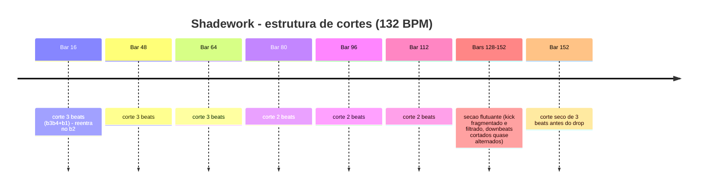

# Discretion — Groove Flutuante: kick com downbeat cortado

**Fonte:** `232. Discretion - Invisible Enemy.mp3` (382,7 s) e `228. Discretion - Shadework.mp3` (436,0 s) — faixas de referência (Discretion).
**Método:** ffmpeg (`-t 300` por segmento, f32le 22050 Hz mono) + numpy. Env: band-pass FFT (sub 30-80 / kick 30-150 / lowmid 120-300 / mid 300-1k / highmid 1k-4k), RMS janela 512 / hop 128 (5,8 ms). Onsets: diff half-wave do log-envelope. Grid: autocorrelação (110-150 BPM) + ajuste fino de período/fase por comb scoring (janela ±70 ms). Kick por beat: onset 30-150 Hz em ±80 ms; validação cruzada por pico de sub 30-80 Hz por beat.

---

## 1. Veredito: CONFIRMADO com correção de padrão

**O corte do downbeat é real e medido. Mas o padrão dominante NÃO é "compasso sim, compasso não" ao longo da track — é um corte de fronteira de frase a cada 16 compassos + seções flutuantes dedicadas onde o kick é fragmentado.**

- **BPM:** Invisible Enemy 131,97 (fit) / 132,4 (ACF); Shadework 132,06 (fit) / 132,35 (ACF). Beat = 0,4545 s; compasso = 1,818 s; ciclo de 16 compassos = 29,1 s. VERIFICADO.

### Prova do corte (Shadework, ciclo 1, beats k56-k63, dump de sub 30-80 Hz)

| beat | t (s) | pico sub 30-80 | leitura |
|---|---|---|---|
| k56 (bar15 b1) | 26,86 | 1,163 | kick cheio |
| k57 (bar15 b2) | 27,32 | 1,072 | kick cheio |
| k58 (bar15 b3) | 27,77 | 0,125 | **sem kick** |
| k59 (bar15 b4) | 28,23 | 0,015 | **sem kick** |
| k60 (bar16 b1) | 28,68 | 0,006 | **DOWNEAT CORTADO** |
| k61 (bar16 b2) | 29,13 | 0,999 | kick reentra |
| k62-k63 | 29,59-30,04 | 1,07 / 1,14 | kick cheio |

**A assinatura Discretion:** o kick cai no beat 3-4 do último compasso do ciclo E no downbeat do ciclo seguinte = **gap de 2-3 beats (0,9-1,4 s) sem kick**, e o groove **reentra no beat 2** (sincopado, nunca no "1"). O 4/4 perde a âncora, o baixo continua, e a frase "flutua" até o beat 2 religar o pulso.

### Padrão por track

**Shadework — 14 downbeats cortados em ~225 compassos ativos (6%):**
- t dos cortes: 0:28,7 / 1:26,8 / 1:55,9 / 2:25,0 / 2:55,9 / 3:25,0 / 3:55,9 / 4:06,8 / 4:23,1 / 4:24,9 / 4:28,6 / 4:35,8 / 6:18,8 / 6:31,6.
- **Ciclo de 16:** cortes nos bars 16, 48, 64, 80, ~96, ~112 → **15 compassos de groove cheio entre cada corte**. (Bar 32 não tem corte — o ciclo de 16 rígido vale de 48 em diante.)
- **Seção flutuante 3:52-4:36 (24 compassos, ~44 s):** cortes quase alternados (130, 136, 145, 146, 148, 152 no downbeat) + cortes internos (beats 2, 3 e 4: bars 128, 129, 133, 137, 141-144, 147). Densidade de beats com ataque de kick: **68%**; densidade de beats com sub de kick: **11%**. Ou seja: o groove segue por ataque/percussão, mas o corpo do kick (sub) é suspenso em 9 de cada 10 beats.
- Trecho final (5:02-7:01): 8 barras com beat 4 ghost (-6 a -8 dB) — desestabilização do pickup.

**Invisible Enemy — 3 downbeats cortados em ~205 compassos (1,5%):**
- t dos cortes: 0:28,6 / 1:26,8 / 4:05,0 (bars 16, 48, 135). Bar 32 sem corte.
- Mesma assinatura nos 2 primeiros: gap de 3 beats (bar15 b3-b4 + bar16 b1), reentrada no beat 2.
- **Seção flutuante 4:03-4:19 (8-9 compassos):** é aqui que aparece o padrão procurado na escuta de referência — barras com kick alternando com 1-2 barras inteiramente sem kick (`KKKK | .... | .... | KKKK | KKKK | .... | ....`), com downbeat cortado no meio (bar 135 .KKK) e cortes internos (134 KKK., 136 KK.K, 140 KK.K, 142 K..K). Depois disso, groove cheio até o fim (300-382,7 s: zero cortes).
- Cortes de beat 4 (pickup) avulsos antes de fronteiras: bars 31, 79.

### Resposta direta à pergunta (padrão em beats @132)

- **Não é:** `[K-K-K-K | .-K-K-K]` repetido a track inteira.
- **É:** a cada **16 compassos** (15 cheios entre cortes), gap de 2-3 beats engolindo o downbeat, reentrada no beat 2; e em **seções específicas** (Shadework 3:52-4:36; IE 4:03-4:19) a fragmentação vira quase alternada (0-2 compassos cheios entre cortes), com o kick frequentemente filtrado (ataque em 30-150 Hz presente, sub 30-80 Hz a -14 a -20 dB).

## 2. O que preenche o vazio do kick cortado

Energia média nos beats cortados vs beats com kick (mesma janela de 0,35-0,40 s):

| Banda | Shadework (12 cortes) | Invisible Enemy (3 cortes) | Interpretação |
|---|---|---|---|
| sub 30-80 Hz | **-10,7 dB** | **-17,0 dB** | corpo do kick some (é o corte) |
| lowmid 120-300 Hz | **-2,2 dB** | -11,4 dB | **baixo rolling continua praticamente integral** |
| mid 300-1k Hz | **+1,1 dB** | -4,8 dB | percussão/atmosfera preenche (sobe ou quase não cai) |
| highmid 1k-4k Hz | +0,7 dB | -5,2 dB | hats/textura mantidos |

- **Sidechain medido: -0,2 a -1,0 dB de ducking** (mediana no mid após cada kick). Praticamente ZERO pump — o baixo flui contínuo por baixo do gap, é ele que carrega a hipnose.
- Baixo on-beat, não rolling 16ths: ACF do onset 120-300 Hz = 0,50-0,66 no lag de 1 beat vs 0,08-0,12 no 8th off. O baixo reforça a pulsação nos beats onde o kick falta.
- Na seção flutuante do Shadework, o que fica é "top kick" filtrado: ataque presente em 30-150 Hz (68% dos beats) sem corpo em 30-80 Hz (11%) — groove sem peso.

## 3. Compassos de groove cheio entre cortes

- **Estrutura macro (Shadework):** 15 compassos cheios → corte (ciclo de 16 compassos), repetido em 48/64/80/96/112.
- **Seções flutuantes:** 0-2 compassos cheios entre cortes (Shadework: 6, 9, 1, 2, 4; IE: trecho com 1-2 cheios alternando com 2 vazios).
- **Invisible Enemy fora das seções:** até 84 compassos cheios seguidos (1:27 → 4:03).

## 4. Outras técnicas de groove flutuante nos dados

1. **Reentrada sincopada no beat 2** — o pulso religa fora do downbeat, adiando o "reset" métrico (VERIFICADO nos ciclos 1 e 3 de ambas).
2. **Kick filtrado ("top kick")** na seção flutuante: onset 30-150 Hz forte (0,8-1,0) com sub 30-80 Hz a 0,17-0,22 (-14 dB) — dança-se o 4/4 sem sentir o peso (VERIFICADO, Shadework beats k592-k601).
3. **Dissolve gradual em vez de corte seco:** entrada da seção flutuante com sub do kick caindo em degraus (1,01 → 0,79 → 0,57 → 0,004 em ~10 beats) — o chão dissolve por ~2 compassos (VERIFICADO, Shadework k500-k517).
4. **Ghost kick no beat 4** (pickup) fraco em compassos avulsos antes de fronteiras (IE bars 31, 79; Shadework 8 barras no trecho final) — antecipa a queda sem anunciar.
5. **Sem sidechain pump** (< 1 dB): sem o "respiro" de compressor, o baixo vira linha contínua — a tensão harmônica/flutuante vem do arranjo, não do dinâmica.
6. **Cortes internos desalinhados** (beats 2, 3, 4 além do 1) nas seções flutuantes: impossibilita travar o contador interno de 4/4 — é o núcleo da "hipnose flutuante".

## 5. Receita para replicar (psytech 132 BPM, beat 0,4545 s, compasso 1,818 s)

**Camada base (o chão que nunca para):**
1. Kick 4/4 normal nos 4 beats.
2. Baixo (mono, fundamental 40-80 Hz + corpo 120-300 Hz) tocando **on-beat**, nota longa/rolling, **sem sidechain** (duck < 1 dB) — ele é o portador do groove quando o kick sai.
3. Percussão/hats 300 Hz-4k no 8th/16th, mixagem constante.

**Move 1 — corte de frase (a cada 16 compassos):**
4. No compasso 15 do ciclo: mute do kick no beat 3 e 4 (ou só no 4).
5. No compasso 16 (downbeat): **sem kick no beat 1**; kick reentra no **beat 2**.
6. Gap resultante: 2-3 beats (0,9-1,4 s) com baixo + percussão soando normalmente.

**Move 2 — seção flutuante (24-32 compassos, uma vez no meio da track):**
7. Dissolver o sub do kick em ~2 compassos (low-cut progressivo até -14 dB em <80 Hz) em vez de cortar seco.
8. Fragmentar o kick: padrões irregulares tipo `K.KK / ..KK / .K.K / KK..`, densidade 50-70%, incluindo downbeats cortados em compassos alternados (a cada 1-2 compassos).
9. Baixo e percussão 100% intactos — só o kick se fragmenta.
10. Fechar a seção com um corte seco de 3 beats e voltar o kick cheio no downbeat do drop.

**Move 3 — detalhe fino:**
11. Ghost kick no beat 4 (-6 a -8 dB) em compassos avulsos antes de fronteiras de frase.

**Referência de mixagem do vazio:** no gap, mirar lowmid 120-300 Hz a ≤ -3 dB do normal e mid 300-1k Hz a ±1 dB; sub 30-80 Hz -10 a -17 dB.

---

### Evidência e limites

- VERIFICADO: BPM, grid, presença/ausência de kick por beat (dupla métrica: onset 30-150 Hz + pico sub 30-80 Hz), energias de banda nos vales, sidechain, ACF do baixo, mapa de compassos das duas faixas (0-300 s + segmentos finais até o fim).
- NÃO VERIFICADO / limite: kicks "fantasma" com sub entre -8 e -14 dB podem ser classe borderline (kick filtrado vs nota de baixo) — tratados como "kick sem sub". Numeração de compassos pode variar ±1 entre segmentos (grids ajustados independentes); tempos absolutos são a referência confiável.
